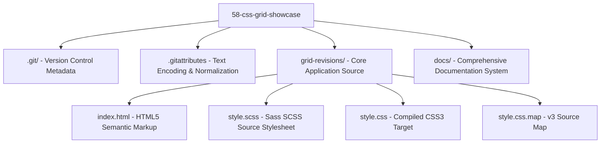

# Project Map & Technical Landscape

## 1. Directory Tree & File Inventory



### File-by-File Technical Purpose

```
58-css-grid-showcase/
├── .gitattributes             # Git LF normalization across operating systems (line endings: text=auto)
├── grid-revisions/            # Core presentation and styling module
│   ├── index.html             # Semantic HTML5 entry document defining 7 structural grid items
│   ├── style.scss             # Primary preprocessed stylesheet defining 2D Grid rules & BEM nesting
│   ├── style.css              # Compiled CSS3 output consumed by the browser's CSSOM parser
│   └── style.css.map          # JSON v3 source map linking compiled CSS declarations back to style.scss
└── docs/                      # Architectural, technical, and interview documentation suite
```

---

## 2. Technology Stack & Specifications Detected

| Technology / Standard | Specification / Version | Source File / Detection Point | Purpose in Architecture |
| :--- | :--- | :--- | :--- |
| **HTML5** | W3C / WHATWG HTML Living Standard | [`grid-revisions/index.html`](file:///Users/avishjain/avishjain9-repos/58-css-grid-showcase/grid-revisions/index.html) | Semantic markup with `<header>`, `<main>`, `<footer>` elements |
| **CSS Grid Layout** | CSS Grid Layout Module Level 1 (W3C REC) | [`grid-revisions/style.scss:L3-L8`](file:///Users/avishjain/avishjain9-repos/58-css-grid-showcase/grid-revisions/style.scss#L3-L8) | Native 2D grid formatting context, track definitions & gap |
| **Sass (SCSS)** | Sass Syntax 3.x+ (Dart Sass / LibSass) | [`grid-revisions/style.scss`](file:///Users/avishjain/avishjain9-repos/58-css-grid-showcase/grid-revisions/style.scss) | Preprocessing, parent selector (`&`) nesting, modular authoring |
| **Source Maps** | Source Map v3 Specification | [`grid-revisions/style.css.map`](file:///Users/avishjain/avishjain9-repos/58-css-grid-showcase/grid-revisions/style.css.map) | In-browser mapping of compiled CSS back to original SCSS lines |
| **Node.js Runtime** | Node.js v22.23.2 & npm 10.9.8 | System Environment / Docs Tooling | Execution environment for build tooling and documentation site |

---

## 3. Dependency Inventory

The core layout application was crafted with **zero external runtime dependencies**, leveraging browser-native standards:

| Package / Tool | Type | Purpose | Reason It Exists |
| :--- | :--- | :--- | :--- |
| **HTML5 Engine** | Browser Native | DOM Structure | Native browser document parser; zero overhead |
| **CSS3 Engine** | Browser Native | Visual Geometry | High-performance GPU-accelerated styling |
| **Sass Compiler** | Build Tooling | SCSS to CSS Transpilation | Compiles modular nested SCSS into standard CSS3 |
| **VitePress** (Docs) | DevDependency | Documentation Engine | Generates static Vue.js-style technical documentation |

---

## 4. Environment Variables & Secrets Inventory

*No environment variables or secrets are required or used.*  
Because this project runs purely as static client-side web assets, there are no database credentials, JWT secrets, payment API keys, or cloud tokens.

| Variable | Target Service | Purpose | Where Used in Code | Where to Obtain |
| :--- | :--- | :--- | :--- | :--- |
| *None* | *None* | *Not applicable (Static Frontend)* | *N/A* | *N/A* |

---

## 5. Third-Party Services & Integrations

- **Cloud / Third-Party APIs:** None (Standalone offline-first client layout).
- **External Fonts / CDNs:** None (Default system font stack used, preserving maximum performance and zero network latency).
- **Telemetry / Analytics:** None (Zero tracking scripts, compliant with strict privacy requirements).

---

## 6. System Entry Points

| Tier | File Path | Entry Function / Mechanism | Lifecycle Trigger |
| :--- | :--- | :--- | :--- |
| **Frontend DOM** | [`grid-revisions/index.html`](file:///Users/avishjain/avishjain9-repos/58-css-grid-showcase/grid-revisions/index.html) | `<!DOCTYPE html>` | Browser HTTP GET or file open |
| **Frontend Style** | [`grid-revisions/style.css`](file:///Users/avishjain/avishjain9-repos/58-css-grid-showcase/grid-revisions/style.css) | `<link rel="stylesheet" href="style.css">` | HTML `<head>` parsing (render-blocking) |
| **Sass Source** | [`grid-revisions/style.scss`](file:///Users/avishjain/avishjain9-repos/58-css-grid-showcase/grid-revisions/style.scss) | Compiler CLI (`sass style.scss style.css`) | Developer build or file watcher |
| **Backend** | *Not applicable* | *Not applicable (Frontend-only architecture)* | *N/A* |
