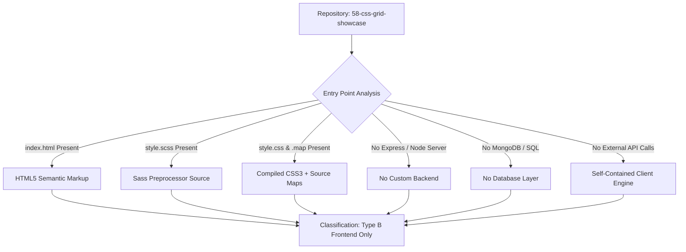

# Project Type Classification & Technical Pre-Check

## 1. Project Type Verdict

**Classification:** **Type B — Frontend Only (Modern Web Layout & Preprocessor Architecture)**  
**Subtype:** Static Web Layout Engine Architecture & CSS Grid Level 1 Specification Implementation with Sass (SCSS) Compilation Pipeline.

---

## 2. Forensic Codebase Evidence

Every claim regarding this project's architecture is grounded in verified files, file contents, and Git history:

| Evidence Indicator | File Reference | Code / Git Commit Evidence | Technical Conclusion |
| :--- | :--- | :--- | :--- |
| **Markup Entry** | [`grid-revisions/index.html`](file:///Users/avishjain/avishjain9-repos/58-css-grid-showcase/grid-revisions/index.html#L1-L24) | Standalone HTML5 document with `<!DOCTYPE html>`, `<header>`, `
`, `<main>`, `<footer>` elements. No React/Vue JSX bundle scripts. | Static HTML5 client DOM structure. |
| **Stylesheet Preprocessing** | [`grid-revisions/style.scss`](file:///Users/avishjain/avishjain9-repos/58-css-grid-showcase/grid-revisions/style.scss#L1-L57) | Uses Sass nested selectors (`&>*`, `.small-box { &-1 {...} }`). | Preprocessed CSS authoring workflow. |
| **Compiled Target & Maps** | [`grid-revisions/style.css`](file:///Users/avishjain/avishjain9-repos/58-css-grid-showcase/grid-revisions/style.css#L1-L38) & [`style.css.map`](file:///Users/avishjain/avishjain9-repos/58-css-grid-showcase/grid-revisions/style.css.map#L1) | Contains standard CSS3 rule declarations and a `/*# sourceMappingURL=style.css.map */` comment line 37. | Output of Dart Sass or node-sass compiler. |
| **Backend & Server Code** | Entire Repository | Zero server scripts (`server.js`, `app.ts`, `main.go`, `manage.py`, etc.). | **No server runtime exists.** |
| **Database Layer** | Entire Repository | No Mongoose models, SQL schemas, migrations, or database connection pools. | **No database layer exists.** |
| **Commit History** | Git Commit `fdfb0c6` | Commit message: *"Adding grid backend logic"* by AVISHJAIN9 on Mar 22, 2026. | Ironical/colloquial developer phrasing for core CSS Grid layout logic. |

---

## 3. Applicable vs. Non-Applicable Tracks

In strict compliance with **RULE 8 (ADAPT TO THE PROJECT TYPE)** of the specification:

### Applicable Tracks (Detailed In-Depth Documentation)
- **Frontend Architecture & DOM Geometry:** Complete analysis of the 2D layout model, track sizing algorithms (`1fr` vs percentage), explicit vs implicit grid lines, negative indexing (`-1`), and stacking contexts.
- **Sass (SCSS) Build Pipeline:** Analysis of parent selector references (`&`), BEM-style nesting, transpilation targets, and debugging via source map v3.
- **Browser Rendering Engine Pipeline:** Deep technical breakdown of DOM construction, CSSOM tree generation, Render Tree synthesis, Layout/Reflow (LayoutNG Grid algorithm), Paint, and Compositing.
- **System Design for Client-Side Architecture:** CDN asset caching, edge delivery, HTTP/2 multiplexing, subresource integrity, Web Vitals (CLS, LCP, INP), and progressive scaling up to 100x/1000x traffic.
- **Interview Preparation:** 150+ comprehensive questions and answers covering CSS Grid Level 1/2, browser internals, box model quirks, responsive strategies, and modern CSS capabilities.

### Non-Applicable Tracks (Explicitly Documented with Rationale)
- **Node/Express Backend & REST Endpoints:** *Not applicable for this project type* — the application executes entirely within the client's browser layout engine without an application server tier.
- **MongoDB / Relational Database:** *Not applicable for this project type* — layout presentation and structural state are declaratively encoded in markup and stylesheets without persistence.
- **JWT / Session Authentication:** *Not applicable for this project type* — no user authentication, session state, or credentials are required for public presentation layouts.
- **External AI Model API Integration:** *No AI integration* — the project implements deterministic CSS layout algorithms and does not consume external LLM or vision APIs. (Hypothetical layout-generation AI pipeline documented in Section 07 for interview readiness).
