# Full Project Analysis & Architectural Trace

## 0.1 Project Overview & Purpose

### Identity & Purpose
- **Project Name:** CSS Grid Showcase (`58-css-grid-showcase` / `grid-revisions`)
- **Repository Corpus:** `AVISHJAIN9/grid`
- **Core Purpose:** Demonstrates a clean, modern two-dimensional asymmetric web layout engine built with the CSS Grid Level 1 specification, authored via preprocessed Sass (SCSS) and delivered as semantic HTML5.
- **Problem Solved:** Traditional CSS layout mechanisms (floats, inline-blocks, and one-dimensional flexbox rows/columns) require brittle nested `div` wrappers, clearfix hacks, and JavaScript recalculations to achieve asymmetric, multi-column, multi-row spanning layouts. This project demonstrates how CSS Grid achieves complex structural choreography with zero layout wrapper bloat and pure browser-native layout algorithms.
- **Target Users:** Web engineers, UI designers, frontend developers, and technical interviewers seeking a textbook reference for two-dimensional grid track sizing, fractional unit distribution (`fr`), explicit line placement, and Sass nesting patterns.
- **Primary User Journey:**
  1. User navigates to the layout URL or opens [`grid-revisions/index.html`](file:///Users/avishjain/avishjain9-repos/58-css-grid-showcase/grid-revisions/index.html) in any modern browser.
  2. The browser parses HTML5 into the DOM and [`grid-revisions/style.css`](file:///Users/avishjain/avishjain9-repos/58-css-grid-showcase/grid-revisions/style.css) into the CSSOM.
  3. The layout engine computes the Grid Formatting Context (GFC), allocating fractional column tracks and multi-row spans.
  4. The user views an asymmetric editorial dashboard layout containing a full-span header, three horizontal feature cards, a vertical sidebar spanning multiple rows, a broad primary content canvas, and a full-bleed footer.

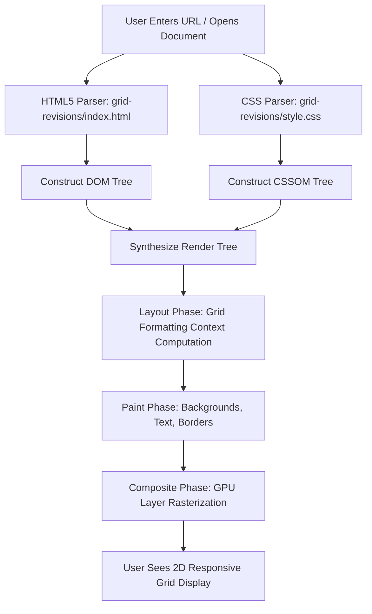

---

## 0.2 Comprehensive Feature Inventory & Execution Traces

We trace all 8 structural and algorithmic features identified across [`grid-revisions/index.html`](file:///Users/avishjain/avishjain9-repos/58-css-grid-showcase/grid-revisions/index.html) and [`grid-revisions/style.scss`](file:///Users/avishjain/avishjain9-repos/58-css-grid-showcase/grid-revisions/style.scss):

| ID | Feature Name | Primary Source Files | Primary Declarations / Lines |
| :--- | :--- | :--- | :--- |
| **F1** | 2D Grid Formatting Context & Track Geometry | `style.scss` / `style.css` | `display: grid; grid-template-columns: repeat(3, 1fr) 20%; grid-template-rows: 1fr 2fr 4fr 1fr;` |
| **F2** | Full-Width Span Header Architecture | `index.html` / `style.scss` | `<header>`, `grid-column: 1/5;` |
| **F3** | Subdivided 3-Column Card Cluster | `index.html` / `style.scss` | `.small-box-1`, `.small-box-2`, `.small-box-3`, `grid-column: 1/2, 2/3, 3/4` |
| **F4** | Multi-Row Spanning Asymmetric Sidebar | `index.html` / `style.scss` | `.sidebar`, `grid-row: 2/4; grid-column: 4/5;` |
| **F5** | Three-Column Primary Content Canvas | `index.html` / `style.scss` | `<main class="main-content">`, `grid-column: 1/4;` |
| **F6** | Negative-Indexed Full-Bleed Sticky Footer | `index.html` / `style.scss` | `<footer>`, `grid-column: 1/-1;` |
| **F7** | Sass Preprocessing, BEM-like Concatenation & Maps | `style.scss` / `style.css.map` | Parent selector `&`, `.small-box { &-1 ... }`, v3 source map |
| **F8** | Viewport Proportioning, Spacing & Base Inheritance | `style.scss` / `style.css` | `gap: 20px; min-height: 90vh; margin: 30px auto; body > *` |

---

### Detailed Trace: Feature F1 — 2D Grid Formatting Context & Track Geometry

- **What the user sees:** A balanced 4-column, 4-row layout where the first three columns share remaining flexible space equally, and the fourth column reserves a fixed 20% width.
- **Frontend Code Flow:** [`grid-revisions/style.scss:L3-L8`](file:///Users/avishjain/avishjain9-repos/58-css-grid-showcase/grid-revisions/style.scss#L3-L8) applies `display: grid;` to `<body>`.
- **Browser Layout Engine Flow:**
  1. The browser creates a **Grid Formatting Context (GFC)** for `document.body`.
  2. Resolves column tracks: `repeat(3, 1fr) 20%`. Available width $W_{\text{avail}} = W_{\text{body}} - (3 \times 20\text{px}) - 20\%$. Each $1\text{fr}$ column receives $(W_{\text{avail}}) / 3$.
  3. Resolves row tracks: `1fr 2fr 4fr 1fr` against the container's height constraint (`min-height: 90vh`). Total flex factors = $1 + 2 + 4 + 1 = 8\text{fr}$. Row 1 receives $1/8$, Row 2 receives $2/8$ (1/4), Row 3 receives $4/8$ (1/2), and Row 4 receives $1/8$ of the flexible height.
- **Database / API Operations:** *Not applicable* (Pure client layout engine).
- **Failure Path:** If a legacy browser does not support CSS Grid Level 1, children collapse into default standard document block layout flow (`display: block`).

#### Diagrams for Feature F1:

**(a) Component & Track Flowchart:**
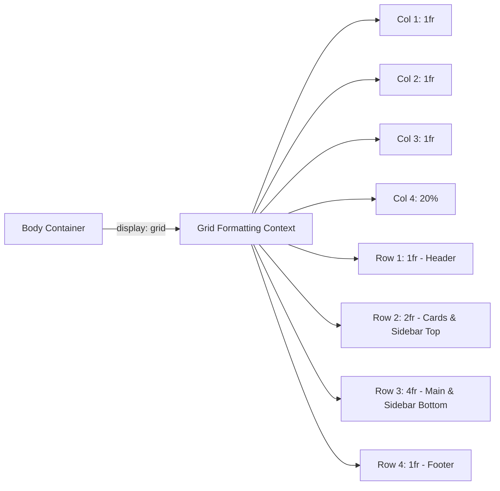

**(b) Browser Layout Lifecycle Sequence Diagram:**
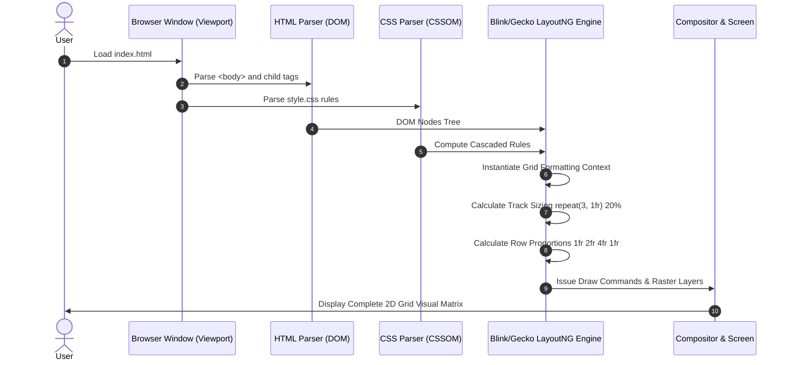

**(c) Grid Structure & Dimension Map:**
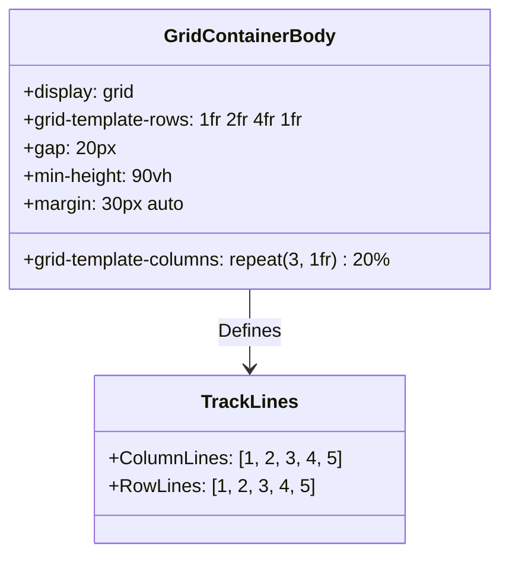

**(d) Grid State Lifecycle:**
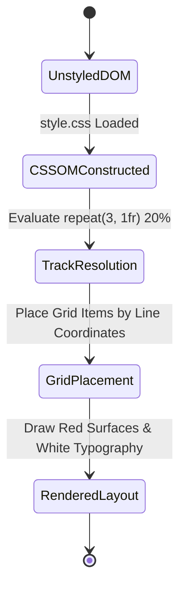

**(e) Failure & Fallback Path:**
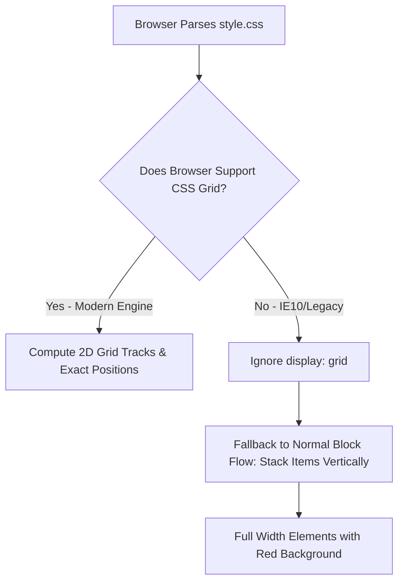

---

### Detailed Trace: Feature F2 — Full-Width Span Header Architecture

- **What the user sees:** A red banner at the top displaying "Header" in bold white text, spanning from the extreme left boundary to the extreme right boundary of the grid.
- **Frontend Code Flow:** [`grid-revisions/index.html:L13`](file:///Users/avishjain/avishjain9-repos/58-css-grid-showcase/grid-revisions/index.html#L13) `<header>Header</header>` is targeted by [`grid-revisions/style.scss:L18-L21`](file:///Users/avishjain/avishjain9-repos/58-css-grid-showcase/grid-revisions/style.scss#L18-L21).
- **CSS Rule:** `body header { grid-column: 1/5; }`.
- **Browser Layout Engine Flow:** The item is pinned starting at Column Grid Line 1 and spans continuously across 4 column tracks to terminate at Column Grid Line 5. Placed automatically in implicit Row Track 1.

#### Diagrams for Feature F2:
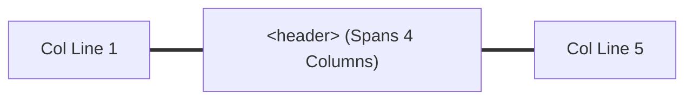

```mermaid
sequenceDiagram
    participant HTML as index.html
    participant CSS as style.css (Line 14)
    participant Engine as Layout Engine
    HTML->>Engine: &lt;header&gt;Header&lt;/header&gt;
    CSS->>Engine: body header { grid-column: 1/5; }
    Engine->>Engine: Resolve bounds: start=1, end=5 (Span 4 columns)
    Engine-->>HTML: Render Header spanning tracks [1fr, 1fr, 1fr, 20%]
```

---

### Detailed Trace: Feature F3 — Subdivided 3-Column Card Cluster

- **What the user sees:** Three distinct cards ("Small box 1", "Small box 2", "Small box 3") aligned horizontally directly beneath the header, occupying the first three columns.
- **Frontend Code Flow:** Elements `.small-box-1`, `.small-box-2`, `.small-box-3` in [`grid-revisions/index.html:L14-L16`](file:///Users/avishjain/avishjain9-repos/58-css-grid-showcase/grid-revisions/index.html#L14-L16).
- **CSS Rule:** In [`grid-revisions/style.scss:L23-L39`](file:///Users/avishjain/avishjain9-repos/58-css-grid-showcase/grid-revisions/style.scss#L23-L39):
  - `.small-box-1 { grid-column: 1/2; }`
  - `.small-box-2 { grid-column: 2/3; }`
  - `.small-box-3 { grid-column: 3/4; }`
- **Track Interaction:** Each card takes exactly one $1\text{fr}$ unit width. The 4th column is vacated on Row 2 to accommodate the sidebar.

#### Diagrams for Feature F3:
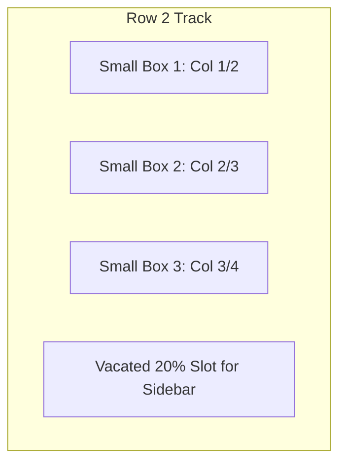

---

### Detailed Trace: Feature F4 — Multi-Row Spanning Asymmetric Sidebar

- **What the user sees:** A tall vertical sidebar ("Sidebar") on the right side of the screen occupying 20% width and extending across two full rows (Row 2 and Row 3).
- **Frontend Code Flow:** `<div class="sidebar">Sidebar</div>` in [`grid-revisions/index.html:L17`](file:///Users/avishjain/avishjain9-repos/58-css-grid-showcase/grid-revisions/index.html#L17).
- **CSS Rule:** [`grid-revisions/style.scss:L41-L45`](file:///Users/avishjain/avishjain9-repos/58-css-grid-showcase/grid-revisions/style.scss#L41-L45):
  ```scss
  .sidebar {
      grid-row: 2/4;
      grid-column: 4/5;
  }
  ```
- **Browser Layout Engine Flow:** Spans vertically from Row Grid Line 2 to Row Grid Line 4 (combining Row 2's $2\text{fr}$ and Row 3's $4\text{fr}$ plus the $20\text{px}$ intervening gap). Horizontally pinned between Column Line 4 and 5 ($20\%$ track).

#### Diagrams for Feature F4:
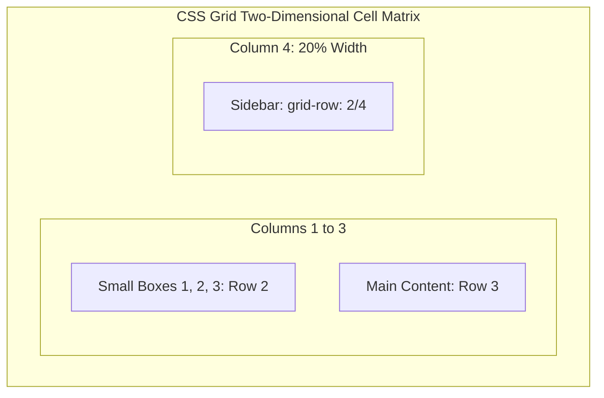

---

### Detailed Trace: Feature F5 — Three-Column Primary Content Canvas

- **What the user sees:** A large central container with text "Main content" placed below the small boxes and spanning the first three columns.
- **Frontend Code Flow:** `<main class="main-content">` in [`grid-revisions/index.html:L18-L20`](file:///Users/avishjain/avishjain9-repos/58-css-grid-showcase/grid-revisions/index.html#L18-L20).
- **CSS Rule:** [`grid-revisions/style.scss:L47-L50`](file:///Users/avishjain/avishjain9-repos/58-css-grid-showcase/grid-revisions/style.scss#L47-L50): `main { grid-column: 1/4; }`.
- **Browser Layout Engine Flow:** Positioned on Row 3 (allocated $4\text{fr}$ height), stretching horizontally from Line 1 to Line 4 across three fractional columns.

---

### Detailed Trace: Feature F6 — Negative-Indexed Full-Bleed Footer

- **What the user sees:** A full-width red bar at the base of the layout ("Footer") spanning across all four columns.
- **Frontend Code Flow:** `<footer>Footer</footer>` in [`grid-revisions/index.html:L21`](file:///Users/avishjain/avishjain9-repos/58-css-grid-showcase/grid-revisions/index.html#L21).
- **CSS Rule:** [`grid-revisions/style.scss:L52-L55`](file:///Users/avishjain/avishjain9-repos/58-css-grid-showcase/grid-revisions/style.scss#L52-L55): `footer { grid-column: 1/-1; }`.
- **Technical Mechanism:** Negative grid line indexing (`-1`) resolves dynamically to the final explicit column grid line (Line 5 in a 4-column definition), guaranteeing that even if additional columns are inserted, the footer always bleeds to the trailing edge.

---

### Detailed Trace: Feature F7 — Sass Preprocessing, BEM-like Concatenation & Source Mapping

- **What the engineer uses:** SCSS syntax with parent selector concatenation `&-1`, `&-2`, `&-3` within `.small-box`, compiling to modular CSS with a `.map` file.
- **Source Files:**
  - Input: [`grid-revisions/style.scss`](file:///Users/avishjain/avishjain9-repos/58-css-grid-showcase/grid-revisions/style.scss)
  - Output: [`grid-revisions/style.css`](file:///Users/avishjain/avishjain9-repos/58-css-grid-showcase/grid-revisions/style.css)
  - Map: [`grid-revisions/style.css.map`](file:///Users/avishjain/avishjain9-repos/58-css-grid-showcase/grid-revisions/style.css.map)
- **Compilation Mechanism:** Transpiled via Dart Sass / Node Sass; line 37 connects Chrome/Firefox DevTools directly to the SCSS source.

---

### Detailed Trace: Feature F8 — Viewport Height Centering, Gap Geometry & Universal Child Styles

- **What the user sees:** A unified red background (`background-color: red;`), bold typography (`font-weight: 700; color: white;`), consistent $20\text{px}$ gutters, and vertical centering with `min-height: 90vh; margin: 30px auto;`.
- **CSS Rule:** [`grid-revisions/style.scss:L6-L16`](file:///Users/avishjain/avishjain9-repos/58-css-grid-showcase/grid-revisions/style.scss#L6-L16).
- **Technical Mechanism:** `gap: 20px;` establishes both row-gap and column-gap between grid cells without requiring margin collapse tricks on individual children. The direct child universal selector `& > *` enforces aesthetic uniformity.

---

## 0.3 API & Interface Inventory

### Backend Endpoints Table
*Not applicable for this project type.* The application is a static client-side layout showcase and does not expose or consume HTTP/REST/GraphQL server endpoints.

| Method | Path | Auth | Controller | Purpose | Status |
| :--- | :--- | :--- | :--- | :--- | :--- |
| N/A | N/A | N/A | N/A | No custom backend endpoints implemented | *Not applicable* |

### External APIs and SDKs
No third-party SDKs, telemetry, or external REST endpoints are called.

| Provider | Purpose | Where in Code | API Key Variable | Status |
| :--- | :--- | :--- | :--- | :--- |
| None | None | None | None | *No external API consumed* |

### Environment Variables & Secrets
No runtime environment variables or client-exposed API keys are required.

| Variable Name | Service | Purpose | Where Read | Status |
| :--- | :--- | :--- | :--- | :--- |
| None | None | Static client assets require zero secret injection | N/A | *Not applicable* |

---

## 0.4 Hooks, Helpers, and Shared Utilities Inventory

- **React Hooks:** *Not applicable* (Plain HTML5 / Vanilla CSS).
- **Global Stores / Context:** *Not applicable* (Document state is statically declared in the DOM).
- **Sass Parent References (`&`):** Used in [`grid-revisions/style.scss:L10`](file:///Users/avishjain/avishjain9-repos/58-css-grid-showcase/grid-revisions/style.scss#L10) and [`style.scss:L25-L38`](file:///Users/avishjain/avishjain9-repos/58-css-grid-showcase/grid-revisions/style.scss#L25-L38) for pseudo-BEM selector generation.
- **Shared Style Token:** Direct child universal selector `body > *` establishes inherited visual styles across all layout items.

---

## 0.5 System Connection Map

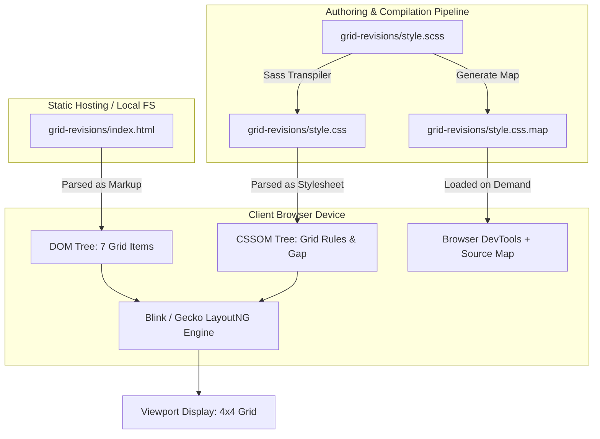

---

## 0.6 Additional Platform & Browser Features

1. **Meta Viewport Definition:** [`index.html:L7`](file:///Users/avishjain/avishjain9-repos/58-css-grid-showcase/grid-revisions/index.html#L7) defines `<meta name="viewport" content="width=device-width, initial-scale=1.0">` to prevent mobile browser auto-scaling.
2. **Character Encoding:** [`index.html:L5`](file:///Users/avishjain/avishjain9-repos/58-css-grid-showcase/grid-revisions/index.html#L5) enforces standard UTF-8 text interpretation.
3. **Legacy IE Header:** [`index.html:L6`](file:///Users/avishjain/avishjain9-repos/58-css-grid-showcase/grid-revisions/index.html#L6) specifies `<meta http-equiv="X-UA-Compatible" content="IE=edge">` for legacy Microsoft browsers.
4. **Source Mapping:** [`style.css:L37`](file:///Users/avishjain/avishjain9-repos/58-css-grid-showcase/grid-revisions/style.css#L37) contains the source mapping directive linking CSS declarations back to Sass source lines.

---

## 0.7 Master Connection Architecture Diagram

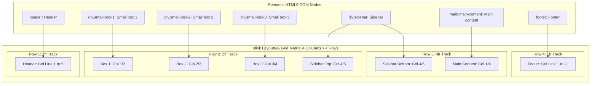

---

## 0.8 Final Quantitative Inventory Counts

These official inventory counts govern all subsequent documentation sections:

| Category | Metric Count | Verified Source |
| :--- | :--- | :--- |
| **Total HTML Pages** | **1** | [`grid-revisions/index.html`](file:///Users/avishjain/avishjain9-repos/58-css-grid-showcase/grid-revisions/index.html) |
| **Total DOM Grid Children** | **7** | `<header>`, 3 `small-box` divs, `.sidebar`, `<main>`, `<footer>` |
| **Total Features Documented** | **8** | F1 through F8 (Grid track, header, cards, sidebar, main, footer, Sass, spacing) |
| **Total CSS Rules Generated** | **9** | Rules in [`grid-revisions/style.css`](file:///Users/avishjain/avishjain9-repos/58-css-grid-showcase/grid-revisions/style.css) |
| **Total Sass Selectors & Blocks**| **8** | Nested selector blocks in [`grid-revisions/style.scss`](file:///Users/avishjain/avishjain9-repos/58-css-grid-showcase/grid-revisions/style.scss) |
| **Total Server Endpoints** | **0** | *Not applicable* (Frontend-only architecture) |
| **Total Database Collections/Tables** | **0** | *Not applicable* (No persistent storage) |
| **Total External APIs Called** | **0** | *Not applicable* (Zero external runtime dependencies) |
| **Total Environment Variables** | **0** | *Not applicable* (Static presentation layer) |
| **Total Package Dependencies** | **0** | (Native web platform technologies without node runtime) |
