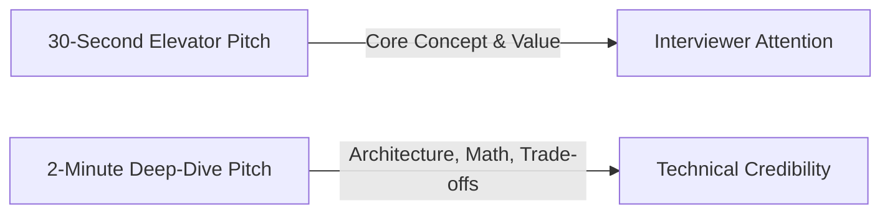

# Project Pitches: 30-Second & 2-Minute Verbal Scripts

These elevator pitches explain the project out loud with zero jargon fluff, tailored for engineering interviews.

---

## 1. The 30-Second Project Pitch

> "I built the **CSS Grid Showcase** to demonstrate how modern browser layout engines can solve complex two-dimensional web layouts natively without wrapper bloat, JavaScript recalculations, or CSS float hacks. The project uses the CSS Grid Level 1 specification alongside Sass preprocessing to coordinate a 4-column, 4-row layout featuring dynamic fractional track distribution, multi-row sidebar spanning, and negative index column bleeding. It eliminates the fragile parent-child nesting traditionally required by Flexbox for two-dimensional interfaces. Building this gave me a deep understanding of browser rendering pipelines, fractional unit geometry, and how layout engines like Blink's LayoutNG resolve grid formatting contexts."

---

## 2. The 2-Minute Comprehensive Architectural Pitch

> "In frontend engineering, building complex, asymmetric web dashboards often introduces heavy technical debt when developers rely solely on one-dimensional layout systems like Flexbox or legacy float grids. You end up with deep 'div soup'—extra nested wrappers created solely to group elements into artificial horizontal rows and vertical columns, which hurts accessibility, inflates the DOM, and complicates responsive redesigns.
> 
> To solve this directly at the browser engine level, I built the **CSS Grid Showcase**. The architecture establishes a native two-dimensional Grid Formatting Context on the document body. Instead of wrapping elements, all seven primary structural components—the header, three feature cards, the multi-row sidebar, the primary content canvas, and the footer—sit as direct semantic children of the grid container.
> 
> The layout geometry uses `repeat(3, 1fr) 20%` for column tracks and `1fr 2fr 4fr 1fr` for row tracks. This means the browser automatically subtracts the fixed 20% right sidebar column and three 20-pixel gutters, and then divides the remaining flexible width equally among three columns using fractional units. For the vertical axis, the sidebar spans across rows 2 and 3 using `grid-row: 2/4`, while the main content area shares that third row horizontally across the first three columns. For the footer, I used negative line indexing—`grid-column: 1/-1`—so it automatically spans from the first line to the final explicit column line regardless of how many columns are added later.
> 
> I authored the stylesheet in Sass (SCSS) to leverage BEM-like selector concatenation with the parent ampersand selector, and generated standard v3 source maps to connect compiled CSS declarations back to source lines in browser DevTools. 
> 
> If I were taking this to production for a high-traffic media site, the next step would be adding container queries for modular card responsiveness, CSS custom properties for fluid typography and dark mode theming, and an automated continuous delivery pipeline on a global CDN edge. Overall, this project demonstrates how to harness the full power of modern CSS specifications to write lean, high-performance, and maintainable user interfaces."
