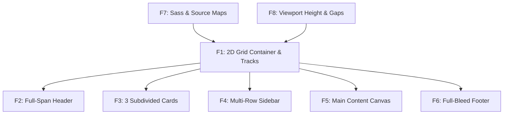

# Comprehensive Feature Inventory

This document compiles the complete feature set of the CSS Grid Showcase, detailing the code implementation, line numbers, dependencies, and spoken interview scripts for each feature.

---

## Master Feature Table

| Feature ID | Feature Name | Source File | Exact Lines | Primary CSS/HTML Declaration | Status |
| :--- | :--- | :--- | :--- | :--- | :--- |
| **F1** | 2D Grid Formatting Context & Tracks | `style.scss` | [L3-L8](file:///Users/avishjain/avishjain9-repos/58-css-grid-showcase/grid-revisions/style.scss#L3-L8) | `display: grid; repeat(3, 1fr) 20%; 1fr 2fr 4fr 1fr;` | **Active** |
| **F2** | Full-Width Span Header | `index.html` & `style.scss` | [L18-L21](file:///Users/avishjain/avishjain9-repos/58-css-grid-showcase/grid-revisions/style.scss#L18-L21) | `<header>`, `grid-column: 1/5;` | **Active** |
| **F3** | Subdivided 3-Column Card Cluster | `index.html` & `style.scss` | [L23-L39](file:///Users/avishjain/avishjain9-repos/58-css-grid-showcase/grid-revisions/style.scss#L23-L39) | `.small-box-1..3`, `grid-column: 1/2, 2/3, 3/4;` | **Active** |
| **F4** | Multi-Row Spanning Sidebar | `index.html` & `style.scss` | [L41-L45](file:///Users/avishjain/avishjain9-repos/58-css-grid-showcase/grid-revisions/style.scss#L41-L45) | `.sidebar`, `grid-row: 2/4; grid-column: 4/5;` | **Active** |
| **F5** | Three-Column Primary Content Canvas | `index.html` & `style.scss` | [L47-L50](file:///Users/avishjain/avishjain9-repos/58-css-grid-showcase/grid-revisions/style.scss#L47-L50) | `<main>`, `grid-column: 1/4;` | **Active** |
| **F6** | Negative-Indexed Full-Bleed Footer | `index.html` & `style.scss` | [L52-L55](file:///Users/avishjain/avishjain9-repos/58-css-grid-showcase/grid-revisions/style.scss#L52-L55) | `<footer>`, `grid-column: 1/-1;` | **Active** |
| **F7** | Sass Preprocessing & Source Mapping | `style.scss` & `style.css.map` | [L1-L57](file:///Users/avishjain/avishjain9-repos/58-css-grid-showcase/grid-revisions/style.scss#L1-L57) | Parent selector `&`, sourceMappingURL | **Active** |
| **F8** | Viewport Height, Gap & Base Styling | `style.scss` | [L6-L16](file:///Users/avishjain/avishjain9-repos/58-css-grid-showcase/grid-revisions/style.scss#L6-L16) | `gap: 20px; min-height: 90vh; margin: 30px auto; body > *` | **Active** |

---

## Feature F1: Two-Dimensional Grid Formatting Context & Track Geometry
- **Files & Lines:** [`grid-revisions/style.scss:L3-L8`](file:///Users/avishjain/avishjain9-repos/58-css-grid-showcase/grid-revisions/style.scss#L3-L8)
- **User-Facing Behavior:** Establishes a 4-column, 4-row flexible grid matrix across the page.
- **Dependencies:** None (Root layout container).
- **Known Limitations:** If cell content exceeds fractional space, track expands unless wrapped in `minmax(0, 1fr)`.

### Say It Out Loud (Feature F1)
I built the foundational grid container right on the body tag to establish a unified two-dimensional layout for the entire page. When the browser renders the page, it reads the display grid rule and creates a four-column by four-row grid matrix. For the columns, I combined fractional units and a percentage by writing repeat three one-fr followed by twenty percent. This tells the browser to set aside twenty percent for the right-hand sidebar, subtract the twenty-pixel gaps, and divide all remaining horizontal space equally among the first three columns. For the rows, I used a one-fr, two-fr, four-fr, one-fr progression constrained by a ninety-vh minimum height, which gives the main content area twice the vertical height of the feature cards and four times the height of the header. I chose this native CSS Grid approach over Flexbox because Flexbox is strictly one-dimensional, so coordinating matching widths across separate rows would have forced me to wrap elements in artificial row containers. If this fails in a legacy browser without grid support, the elements simply fall back to normal document block flow. One limitation is that fractional units can expand unexpectedly if an image or long string overflows its cell, which I would improve in production by using minmax zero comma one-fr for defensive sizing.

---

## Feature F2: Full-Width Span Header Architecture
- **Files & Lines:** [`grid-revisions/style.scss:L18-L21`](file:///Users/avishjain/avishjain9-repos/58-css-grid-showcase/grid-revisions/style.scss#L18-L21)
- **User-Facing Behavior:** Stretches across all columns along the top of the interface.
- **Dependencies:** F1 (Grid container).

### Say It Out Loud (Feature F2)
I implemented the header using the semantic HTML5 header element and pinned it across the top of the layout with grid-column one slash five. When the layout engine runs, it anchors the header at column line one on the far left and stretches it continuously through line five on the far right, covering all three flexible columns and the twenty percent sidebar column. I chose explicit grid line spanning over traditional full-width block positioning or absolute positioning because it keeps the header directly inside the grid formatting context, ensuring that its height automatically informs row track calculations. If this rule were removed, the header would default to occupying only the first one-fr column cell. One limitation is that using the hardcoded line number five means that if we dynamically add a fifth column track later, the header will stop short, so in a future revision I would change this to one slash minus one to always span to the true trailing edge.

---

## Feature F3: Subdivided 3-Column Card Cluster
- **Files & Lines:** [`grid-revisions/style.scss:L23-L39`](file:///Users/avishjain/avishjain9-repos/58-css-grid-showcase/grid-revisions/style.scss#L23-L39)
- **User-Facing Behavior:** Presents three evenly proportioned cards side-by-side in row 2.
- **Dependencies:** F1, F2.

### Say It Out Loud (Feature F3)
I created three feature cards that sit side by side in row two by using explicit column line declarations. In the HTML, they share a base class called small-box along with numeric modifier classes. In the Sass file, I nested hyphen-one, hyphen-two, and hyphen-three under small-box using the ampersand parent selector, mapping them to grid-column one slash two, two slash three, and three slash four. When the browser renders row two, it puts each card into its own flexible fractional column while leaving column four open. I used explicit line placement instead of relying solely on auto-placement so that each card remains locked to its intended grid coordinate even if the DOM ordering is altered or an editor rearranges elements. If a card's content expands vertically, the entire row track grows uniformly to maintain visual alignment across all three boxes. One limitation is that writing separate modifier classes for every single box doesn't scale if we have ten or twenty dynamic items, so in a real-world application I would leverage CSS Grid auto-flow with repeat auto-fit to dynamically handle arbitrary card collections.

---

## Feature F4: Multi-Row Spanning Asymmetric Sidebar
- **Files & Lines:** [`grid-revisions/style.scss:L41-L45`](file:///Users/avishjain/avishjain9-repos/58-css-grid-showcase/grid-revisions/style.scss#L41-L45)
- **User-Facing Behavior:** Spans vertically down the right side of the screen across two full rows.
- **Dependencies:** F1, F3.

### Say It Out Loud (Feature F4)
I implemented the sidebar as a true multi-row spanning element to highlight the power of two-dimensional grid layouts. In the CSS, I gave the sidebar class two properties: grid-row two slash four and grid-column four slash five. This positions the sidebar in the fourth column—which has a dedicated twenty percent track width—and stretches it vertically from row line two down to row line four. That means the sidebar seamlessly spans across the two-fr card row, crosses the twenty-pixel row gutter, and extends all the way through the four-fr main content row. Achieving this layout in Flexbox would have forced me to corrupt the semantic HTML tree by adding an artificial outer wrapper around the cards and main content to separate them from the sidebar. With CSS Grid, every section remains a flat, direct child of the body tag, keeping the DOM lean and accessible. If the sidebar receives extra content, the browser naturally recalculates both row heights while maintaining visual harmony. One limitation is that on narrow mobile viewports, keeping the sidebar at twenty percent makes it unreadable, so for responsive devices I would write a media query that stacks it as a full-width block below the main content.

---

## Feature F5: Three-Column Primary Content Canvas
- **Files & Lines:** [`grid-revisions/style.scss:L47-L50`](file:///Users/avishjain/avishjain9-repos/58-css-grid-showcase/grid-revisions/style.scss#L47-L50)
- **User-Facing Behavior:** Expansive central content area beneath the cards and alongside the sidebar.
- **Dependencies:** F1, F3, F4.

### Say It Out Loud (Feature F5)
I structured the primary content area using the HTML5 main element and styled it to span from column line one to column line four. Because row three is defined with a four-fr height in the grid container, the main content area naturally receives the largest visual presence on the screen—twice the height of the card row and four times the height of the header or footer. It stretches across all three flexible columns while neatly stopping at line four to leave room for the sidebar. I chose this approach because the browser's layout engine automatically figures out that row three is the next available vertical slot after the cards, perfectly coordinating with the multi-row sidebar. If this rule were absent, the main element would collapse into just the first column, leaving columns two and three empty. One limitation is that a broad three-column span can cause text lines to stretch too wide for comfortable reading on high-resolution monitors, which I would address by adding a max-width constraint or introducing an internal multi-column layout.

---

## Feature F6: Negative-Indexed Full-Bleed Footer
- **Files & Lines:** [`grid-revisions/style.scss:L52-L55`](file:///Users/avishjain/avishjain9-repos/58-css-grid-showcase/grid-revisions/style.scss#L52-L55)
- **User-Facing Behavior:** Clean baseline banner across the bottom of the viewport.
- **Dependencies:** F1, F4, F5.

### Say It Out Loud (Feature F6)
I implemented the footer at the bottom of the page and used negative line indexing by setting grid-column to one slash minus one. The minus-one syntax is a powerful CSS Grid feature that refers to the very last line of the explicit grid from the right, which in our four-column layout resolves to column line five. When the browser places the footer in row four, it automatically stretches it across all three fractional columns, the sidebar column, and all intermediate gaps. I intentionally used one slash minus one instead of hardcoding one slash five because it makes the layout future-proof; if we ever redesign the grid to use six or twelve columns, the footer will automatically continue spanning the entire width without touching its CSS rule. If this rule were removed, the footer would only occupy the first one-fr slot on the bottom left. One limitation with negative indices is that they only target the explicit grid and do not automatically cover implicit tracks if elements are pushed outward, which I keep in mind when designing dynamic content layouts.

---

## Feature F7: Sass Preprocessing, BEM-like Nesting & Source Mapping
- **Files & Lines:** [`grid-revisions/style.scss`](file:///Users/avishjain/avishjain9-repos/58-css-grid-showcase/grid-revisions/style.scss) & [`style.css.map`](file:///Users/avishjain/avishjain9-repos/58-css-grid-showcase/grid-revisions/style.css.map)
- **User-Facing Behavior:** Seamless compilation to CSS3 with browser DevTools line-level debugging.
- **Dependencies:** Sass CLI.

### Say It Out Loud (Feature F7)
I structured the stylesheet using Sass to keep the layout code organized and maintainable through nesting and parent selector references. In style.scss, I nested the entire layout under the body selector and used the ampersand parent selector to author clean BEM-style modifier classes for small-box hyphen one, two, and three without repeating the base class name. When the Sass compiler processes the file, it generates standard CSS alongside a version three source map file. The source map directive at the bottom of style.css allows browser DevTools to link any inspected element directly back to its original line in style.scss, which makes debugging instant during development. I chose Sass over plain CSS because preprocessors streamline selector authoring and prepare the codebase for design tokens like variables and mixins. If the compiler fails, the browser continues serving the existing style.css without crashing the user interface. One trade-off of wrapping everything inside the body selector in SCSS is that it increases CSS specificity for every rule, so in a larger project I would flatten the selectors to avoid specificity battles.

---

## Feature F8: Viewport Height Centering, Dynamic Track Fractioning & Gap Geometry
- **Files & Lines:** [`grid-revisions/style.scss:L6-L16`](file:///Users/avishjain/avishjain9-repos/58-css-grid-showcase/grid-revisions/style.scss#L6-L16)
- **User-Facing Behavior:** Bold, centered, high-contrast visual matrix with 20px gutters.
- **Dependencies:** F1.

### Say It Out Loud (Feature F8)
I configured the overall geometry and spacing using gap, viewport units, and universal direct child styling. On the body container, I set a gap of twenty pixels, a min-height of ninety vh, and a margin of thirty pixels auto. Using the modern gap property is a massive improvement over older CSS techniques because it places gutters purely between grid items without creating awkward outer margins that require negative margin container hacks. Setting min-height to ninety vh ensures that even with minimal placeholder text, the layout expansively fills nearly the entire screen while remaining centered by the auto margins. I then used the ampersand greater-than asterisk selector in Sass to give all direct children a solid red background with bold white text, immediately visualizing the structural boundaries of every cell. If a user resizes the browser window, the fractional row tracks dynamically recalculate against the ninety vh target in real time. One limitation is that on mobile browsers with dynamic URL bars, using standard vh units can cause slight height shifts, so in a modern update I would adopt the newer dvh dynamic viewport height unit.
