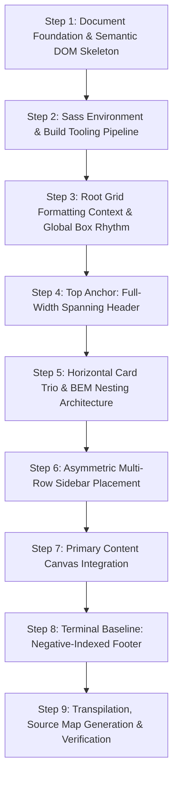

# Step-by-Step Build Order & Architecture Guide

This guide details the exact sequential process of engineering the CSS Grid Showcase from zero to production, explaining the architectural rationale and code mechanics at each milestone.



---

## Step 1: Document Foundation & Semantic DOM Skeleton
- **Files Created:** [`grid-revisions/index.html`](file:///Users/avishjain/avishjain9-repos/58-css-grid-showcase/grid-revisions/index.html)
- **Architectural Rationale:** Establish a lean, semantic HTML5 document without extraneous presentation wrappers. All structural areas are direct children of `<body>`.

```html
<!DOCTYPE html>
<html lang="en">
<head>
    <meta charset="UTF-8">
    <meta http-equiv="X-UA-Compatible" content="IE=edge">
    <meta name="viewport" content="width=device-width, initial-scale=1.0">
    <link rel="stylesheet" href="style.css">
    <title>Document</title>
</head>
<body>
    <header>Header</header>
    <div class="small-box-1 small-box">Small box 1</div>
    <div class="small-box-2 small-box">Small box 2</div>
    <div class="small-box-3 small-box">Small box 3</div>
    <div class="sidebar">Sidebar</div>
    <main class="main-content">Main content</main>
    <footer>Footer</footer>
</body>
</html>
```

### Line-by-Line Mechanics:
- `Lines 1-2`: Enforces standard HTML5 standards mode parsing in the browser.
- `Lines 5-7`: Defines character set encoding and disables mobile auto-zoom scaling via `viewport`.
- `Line 8`: Links to the compiled stylesheet target `style.css`.
- `Lines 13-21`: Declares seven flat semantic children inside `<body>`. Note the absence of intermediate row grouping `<div>` elements.

---

## Step 2: Root Grid Formatting Context & Global Container
- **Files Created:** [`grid-revisions/style.scss`](file:///Users/avishjain/avishjain9-repos/58-css-grid-showcase/grid-revisions/style.scss) (Lines 1-16)
- **Architectural Rationale:** Turn the document `<body>` into a two-dimensional grid container, defining four explicit column tracks and four explicit row tracks.

```scss
body {
    display: grid;
    grid-template-columns: repeat(3, 1fr) 20%;
    grid-template-rows: 1fr 2fr 4fr 1fr;
    gap: 20px;
    min-height: 90vh;
    margin: 30px auto;

    &>* {
        background-color: red;
        font-weight: 700;
        color: white;
    }
}
```

### Line-by-Line Mechanics:
- `Line 3`: `display: grid;` activates the Grid Formatting Context (GFC) algorithm on `<body>`.
- `Line 4`: `repeat(3, 1fr) 20%;` creates four column tracks: three flexible fractional columns and one fixed 20% column.
- `Line 5`: `1fr 2fr 4fr 1fr;` allocates vertical height dynamically across four tiers.
- `Line 6`: `gap: 20px;` establishes $20\text{px}$ spacing strictly between grid cells.
- `Line 7`: `min-height: 90vh;` stretches the layout across 90% of the viewport height.
- `Line 8`: `margin: 30px auto;` centers the grid horizontally with a $30\text{px}$ top/bottom margin.
- `Lines 10-15`: `&>*` applies base red backgrounds, bold weight, and white text universally to all direct children.

---

## Step 3: Top Anchor: Full-Width Spanning Header
- **Files Modified:** [`grid-revisions/style.scss`](file:///Users/avishjain/avishjain9-repos/58-css-grid-showcase/grid-revisions/style.scss) (Lines 18-21)
- **Architectural Rationale:** Anchor the `<header>` across the entire top width of the grid container.

```scss
header {
    grid-column: 1/5;
}
```

### Line-by-Line Mechanics:
- `Line 20`: `grid-column: 1/5;` explicitly pins the header from Column Line 1 to Column Line 5, covering all four columns in Row 1.

---

## Step 4: Horizontal Card Trio & BEM Modifier Architecture
- **Files Modified:** [`grid-revisions/style.scss`](file:///Users/avishjain/avishjain9-repos/58-css-grid-showcase/grid-revisions/style.scss) (Lines 23-39)
- **Architectural Rationale:** Position three feature cards side-by-side in Row 2, reserving the fourth column for the upcoming multi-row sidebar.

```scss
.small-box {
    &-1 {
        grid-column: 1/2;
    }
    &-2 {
        grid-column: 2/3;
    }
    &-3 {
        grid-column: 3/4;
    }
}
```

### Line-by-Line Mechanics:
- `Line 23`: Groups modifier styles under the `.small-box` scope.
- `Lines 25-28`: `&-1` concatenates to `.small-box-1`, assigning it to Column Line 1 to 2.
- `Lines 30-33`: `&-2` concatenates to `.small-box-2`, assigning it to Column Line 2 to 3.
- `Lines 35-38`: `&-3` concatenates to `.small-box-3`, assigning it to Column Line 3 to 4.

---

## Step 5: Asymmetric Multi-Row Sidebar Placement
- **Files Modified:** [`grid-revisions/style.scss`](file:///Users/avishjain/avishjain9-repos/58-css-grid-showcase/grid-revisions/style.scss) (Lines 41-45)
- **Architectural Rationale:** Connect the rightmost 20% column across both Row 2 and Row 3, creating an asymmetric visual hierarchy.

```scss
.sidebar {
    grid-row: 2/4;
    grid-column: 4/5;
}
```

### Line-by-Line Mechanics:
- `Line 43`: `grid-row: 2/4;` stretches the sidebar vertically across Row 2 ($2\text{fr}$) and Row 3 ($4\text{fr}$).
- `Line 44`: `grid-column: 4/5;` fixes the sidebar in the fourth column ($20\%$ track).

---

## Step 6: Primary Content Canvas Integration
- **Files Modified:** [`grid-revisions/style.scss`](file:///Users/avishjain/avishjain9-repos/58-css-grid-showcase/grid-revisions/style.scss) (Lines 47-50)
- **Architectural Rationale:** Provide the expansive central workspace for the application.

```scss
main {
    grid-column: 1/4;
}
```

### Line-by-Line Mechanics:
- `Line 49`: `grid-column: 1/4;` spans across columns 1, 2, and 3, automatically placed in Row 3 alongside the bottom half of the sidebar.

---

## Step 7: Terminal Baseline: Negative-Indexed Footer
- **Files Modified:** [`grid-revisions/style.scss`](file:///Users/avishjain/avishjain9-repos/58-css-grid-showcase/grid-revisions/style.scss) (Lines 52-55)
- **Architectural Rationale:** Anchor the bottom of the interface using dynamic negative line coordinates.

```scss
footer {
    grid-column: 1/-1;
}
```

### Line-by-Line Mechanics:
- `Line 54`: `grid-column: 1/-1;` anchors the footer at line 1 and stretches it to the final explicit column grid line (line 5).

---

## Step 8: Compilation, Source Mapping & DevTools Verification
- **Command:** `sass grid-revisions/style.scss grid-revisions/style.css`
- **Output:** Generates `style.css` and `style.css.map`.
- **Verification:** Inspect in Chrome DevTools to confirm the `display: grid` overlay highlights all 16 cells and 20 lines accurately.
