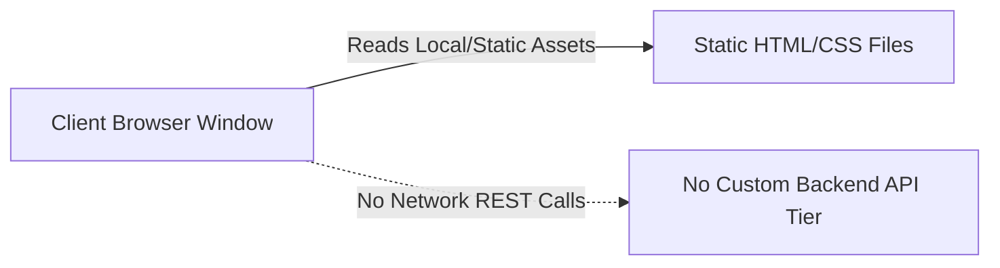

# API Reference & Browser Interface Specification

## 1. Backend REST Endpoints

**Status:** *Not applicable for this project type.*  
**Reason:** The CSS Grid Showcase is a static, client-side web layout architecture executed directly by the browser layout engine without an Express, Node.js, or cloud application server.



---

## 2. Document Resource Loading & HTTP Protocols

When deployed to a static web server or CDN (e.g., Nginx, Vercel, Cloudflare, Netlify, or AWS S3/CloudFront), the client fetches document assets via standard HTTP/2 or HTTP/3 GET requests:

### Request Specification: HTML Document
- **Method:** `GET`
- **Path:** `/grid-revisions/index.html` (or `/`)
- **Headers Sent by Browser:**
  ```http
  Accept: text/html,application/xhtml+xml,application/xml;q=0.9,*/*;q=0.8
  Accept-Encoding: gzip, deflate, br, zstd
  Sec-Fetch-Dest: document
  Sec-Fetch-Mode: navigate
  Sec-Fetch-Site: none
  ```
- **Response Headers:**
  ```http
  HTTP/2 200 OK
  Content-Type: text/html; charset=UTF-8
  Content-Encoding: br
  Cache-Control: public, max-age=3600, must-revalidate
  ETag: "fdfb0c631bb7b532b1b04d5671c63db2aecedf55"
  ```

### Request Specification: Compiled Stylesheet
- **Method:** `GET`
- **Path:** `/grid-revisions/style.css`
- **Headers Sent by Browser:**
  ```http
  Accept: text/css,*/*;q=0.1
  Sec-Fetch-Dest: style
  Sec-Fetch-Mode: no-cors
  Sec-Fetch-Site: same-origin
  ```
- **Response Headers:**
  ```http
  HTTP/2 200 OK
  Content-Type: text/css; charset=UTF-8
  Cache-Control: public, max-age=31536000, immutable
  ```

---

## 3. DOM & CSSOM Object Model Interfaces

The application exposes and manipulates standard browser DOM and CSSOM layout properties accessible through the JavaScript runtime:

| Interface Property | Exposed Object | Value Type | Current Computed Value |
| :--- | :--- | :--- | :--- |
| `display` | `getComputedStyle(document.body)` | String | `"grid"` |
| `gridTemplateColumns` | `getComputedStyle(document.body)` | String | Computed pixel track dimensions (e.g., `"280px 280px 280px 225px"`) |
| `gridTemplateRows` | `getComputedStyle(document.body)` | String | Computed pixel row dimensions (e.g., `"95px 190px 380px 95px"`) |
| `gap` / `rowGap` / `columnGap` | `getComputedStyle(document.body)` | String | `"20px"` |
| `gridColumn` | `getComputedStyle(document.querySelector('header'))` | String | `"1 / 5"` |
| `gridRow` | `getComputedStyle(document.querySelector('.sidebar'))` | String | `"2 / 4"` |
| `gridColumn` | `getComputedStyle(document.querySelector('footer'))` | String | `"1 / -1"` |

```javascript
// Runtime programmatic inspection snippet
const bodyStyle = window.getComputedStyle(document.body);
console.log({
  display: bodyStyle.display,
  columns: bodyStyle.gridTemplateColumns,
  rows: bodyStyle.gridTemplateRows,
  gap: bodyStyle.gap
});
```

---

## 4. External APIs and Cloud Services
- **External Web APIs:** None.
- **Third-Party Telemetry:** None.
- **Third-Party Identity Providers:** None.
