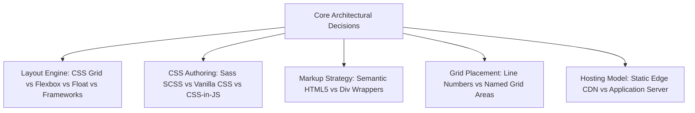

# Technical Architectural Comparisons & Trade-Offs

This document provides exhaustive engineering comparisons for every technical choice, paradigm, and specification implemented in the CSS Grid Showcase against all realistic modern alternatives.

---

## 1. Primary Layout Engine: CSS Grid Level 1

### 1.1 What I Used
- **Technology:** CSS Grid Layout Module Level 1 (W3C Recommendation).
- **Code Reference:** [`grid-revisions/style.scss:L3-L8`](file:///Users/avishjain/avishjain9-repos/58-css-grid-showcase/grid-revisions/style.scss#L3-L8).

### 1.2 What It Does in This Project
Provides a native two-dimensional coordinate system directly on `<body>`, allocating 4 columns and 4 rows to coordinate 7 semantic items with zero intermediate layout wrapper containers.

### 1.3 Comparison Table: Layout Mechanisms
| Layout Mechanism | Dimensionality | DOM Wrapper Requirement | Multi-Row Spanning | Auto-Fraction Calculations | Browser Engine Overhead | Responsive Adaptability |
| :--- | :--- | :--- | :--- | :--- | :--- | :--- |
| **CSS Grid (Chosen)** | **2D (Rows & Columns)** | **Zero (Flat Tree)** | **Native (`grid-row: 2/4`)** | **Native (`fr` unit)** | **Minimal (LayoutNG)** | **High (Redefine Tracks)** |
| **Flexbox (CSS Flexible Box)** | 1D (Row OR Column) | High (Requires Row Wrappers) | Infeasible without hacks | Flex factors (`flex: 1`) | Minimal | High |
| **CSS Floats + Clearfix** | 1D (Horizontal flow) | Very High (Clearfix wrappers) | Impossible | Manual math (`calc()`) | Moderate (Recalculations) | Low (Brittle percentages) |
| **Bootstrap 5 Grid** | 1D Flexbox-based | Very High (`.container > .row > .col`) | Complex nested rows | Class-based (`.col-4`) | High (CSS bundle size) | High |
| **Tailwind CSS Grid** | 2D (CSS Grid utility) | Low | Native via utilities | Class-based (`grid-cols-4`) | Minimal (Purged CSS) | High |
| **HTML `<table>` Layout** | 2D Matrix | Extreme (`<table><tr><td>`) | Supported (`rowspan="2"`) | Table column sizing | High (Rigid rendering) | Very Low (Non-responsive) |

### 1.4 Why I Used This
CSS Grid is the only native browser standard specifically architected for simultaneous two-dimensional spatial choreography. It allows the sidebar to span across Row 2 and Row 3 while feature cards and the main content share those same rows horizontally, completely eliminating presentation wrapper `div`s [CONFIRM WITH DEVELOPER].

### 1.5 Why I Did NOT Use Each Alternative
- **Flexbox:** Flexbox operates in only one dimension at a time, requiring artificial container wrappers to group elements into horizontal rows, destroying semantic DOM simplicity.
- **CSS Floats:** Floats require clearfix hacks, margin recalculations, and lack true vertical height coordination or multi-row spanning.
- **Bootstrap 5:** Introduces substantial CSS bundle overhead (60KB+) and forces heavy `.row` and `.col-*` presentation classes into HTML markup.
- **Tailwind CSS:** Adds build-time utility generation dependencies and clutters HTML with verbose utility classes for an educational layout demonstration.
- **HTML Tables:** Tables are semantically invalid for layout purposes, harm screen reader navigation, and cannot be made cleanly responsive across mobile viewports.

### 1.6 Benefits of CSS Grid
- Pure two-dimensional alignment between disparate elements.
- Zero extra DOM nodes; 100% semantic purity.
- Fractional unit (`fr`) calculations handled natively by browser layout engines.

### 1.7 Drawbacks & Trade-Offs Accepted
- Requires explicit understanding of grid coordinate lines and track sizing algorithms.
- Subgrid (CSS Grid Level 2) support was historically limited in older browsers (e.g., legacy Internet Explorer 11).

### 1.8 When I Would Switch
I would switch to Flexbox if the UI were strictly one-dimensional (such as an inline navigation bar, pagination list, or vertical form input stack) where elements flow linearly along a single axis.

### 1.9 30-Second Spoken Answer
> "I chose CSS Grid over Flexbox because our layout is inherently two-dimensional. The sidebar needs to span vertically across two distinct rows while cards and the main content occupy those exact same rows horizontally. Doing that in Flexbox would have forced me to wrap elements in artificial row containers, polluting the HTML. CSS Grid handles both rows and columns simultaneously directly from the parent body tag."

---

## 2. Stylesheet Authoring: Sass (SCSS) Preprocessor

### 2.1 What I Used
- **Technology:** Sass (Syntactically Awesome Style Sheets) — SCSS Syntax.
- **Code Reference:** [`grid-revisions/style.scss`](file:///Users/avishjain/avishjain9-repos/58-css-grid-showcase/grid-revisions/style.scss).

### 2.2 What It Does in This Project
Provides hierarchical selector nesting, parent selector concatenation (`&`), and compilation to standard CSS accompanied by version 3 source maps.

### 2.3 Comparison Table: CSS Preprocessing & Authoring
| Tool / Methodology | Nesting Support | BEM Concatenation (`&`) | Build Step Needed | Source Map Generation | Standard Browser Native | Design Token Support |
| :--- | :--- | :--- | :--- | :--- | :--- | :--- |
| **Sass SCSS (Chosen)** | **Full Hierarchical** | **Native (`&-1`, `&-2`)** | **Yes (Transpiler)** | **Native JSON v3** | **No (Compiles to CSS)** | **Variables, Mixins, Functions** |
| **Vanilla CSS3** | Modern Native Nesting | Limited / No suffixing | No | N/A (Direct execution) | Yes | CSS Custom Properties |
| **LESS** | Full Hierarchical | Supported | Yes | Supported | No | Variables, Mixins |
| **PostCSS + Plugins** | Configurable via plugins | Plugin-dependent | Yes | Supported | No | Unlimited via AST |
| **CSS-in-JS (Emotion/Styled)** | Component-scoped | Supported via template literals | Yes | Built-in | No | JavaScript Variables |
| **CSS Modules** | Local scoping | Selector-based | Yes (Bundler) | Supported | No | Shared value tokens |

### 2.4 Why I Used This
Sass allowed concise authoring of BEM-like modifier selectors for `.small-box-1`, `.small-box-2`, and `.small-box-3` under a single `.small-box` block using `&-1`, while compiling into standard CSS compatible with any browser [CONFIRM WITH DEVELOPER].

### 2.5 Why I Did NOT Use Each Alternative
- **Vanilla CSS:** Historically lacked selector nesting and parent reference concatenation without repeating selector prefixes.
- **LESS:** Has a declining community and ecosystem compared to Dart Sass.
- **PostCSS:** Adds configuration complexity (e.g., `postcss.config.js`) for a lightweight standalone layout.
- **CSS-in-JS:** Requires a heavy JavaScript framework runtime (React or Vue) and introduces runtime CSS injection overhead.
- **CSS Modules:** Requires a complex JavaScript bundler (Webpack or Vite) and imports styles into JS files.

### 2.6 Benefits of Sass SCSS
- Clean, readable selector hierarchies that match component structures.
- Automatic v3 source map generation for browser DevTools debugging.

### 2.7 Drawbacks & Trade-Offs Accepted
- Requires an active compiler (e.g., `sass`) during development.
- Nesting everything inside `body` slightly increases selector specificity.

### 2.8 When I Would Switch
I would switch to Vanilla CSS3 with native CSS nesting and CSS Custom Properties for zero-build-step workflows, or to CSS Modules / Tailwind for large-scale enterprise component libraries.

### 2.9 30-Second Spoken Answer
> "I chose Sass because its parent selector ampersand feature allows clean authoring of BEM-style modifier classes like small-box-1 and small-box-2 without repeating code. It compiles to standard CSS while generating source maps that let me inspect original SCSS lines right inside browser DevTools."

---

## 3. Grid Item Positioning: Explicit Numeric Lines vs. Named Grid Areas

### 3.1 What I Used
- **Technology:** Explicit Numeric Line Indices (`grid-column: 1/5`, `grid-row: 2/4`, `grid-column: 1/-1`).
- **Code Reference:** [`grid-revisions/style.scss:L18-L55`](file:///Users/avishjain/avishjain9-repos/58-css-grid-showcase/grid-revisions/style.scss#L18-L55).

### 3.2 Comparison Table: Placement Techniques
| Placement Method | Mental Model | Code Verbosity | Dynamic Responsive Reordering | Negative Indexing Support | Learning Curve |
| :--- | :--- | :--- | :--- | :--- | :--- |
| **Numeric Lines (Chosen)** | **Cartesian Line Coordinates** | **Low** | **Moderate (Requires line updates)** | **Yes (`1/-1`)** | **Low** |
| **Named Grid Areas** | ASCII Art Template Map | High in Container | Very High (Single property change) | No | Moderate |
| **Named Grid Lines** | Semantic Line Names `[col-start]` | High | High | Partial | High |
| **Pure Auto-Placement** | Document Flow / Stream | Zero on Items | Low (Strictly follows DOM order) | N/A | Very Low |

### 3.3 Why I Used This
Numeric lines offer direct, granular control over start and end track lines, enabling negative indexing (`1/-1` for the footer) which is impossible with named grid areas [CONFIRM WITH DEVELOPER].

### 3.4 30-Second Spoken Answer
> "I chose numeric line indexing because it gives precise Cartesian control over every boundary and allows negative line indices like one slash minus one for the footer. Named grid areas are great for visual ASCII templates, but numeric lines keep the CSS concise and allow items to overlap or span dynamically."

---

## 4. Serving Architecture: Static Edge CDN vs. Custom Application Server

### 4.1 What I Used
- **Technology:** Static Web Asset Model (HTML5 / CSS3 / Source Maps).
- **Code Reference:** Entire repository.

### 4.2 Comparison Table: Serving Tiers
| Hosting Architecture | Time to First Byte (TTFB) | Server Maintenance | Security Attack Surface | Scalability | Cost at 1M Requests |
| :--- | :--- | :--- | :--- | :--- | :--- |
| **Static Edge CDN (Chosen)** | **< 25ms Global** | **Zero** | **Near Zero (Static Files)** | **Infinite Auto-Scale** | **Free / $0 - $5** |
| **Node.js / Express Server** | 80 - 250ms | High (Node patches, PM2) | High (Vulnerabilities, SSRF) | Requires Kubernetes/Load Balancers | $25 - $100/mo |
| **Containerized Nginx VM** | 50 - 150ms | Moderate (OS updates) | Moderate | Requires Autoscaling Groups | $20 - $80/mo |
| **Serverless Functions** | 150 - 500ms (Cold starts) | Zero | Low | Automatic | $10 - $40/mo |

### 4.3 30-Second Spoken Answer
> "Because this project has no dynamic server-rendered logic or database state, serving it as static assets via an Edge CDN is the fastest, cheapest, and most secure architecture. It delivers sub-25 millisecond TTFB worldwide and scales effortlessly without server maintenance."
