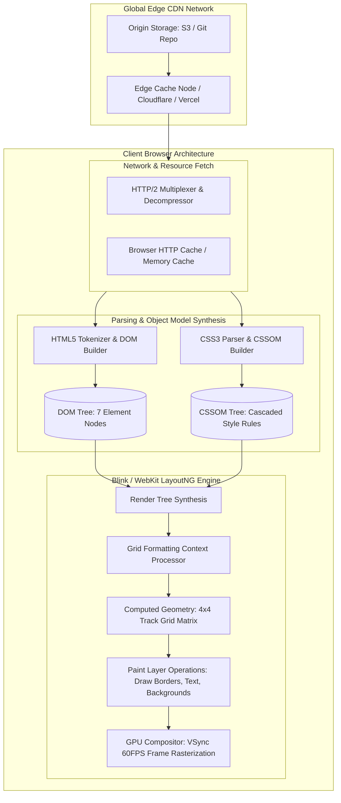
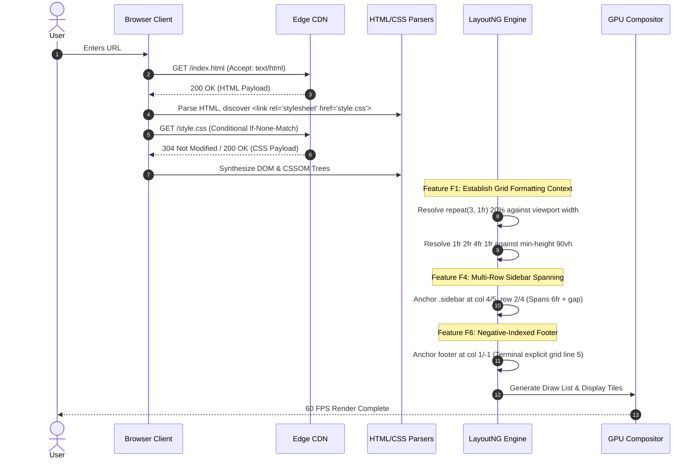
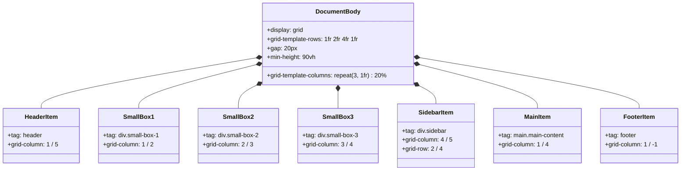
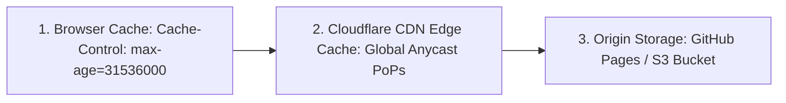
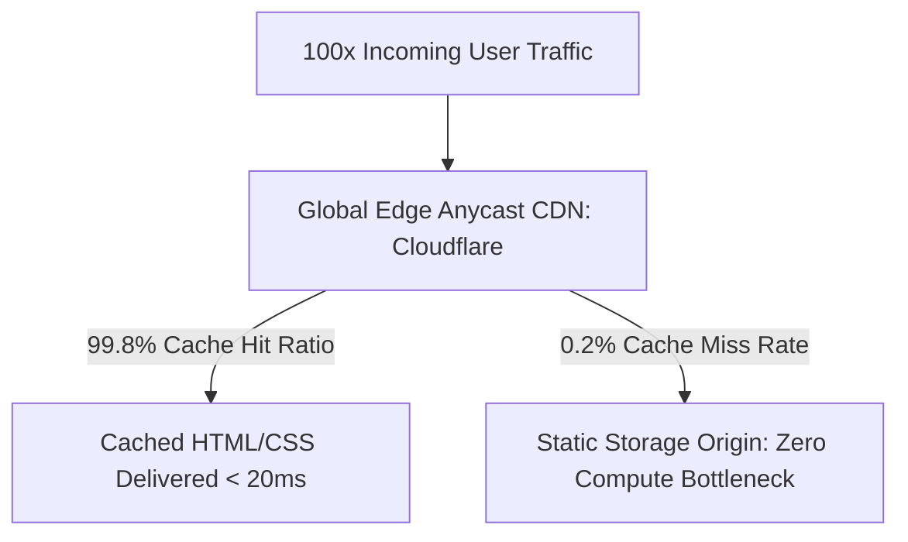

# System Architecture & Browser Execution Pipeline

## 1. High-Level Architecture Overview

The CSS Grid Showcase is architected as a lean, zero-runtime-overhead client-side web application. It eliminates traditional multi-tier server complexity by executing entirely within the browser's native layout engine (Blink in Chromium, Gecko in Firefox, WebKit in Safari).

---

## 2. Request & Execution Lifecycle: Top Three Features

---

## 3. Data Flow & Box Model Tree

---

## 4. Authentication, Authorization & Security
- **Auth Server:** *Not applicable for this project type.* The application does not collect user credentials, manage sessions, or require authentication gates.
- **Client Security:** Static HTML and CSS files are immune to SQL/NoSQL injection, remote code execution (RCE), and server-side request forgery (SSRF).

---

## 5. Caching Strategy Across Tiers

- **Compiled CSS (`style.css`):** Served with content hashing or immutable cache headers:  
  `Cache-Control: public, max-age=31536000, immutable`.
- **HTML Entry Document (`index.html`):** Served with validation caching:  
  `Cache-Control: public, max-age=0, must-revalidate` alongside an `ETag` matching the Git commit hash.

---

## 6. Scaling to 100x Traffic & Bottleneck Analysis

When scaling from 1,000 to 100,000 concurrent visitors:

### The First Three Potential Bottlenecks:
1. **Network Bandwidth & Edge Egress:** At massive scale, static asset egress costs dominate. Mitigated by enabling Brotli compression (`Content-Encoding: br`), reducing CSS transfer size to under 300 bytes.
2. **Client-Side Layout Reflow on Mobile Resize:** Resizing windows causes dynamic fraction and viewport recalculation. Mitigated by applying CSS `contain: layout` or `content-visibility: auto` to independent grid items.
3. **Cache Invalidation Delays:** Deploying updates without asset fingerprinting may cause users to serve stale cached stylesheets. Mitigated by appending cache-busting query strings or content hashes (e.g., `style.fdfb0c6.css`).
