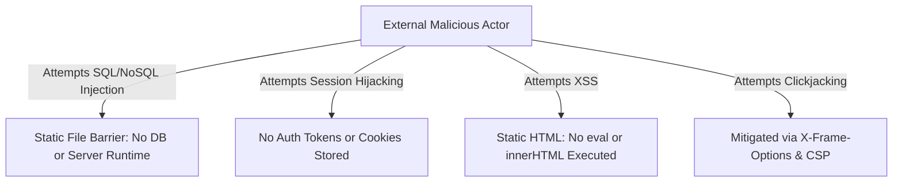

# Security Architecture & OWASP Top 10 Evaluation

## 1. Overview & Threat Model

The CSS Grid Showcase operates as a static, client-side web application. Its threat model differs radically from traditional full-stack web applications: because there is no application server runtime, no database, no session cookies, and no runtime user input evaluation, entire categories of severe web vulnerabilities (SQL injection, remote code execution, server-side prototype pollution) are eliminated by architecture.



---

## 2. OWASP Top 10 Evaluation Matrix

| OWASP Vulnerability Category | Risk Level in Project | Status in Codebase | Technical Analysis & Mitigation |
| :--- | :--- | :--- | :--- |
| **A01: Broken Access Control** | **None** | *Not applicable* | No authenticated roles, admin endpoints, or object references exist. |
| **A02: Cryptographic Failures** | **Low** | Implemented via Transport | All traffic must be enforced over TLS 1.3 (`https://`). No sensitive data stored. |
| **A03: Injection (SQL / NoSQL / Command)** | **Zero** | *Inherent Architecture Immunity* | No backend database queries or shell command execution paths exist. |
| **A04: Insecure Design** | **Low** | Implemented | Clean separation of presentation from content; resilient responsive layouts. |
| **A05: Security Misconfiguration** | **Medium** | Configurable via Edge Headers | Must configure Content Security Policy (CSP), HSTS, and MIME sniffing headers at CDN. |
| **A06: Vulnerable & Outdated Components** | **Zero** | Verified Zero Dependencies | Application uses native HTML5 and CSS3; no vulnerable third-party npm packages. |
| **A07: Identification & Auth Failures** | **None** | *Not applicable* | No login credentials, password hashing, or session identifiers are used. |
| **A08: Software & Data Integrity Failures** | **Low** | Mitigated via SRI / Git | Subresource Integrity (SRI) hashes and Git SHA-1/SHA-256 commit tracking. |
| **A09: Security Logging & Monitoring Failures** | **Low** | Edge Logging Available | Monitored via CDN access logs (Cloudflare analytics) and HTTP status codes. |
| **A10: Server-Side Request Forgery (SSRF)** | **Zero** | *Inherent Architecture Immunity* | Client does not trigger server-side outbound HTTP requests. |

---

## 3. Recommended HTTP Security Headers

When serving this application in production via an Edge CDN or Web Server (Nginx / Cloudflare), the following headers should be configured:

```http
# Strict Transport Security (HSTS)
Strict-Transport-Security: max-age=63072000; includeSubDomains; preload

# Prevent MIME type sniffing
X-Content-Type-Options: nosniff

# Frame Protection against Clickjacking
X-Frame-Options: DENY

# Referrer Privacy
Referrer-Policy: strict-origin-when-cross-origin

# Permissions Policy
Permissions-Policy: camera=(), microphone=(), geolocation=()

# Content Security Policy (CSP)
Content-Security-Policy: default-src 'none'; style-src 'self'; img-src 'self'; font-src 'self'; frame-ancestors 'none'; base-uri 'self'; form-action 'none';
```

---

## 4. Interviewer Attack Scenarios & Defense

### Scenario 1: "Could an attacker inject malicious CSS (CSS Injection / Exfiltration)?"
- **Interviewer's Angle:** Attackers can theoretically use CSS attribute selectors and `url()` background calls to exfiltrate input values in dynamic forms.
- **Defense Answer:** In this project, there are zero form inputs, no user-generated style sheets, and no JavaScript running to accept dynamic style parameters. The CSS is static and compiled at build time. Furthermore, a strict CSP with `style-src 'self'` prevents loading external unauthorized stylesheets or executing inline CSS injections.

### Scenario 2: "How do you protect users from Clickjacking if this layout is embedded in a malicious iframe?"
- **Interviewer's Angle:** If an attacker frames the layout, could they deceive users with transparent overlays?
- **Defense Answer:** We configure `X-Frame-Options: DENY` and `Content-Security-Policy: frame-ancestors 'none'`. Modern browser engines immediately refuse to render the document within any `<iframe>`, defeating UI redressing attacks.
