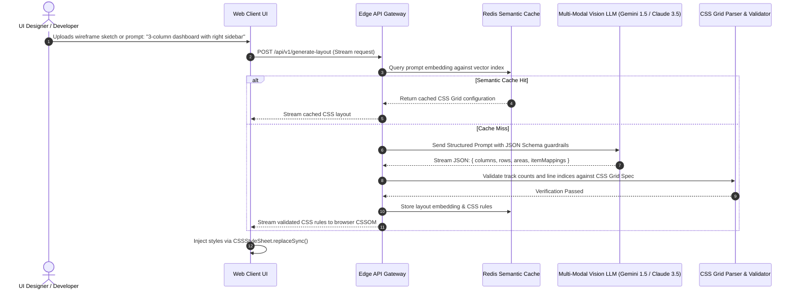

# AI Integration Analysis & Layout Intelligence Architecture

## 1. Status in Codebase

**Status:** **No AI integration.**  
**Reason:** The CSS Grid Showcase implements deterministic, browser-native CSS Grid Level 1 layout algorithms. It does not invoke external machine learning APIs or local inference models.


---

## 2. Hypothetical Architecture: AI-Powered Layout Generator & Assistant

In engineering interviews, candidates are frequently asked: *"How would you integrate an AI model to dynamically generate, optimize, or adapt this CSS Grid layout based on natural language wireframes or user content?"*

Below is the production-ready system design for integrating a pre-trained multimodal AI model (e.g., Google Gemini 1.5 Pro / Anthropic Claude 3.5 Sonnet / OpenAI GPT-4o) without custom model training.



---

## 3. Why a Pre-Trained API Over Training a Custom ML Model

| Dimension | Pre-Trained Multi-Modal API (Gemini / Claude / GPT-4o) | Custom Fine-Tuned Model | Training from Scratch (Transformer) |
| :--- | :--- | :--- | :--- |
| **Capital Expenditure** | **$0 Initial** (Pay per token consumed) | $5,000 - $30,000 (GPU instances) | $500,000+ (H100 clusters) |
| **Data Requirements** | **Zero dataset collection** (Zero-shot / Few-shot) | 50,000+ labeled HTML/CSS wireframe pairs | 100M+ web layout documents |
| **Time to Production** | **< 2 Days** (API integration + schema validation) | 2 - 3 Months | 9 - 18 Months |
| **Generalization** | **High** (Understands complex layout descriptions) | Moderate (Prone to overfitting) | High |
| **Inference Latency** | 300 - 1,200ms (Streaming provides instant TTFT) | 100 - 300ms | 100 - 300ms |
| **Maintenance Burden** | **Zero GPU/Server ops** (Managed SaaS) | High (Model drift, weight updates) | Extreme |

### Engineering Verdict
Training a custom model from scratch to output CSS Grid coordinates would be an anti-pattern. Modern LLMs have already ingested millions of W3C CSS specifications, MDN guides, and open-source stylesheets. Using structured output schemas (`response_mime_type: "application/json"`) with a pre-trained API guarantees syntactic validity at a fraction of the cost.

---

## 4. Structured Output Schema for CSS Grid Generation

To prevent hallucinations, the model must be constrained to a strict JSON schema:

```json
{
  "type": "object",
  "properties": {
    "gridTemplateColumns": {
      "type": "string",
      "description": "Valid CSS grid-template-columns value, e.g., 'repeat(3, 1fr) 20%'"
    },
    "gridTemplateRows": {
      "type": "string",
      "description": "Valid CSS grid-template-rows value, e.g., '1fr 2fr 4fr 1fr'"
    },
    "gap": {
      "type": "string",
      "description": "CSS gap with units, e.g., '20px'"
    },
    "items": {
      "type": "array",
      "items": {
        "type": "object",
        "properties": {
          "selector": { "type": "string" },
          "gridColumn": { "type": "string" },
          "gridRow": { "type": "string" }
        },
        "required": ["selector", "gridColumn"]
      }
    }
  },
  "required": ["gridTemplateColumns", "gridTemplateRows", "gap", "items"]
}
```

---

## 5. Security & Safety: Prompt Injection Guardrails
- **Prompt Isolation:** User layout requests must be placed within designated user content boundaries (`<user_prompt>`) separated from immutable system instructions.
- **Client-Side CSS Sanitization:** Before applying generated CSS to the DOM, run the output through a strict parser (such as `postcss-safe-parser`) to ensure no external `url()` injections, `@import` vectors, or JavaScript `expression()` hacks can reach the client stylesheet.
