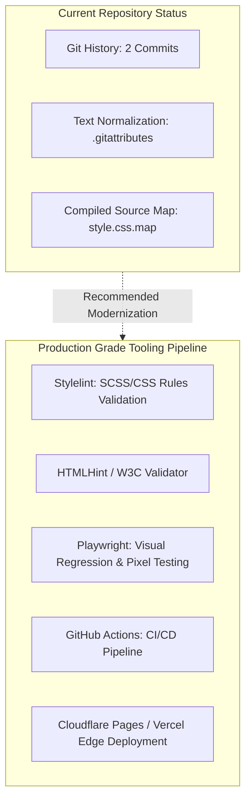
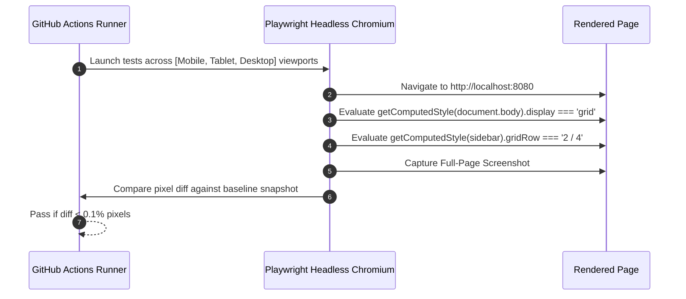

# Engineering Quality, Tooling & Operations

## 1. Code Quality & Tooling Audit



### Audit Findings Matrix
| Quality Dimension | Present in Repository | Missing / Recommended Addition | Severity |
| :--- | :--- | :--- | :--- |
| **Source Maps** | **Present** ([`style.css.map`](file:///Users/avishjain/avishjain9-repos/58-css-grid-showcase/grid-revisions/style.css.map)) | Production strip or upload to private error tracker | Low |
| **Line Normalization** | **Present** ([`.gitattributes`](file:///Users/avishjain/avishjain9-repos/58-css-grid-showcase/.gitattributes)) | None (Properly configured `* text=auto`) | Resolved |
| **CSS / SCSS Linting** | Not implemented | Stylelint with `stylelint-config-standard-scss` | Medium |
| **HTML Linting** | Not implemented | HTMLHint / axe-core accessibility scanner | Medium |
| **Automated Testing** | Not implemented | Playwright visual snapshot / layout regression tests | High |
| **CI/CD Pipeline** | Not implemented | GitHub Actions workflow for linting, build & deploy | High |
| **Containerization** | Not implemented | Multi-stage Dockerfile with Nginx Alpine for self-hosting | Low |

---

## 2. Testing Strategy for CSS Grid Layouts

Because layout correctness is visual and geometric, standard unit tests (e.g., Jest evaluating JS functions) are insufficient. A production-grade testing strategy requires **Visual Regression Testing** and **Computed Style Assertions**:



### Automated Playwright Layout Spec (`tests/layout.spec.ts`)
```typescript
import { test, expect } from '@playwright/test';

test('CSS Grid Layout Structure & Geometry', async ({ page }) => {
  await page.goto('/grid-revisions/index.html');

  // Verify Grid Container Properties
  const body = page.locator('body');
  await expect(body).toHaveCSS('display', 'grid');
  await expect(body).toHaveCSS('gap', '20px');

  // Verify Landmark Spanning
  const header = page.locator('header');
  await expect(header).toHaveCSS('grid-column', '1 / 5');

  const sidebar = page.locator('.sidebar');
  await expect(sidebar).toHaveCSS('grid-row', '2 / 4');
  await expect(sidebar).toHaveCSS('grid-column', '4 / 5');

  const footer = page.locator('footer');
  await expect(footer).toHaveCSS('grid-column', '1 / -1');

  // Pixel-level snapshot test
  await expect(page).toHaveScreenshot('css-grid-desktop-baseline.png');
});
```

---

## 3. Stylelint Configuration (`.stylelintrc.json`)

To prevent syntax bugs, duplicate selectors, and invalid property values in SCSS:

```json
{
  "extends": [
    "stylelint-config-standard",
    "stylelint-config-standard-scss"
  ],
  "rules": {
    "selector-class-pattern": null,
    "scss/at-rule-no-unknown": true,
    "property-no-unknown": true,
    "declaration-block-no-duplicate-properties": true
  }
}
```

---

## 4. Production CI/CD Pipeline (`.github/workflows/deploy.yml`)

```yaml
name: CI/CD Documentation & Static Assets

on:
  push:
    branches: [main]
  pull_request:
    branches: [main]

jobs:
  validate-and-deploy:
    runs-on: ubuntu-latest
    steps:
      - name: Checkout Code
        uses: actions/checkout@v4

      - name: Setup Node.js
        uses: actions/setup-node@v4
        with:
          node-version: 22

      - name: Install Dependencies
        run: npm ci

      - name: Compile Sass
        run: npx sass grid-revisions/style.scss grid-revisions/style.css --no-source-map --style=compressed

      - name: Build VitePress Documentation
        run: npm run docs:build

      - name: Deploy to Cloudflare Pages / GitHub Pages
        uses: peaceiris/actions-gh-pages@v4
        if: github.ref == 'refs/heads/main'
        with:
          github_token: ${{ secrets.GITHUB_TOKEN }}
          publish_dir: ./docs/.vitepress/dist
```

---

## 5. Containerization: Dockerfile (Nginx Alpine)

For self-hosted on-premise or Kubernetes deployments:

```dockerfile
FROM nginx:1.27-alpine
COPY grid-revisions/ /usr/share/nginx/html/
COPY nginx.conf /etc/nginx/conf.d/default.conf
EXPOSE 80
CMD ["nginx", "-g", "daemon off;"]
```

---

## 6. Technical Debt & Codebase Observations

1. **Hardcoded Header Line (`1/5`):** In [`style.scss:L20`](file:///Users/avishjain/avishjain9-repos/58-css-grid-showcase/grid-revisions/style.scss#L20), the header uses `grid-column: 1/5;` while the footer uses `grid-column: 1/-1;`. The header should be refactored to `1/-1` for consistency.
2. **Missing Mobile Media Queries:** The 4-column layout is fixed on all screen widths. On screens narrower than $600\text{px}$, the sidebar at 20% becomes cramped. A responsive breakpoint stacking elements into a single column (`grid-template-columns: 1fr;`) is recommended.
3. **Specific Direct Child Universal Selector (`& > *`):** Applies red background and white text indiscriminately. While effective for layout visualization, in production individual semantic classes should govern aesthetics.
