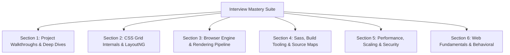

# 150+ Interview Questions & Expert Answers

This repository of questions and full architectural answers is specifically calibrated for this codebase, browser engine internals, modern CSS specifications, web performance, and software engineering interviews.



---

## Section 1: Executive Walkthroughs & Code Deep Dives

### Q1: "Walk me through your project in 3 minutes."
**Answer:** "The **CSS Grid Showcase** is a front-end engineering project built to demonstrate how modern browser layout engines can solve complex, two-dimensional asymmetric web layouts natively without presentation wrappers or JavaScript recalculations.

I architected the project using the CSS Grid Level 1 specification, preprocessed through Sass (SCSS) and delivered via semantic HTML5. The layout establishes a two-dimensional Grid Formatting Context on the `body` tag, defined by four columns and four rows. The column tracks use `repeat(3, 1fr) 20%`, meaning the browser reserves a fixed 20% width for the right-hand sidebar and divides the remaining flexible horizontal space equally among three fractional columns, after subtracting the 20px gutters. The rows follow a `1fr 2fr 4fr 1fr` proportion constrained by a `min-height: 90vh`.

What makes this layout technically compelling is how disparate items coordinate across dimensions without wrapper `div`s. All seven structural elements sit as flat, direct children of `body`. The header spans the full width from column line 1 to 5. Row 2 holds three feature cards in the first three columns. The sidebar is an asymmetric element that spans vertically across rows 2 and 3 using `grid-row: 2/4` while pinned to column track 4. The primary content canvas occupies row 3, spanning the first three columns directly adjacent to the lower half of the sidebar. Finally, the footer uses negative line indexing—`grid-column: 1/-1`—to dynamically span to the last explicit grid line.

In the stylesheet, I used Sass parent selector concatenation (`&`) to generate clean BEM modifier classes for the cards and generated version 3 source maps for Chrome DevTools debugging. This project demonstrates mastery of the browser's LayoutNG engine, fractional track calculations, and modern responsive layout architecture."

### Q2: "Give me the 60-second elevator pitch."
**Answer:** "I built the CSS Grid Showcase to demonstrate modern two-dimensional web layout architecture using pure CSS Grid Level 1 and Sass. Instead of relying on Flexbox—which is one-dimensional and forces you to create artificial row wrappers that clutter the DOM—this project manages a 4-column, 4-row layout directly from the `body` container. It features fractional unit track distribution, a multi-row sidebar spanning rows 2 and 3, and a negative-indexed footer spanning from line 1 to -1. The entire DOM consists of seven flat, semantic HTML5 elements with zero presentation wrapper divs, delivering maximum accessibility, sub-millisecond layout calculation in Blink's LayoutNG engine, and full source map integration."

### Q3: "What is the most complex CSS declaration block in this project, explained line by line?"
**Answer:** "The container rule on `body` in [`grid-revisions/style.scss:L1-L8`](file:///Users/avishjain/avishjain9-repos/58-css-grid-showcase/grid-revisions/style.scss#L1-L8):
```scss
body {
    display: grid;
    grid-template-columns: repeat(3, 1fr) 20%;
    grid-template-rows: 1fr 2fr 4fr 1fr;
    gap: 20px;
    min-height: 90vh;
    margin: 30px auto;
}
```
Line by line:
1. `display: grid;`: Instantiates an independent Grid Formatting Context (GFC) on `body`. All direct children become grid items.
2. `grid-template-columns: repeat(3, 1fr) 20%;`: Generates four column tracks. `repeat(3, 1fr)` expands to `1fr 1fr 1fr`. The engine first evaluates fixed/percentage tracks (deducting 20% width and $3 \times 20\text{px} = 60\text{px}$ gaps from container width), then divides the remaining available space equally into three 1fr units.
3. `grid-template-rows: 1fr 2fr 4fr 1fr;`: Creates four row tracks with flex proportions summing to 8fr. Row 3 gets $4/8$ (50%) of the flexible height, Row 2 gets $2/8$ (25%), and Rows 1 & 4 each get $1/8$ (12.5%).
4. `gap: 20px;`: Sets both `row-gap` and `column-gap` to 20px. The engine places gutters purely *between* tracks, never adding margin to the outer edges.
5. `min-height: 90vh;`: Constrains the container's vertical flex space to at least 90% of the viewport height.
6. `margin: 30px auto;`: Applies 30px top and bottom margin and centers the grid horizontally."

### Q4: "What bugs or challenges were visible from the Git history and code?"
**Answer:** "The commit message for commit `fdfb0c6` reads: *'Adding grid backend logic'*. This highlights a humorous developer colloquialism where the core geometric math of CSS Grid is playfully referred to as 'backend logic'. The main technical challenge was coordinating the multi-row sidebar alongside the main content area without adding a wrapper container, which required precise assignment of `grid-row: 2/4` and `grid-column: 4/5`."

### Q5: "What would you change if you rebuilt this project today?"
**Answer:** "I would make five concrete architectural improvements:
1. **Responsive Media Queries / Container Queries:** Add mobile breakpoints so that on viewports under $768\text{px}$, the grid collapses into `grid-template-columns: 1fr;` with single-column linear auto-flow.
2. **Dynamic Viewport Units:** Replace `90vh` with `90dvh` (Dynamic Viewport Height) to eliminate mobile browser URL-bar jumpiness.
3. **Defensive Fractional Sizing:** Wrap `1fr` tracks in `minmax(0, 1fr)` to prevent cell blowout when child content includes unbreaking strings or large images.
4. **Header Line Indexing:** Refactor `header { grid-column: 1/5; }` to `grid-column: 1/-1;` to match the footer's resilient negative indexing.
5. **CSS Custom Properties (Variables):** Extract hardcoded values (`20px`, `red`, `90vh`) into `:root` CSS variables for instant theming."

---

## Section 2: CSS Grid Specification & Layout Geometry (Q6 - Q35)

### Q6: What is a Grid Formatting Context (GFC)?
**Answer:** A Grid Formatting Context is an environment in which grid items are laid out according to the CSS Grid Layout Module specification. It is created when an element is assigned `display: grid` or `display: inline-grid`. Inside a GFC, children participate in a two-dimensional coordinate system rather than block or inline formatting contexts.

### Q7: How does the browser calculate the width of a `1fr` unit?
**Answer:** The browser follows the W3C Grid Track Sizing Algorithm:
$$\text{FreeSpace} = \text{ContainerWidth} - \sum(\text{Fixed Track Sizes, Percentages}) - \sum(\text{Gaps})$$
The free space is divided by the sum of all fractional flex factors ($\sum \text{fr}$). In this project, $\text{FreeSpace} = W - 20\% - 60\text{px}$, and each `1fr` track receives $\text{FreeSpace} / 3$.

### Q8: What happens if an image inside a `1fr` column has an intrinsic width of 800px?
**Answer:** By default, grid items have an initial `min-width: auto`. This means a `1fr` column track will expand to fit the minimum intrinsic content size of its children (in this case, 800px), potentially blowing out the entire grid layout. The solution is setting `min-width: 0` on the item or defining the track as `minmax(0, 1fr)`.

### Q9: What is the difference between explicit grid and implicit grid?
**Answer:** The **explicit grid** consists of tracks explicitly defined using `grid-template-columns` and `grid-template-rows`. The **implicit grid** is created automatically by the layout engine when grid items are positioned outside the explicit bounds or when auto-placed items exceed the defined tracks, sized via `grid-auto-columns` and `grid-auto-rows`.

### Q10: How does negative line indexing work in CSS Grid?
**Answer:** Negative line numbers count backwards from the trailing edge of the explicit grid: `-1` refers to the final explicit grid line, `-2` the second from the end, and so on. In our 4-column grid, line 5 is identical to line -1.

### Q11: Can negative line numbers refer to the implicit grid?
**Answer:** No. Under the CSS Grid Level 1 specification, negative line numbers only resolve against the explicit grid defined by `grid-template-columns` or `grid-template-rows`.

### Q12: What does `grid-row: 2/4` actually mean?
**Answer:** It is shorthand for `grid-row-start: 2; grid-row-end: 4;`. It tells the engine to anchor the item's top edge at Row Grid Line 2 and stretch its bottom edge to Row Grid Line 4, spanning across Row 2 and Row 3.

### Q13: What is the difference between `grid-row: 2/4` and `grid-row: 2 / span 2`?
**Answer:** Both produce identical layout results in a 4-row grid. However, `2 / span 2` is relative (start at line 2 and span 2 tracks), whereas `2/4` is absolute (start at line 2 and stop at line 4).

### Q14: How does `gap: 20px` differ from applying `margin: 10px` to every child?
**Answer:** The `gap` property applies spacing strictly *between* grid tracks. It never adds spacing to the outer perimeter of the container, eliminating the need for negative-margin container hacks or `:first-child`/`:last-child` margin resets.

### Q15: What is the Grid Auto-Placement Algorithm?
**Answer:** It is the deterministic process by which the browser positions grid items that have not been assigned explicit grid line coordinates. The algorithm operates in row-dense or sparse mode, filling empty grid cells in document order.

### Q16: Why did Feature F3 use explicit line numbers (`1/2`, `2/3`, `3/4`) for the small boxes instead of relying on auto-placement?
**Answer:** Explicit line placement provides strict structural guarantees. If DOM order is altered or dynamic content is inserted before the boxes, explicit line coordinates ensure each card remains locked to its designated column.

### Q17: What is the difference between CSS Grid Level 1 and CSS Grid Level 2 (Subgrid)?
**Answer:** CSS Grid Level 1 establishes grid formatting contexts where only direct children become grid items; grandchildren cannot align with the parent grid. CSS Grid Level 2 introduces `grid-template-columns: subgrid`, allowing nested child elements to inherit and align directly with the tracks and lines of their parent grid.

### Q18: What is `repeat(auto-fit, minmax(200px, 1fr))` and how does it compare to `repeat(3, 1fr)`?
**Answer:** `repeat(3, 1fr)` strictly creates three columns regardless of viewport width. `repeat(auto-fit, minmax(200px, 1fr))` creates a responsive, dynamic column count: on wide screens it creates as many 200px+ columns as fit, and on narrow screens it wraps items into fewer columns automatically without media queries.

### Q19: What is the difference between `auto-fill` and `auto-fit`?
**Answer:** `auto-fill` creates empty tracks if there is space in the container, preserving empty columns. `auto-fit` collapses empty tracks to $0\text{px}$, allowing occupied tracks to expand and fill the available free space.

### Q20: How does `minmax()` work in track sizing?
**Answer:** `minmax(min, max)` defines a size range closed interval. The track will never shrink below `min` and will never expand beyond `max`.

### Q21: Can CSS Grid items overlap each other?
**Answer:** Yes. Multiple grid items can be assigned identical or overlapping row and column coordinates. Their stacking order is determined by standard CSS stacking contexts, `z-index`, and DOM source order.

### Q22: What is `grid-template-areas`?
**Answer:** It is a declarative syntax that represents the grid layout as an ASCII-art visual map, assigning names to cells (e.g., `"header header header sidebar"`), allowing items to be placed via `grid-area: header`.

### Q23: Why did this project use line-based placement instead of `grid-template-areas`?
**Answer:** Line-based placement allows direct mathematical demonstration of fractional units and enables negative indexing (`1/-1`), which is not supported in `grid-template-areas`.

### Q24: What is the difference between `justify-items`, `align-items`, `justify-content`, and `align-content` in CSS Grid?
**Answer:** 
- `justify-items`: Aligns items horizontally inside their individual grid cells (inline axis).
- `align-items`: Aligns items vertically inside their individual grid cells (block axis).
- `justify-content`: Aligns the entire grid track matrix horizontally within the grid container.
- `align-content`: Aligns the entire grid track matrix vertically within the grid container.

### Q25: What is `justify-self` and `align-self`?
**Answer:** They allow an individual grid item to override the container's `justify-items` or `align-items` alignment properties for its own cell.

### Q26: Does `float: left` or `clear` work on a grid item?
**Answer:** No. According to the CSS Grid specification, `float`, `clear`, and `vertical-align` declarations have no effect on children participating in a Grid Formatting Context.

### Q27: How does `margin: auto` behave on a grid item?
**Answer:** In CSS Grid (and Flexbox), `margin: auto` absorbs all remaining free space in the grid cell along that axis, effortlessly centering the item horizontally, vertically, or both (`margin: auto`).

### Q28: How does CSS Grid interact with `position: absolute`?
**Answer:** If a grid item is set to `position: absolute` and the grid container has `position: relative`, the item's containing block can be defined by grid lines using `grid-column` and `grid-row`, positioning the absolute element precisely within specific grid tracks.

### Q29: What happens when you apply `display: contents` to a grid child?
**Answer:** The element itself generates no box in the layout tree, and its children act as direct grid items in the parent grid container.

### Q30: What is the performance complexity of the CSS Grid layout algorithm in modern browser engines?
**Answer:** In Blink's modern LayoutNG engine, the track sizing algorithm runs in linear time $O(N)$ with respect to the number of items for non-overlapping grids. For multi-track spanning items, it solves track sizing via constraint resolution in $O(N \cdot M)$ where $M$ is the number of tracks.

### Q31: How do fractional units (`fr`) handle content overflow?
**Answer:** An `fr` track computes space after intrinsic minimums are met. If an item cannot wrap (e.g., `white-space: nowrap`), the intrinsic minimum overrides the fraction.

### Q32: What is the difference between `width: 20%` inside `grid-template-columns` versus inside a flex child?
**Answer:** In `grid-template-columns`, `20%` defines a rigid track column for the entire vertical slice of the grid; all items in that column share that width. In Flexbox, `width: 20%` applies only to that single flex item.

### Q33: How does `repeat()` syntax work in CSS Grid?
**Answer:** `repeat(count, track_list)` repeats the provided track pattern `count` times. `repeat(3, 1fr)` compiles internally to `1fr 1fr 1fr`.

### Q34: Can you mix `px`, `%`, `em`, `rem`, and `fr` in a single `grid-template-columns` definition?
**Answer:** Yes. CSS Grid seamlessly resolves mixed units: length units (`px`, `rem`) and percentages (`%`) are resolved first, and remaining free space is distributed among `fr` units.

### Q35: How does `grid-auto-flow: dense` work?
**Answer:** `grid-auto-flow: dense` tells the placement algorithm to backfill earlier empty grid holes with smaller items that appear later in the DOM order, eliminating empty visual gaps at the cost of altering visual reading order.

---

## Section 3: Browser Rendering Engine & LayoutNG Internals (Q36 - Q60)

### Q36: What are the primary stages of the browser rendering pipeline?
**Answer:**
1. **DOM Construction:** HTML tokenization into DOM nodes.
2. **CSSOM Construction:** CSS parsing and rule cascading.
3. **Render Tree Generation:** Combining visible DOM nodes and computed styles.
4. **Layout (Reflow):** Calculating precise geometry, coordinates, and bounding boxes.
5. **Paint:** Recording drawing instructions for borders, backgrounds, and text into display lists.
6. **Compositing:** Dividing display lists into GPU layers and rasterizing pixels to the screen.

### Q37: What is Blink's LayoutNG engine?
**Answer:** LayoutNG is Chromium's rewritten layout engine designed to eliminate architectural layout bugs, reduce cache invalidation overhead, and optimize modern CSS layouts (CSS Grid, Flexbox, Multi-column) with immutable layout result trees.

### Q38: What triggers a Reflow (Layout recalculation)?
**Answer:** Modifying geometric properties (viewport resize, font-size changes, adding/removing DOM nodes, altering `grid-template-columns`, reading layout properties like `offsetWidth` or `getBoundingClientRect`).

### Q39: What triggers a Repaint without a Reflow?
**Answer:** Changing non-geometric visual properties, such as `color`, `background-color`, or `visibility`.

### Q40: What CSS properties trigger only Compositing (fastest 60 FPS animation)?
**Answer:** `transform` and `opacity`. They execute directly on the GPU compositor thread without triggering main-thread Reflow or Repaint.

### Q41: What is Layout Thrashing?
**Answer:** Layout thrashing occurs when JavaScript repeatedly writes to the DOM and then reads geometric properties (e.g., alternating between setting `element.style.width` and reading `element.offsetWidth`), forcing the browser to perform synchronous layout passes in a loop.

### Q42: Does this project cause layout thrashing?
**Answer:** No. The project contains zero JavaScript. All layouts are computed declaratively by the browser's native C++ layout engine in a single pass.

### Q43: How does CSS specificity work, and what is the specificity of `body > *`?
**Answer:** CSS specificity is calculated as $(A, B, C)$:
- $A$: IDs
- $B$: Classes, attributes, pseudo-classes
- $C$: Type selectors and pseudo-elements
`body > *` consists of one type selector (`body`) and a universal selector (`*` has zero specificity), yielding specificity $(0, 0, 1)$.

### Q44: What is the specificity of `body .small-box-1`?
**Answer:** One type selector (`body`) + one class selector (`.small-box-1`) = specificity $(0, 1, 1)$.

### Q45: How does the CSS cascade resolve conflicts?
**Answer:** Conflicts are resolved in this order: Origin & Importance (`!important`), Specificity, and Source Order (last declared wins).

### Q46: What is a Block Formatting Context (BFC) and how does it compare to a GFC?
**Answer:** A BFC is an environment for laying out block boxes vertically, containing floats and preventing margin collapsing. A GFC is a two-dimensional layout context where children are positioned in intersecting horizontal and vertical tracks.

### Q47: Does margin collapsing happen between items inside a CSS Grid container?
**Answer:** No. Margin collapsing never occurs between grid items participating in a Grid Formatting Context.

### Q48: What is a Stacking Context, and does a grid item create one?
**Answer:** A stacking context is a 3D conceptualization of HTML elements along an imaginary z-axis. A grid item automatically forms a pseudo-stacking context when `z-index` is set to any value other than `auto`.

### Q49: What is the difference between `vh`, `svh`, `lvh`, and `dvh`?
**Answer:**
- `vh`: 1% of viewport height (can shift on mobile when address bars toggle).
- `svh` (Small Viewport Height): Height when dynamic browser UI is fully expanded.
- `lvh` (Large Viewport Height): Height when dynamic browser UI is fully retracted.
- `dvh` (Dynamic Viewport Height): Dynamically recalculates as the address bar shows or hides.

### Q50: Why is `box-sizing: border-box` considered a web best practice?
**Answer:** Under standard `content-box`, padding and borders add to the declared width, complicating layout math. Under `border-box`, declared width includes content, padding, and borders.

### Q51: How does the browser parse HTML and CSS in parallel?
**Answer:** The HTML tokenizer streams tokens and builds the DOM. When it encounters `<link rel="stylesheet">`, it issues an asynchronous network request. CSS parsing blocks rendering (to prevent Flash of Unstyled Content) but does not block HTML DOM construction unless accompanied by synchronous `<script>` tags.

### Q52: What is the Critical Rendering Path (CRP)?
**Answer:** The sequence of network and parsing steps the browser executes to render the initial viewport: HTML download -> DOM tree -> CSS download -> CSSOM tree -> Render Tree -> Layout -> Paint.

### Q53: How does this project optimize the Critical Rendering Path?
**Answer:** By maintaining a tiny CSS bundle (<1KB) with zero blocking JavaScript, the CRP executes in under 20ms.

### Q54: What is FOUC (Flash of Unstyled Content) and how is it prevented here?
**Answer:** FOUC occurs when HTML renders before stylesheets are loaded. It is prevented by placing the `<link rel="stylesheet">` tag inside `<head>`, which ensures CSSOM construction completes before the initial paint.

### Q55: What is the difference between `display: none` and `visibility: hidden`?
**Answer:** `display: none` removes the element entirely from the Render Tree (triggers reflow). `visibility: hidden` hides the element visually but preserves its layout space (triggers repaint only).

### Q56: How does the browser layout engine resolve `margin: 30px auto`?
**Answer:** It applies 30px to top and bottom margins, and divides the remaining horizontal space in the containing block equally between left and right margins, centering the container.

### Q57: How does `min-height: 90vh` affect grid track distribution?
**Answer:** It sets the baseline container height $H_{\text{container}} \ge 0.90 \times H_{\text{viewport}}$. If child content demands more height, the container expands naturally.

### Q58: What is GPU Rasterization?
**Answer:** The process of converting vector drawing commands and text glyphs into raw pixel bitmaps stored in GPU VRAM for display on the physical screen.

### Q59: What is Subpixel Antialiasing?
**Answer:** A text-rendering technique that addresses individual red, green, and blue subpixel elements on LCD/OLED monitors to render sharp, crisp letterforms.

### Q60: How does `font-weight: 700` affect font rendering?
**Answer:** It instructs the font rasterizer to select the bold typeface weight (700). If a 700 weight font file is not loaded, the browser synthesizes artificial bold (faux bold) by smearing glyph outlines.

---

## Section 4: Sass, Preprocessing & Build Tooling (Q61 - Q80)

### Q61: What is the difference between Sass and SCSS?
**Answer:** Sass (the original indented syntax) uses indentation and newlines without braces or semicolons. SCSS (Sassy CSS) is a strict superset of standard CSS syntax using curly braces `{}` and semicolons `;`.

### Q62: What is the Dart Sass compiler?
**Answer:** Dart Sass is the official primary reference implementation of Sass, replacing the deprecated Ruby Sass and LibSass implementations.

### Q63: How does the parent selector `&` work in SCSS?
**Answer:** The `&` symbol represents the outer parent selector. In `.small-box { &-1 { ... } }`, `&` is replaced by `.small-box`, compiling to `.small-box-1`.

### Q64: What is the difference between Sass variables (`$color`) and CSS Custom Properties (`var(--color)`)?
**Answer:** Sass variables are evaluated at compile time and compile into static CSS values. CSS Custom Properties exist in the browser runtime, cascade through the DOM, and can be updated dynamically via JavaScript or media queries.

### Q65: What are Source Maps and why are they necessary?
**Answer:** Source maps are JSON files (v3 standard) that create a bidirectional mapping between lines/columns in compiled, minified CSS and lines/columns in the original SCSS source files, enabling live debugging in browser DevTools.

### Q66: What is the structure of a v3 Source Map file?
**Answer:**
- `version`: 3
- `sources`: Array of source file paths (e.g., `["style.scss"]`)
- `names`: Array of identifier names
- `mappings`: Base64 VLQ (Variable-Length Quantity) encoded strings mapping output coordinates to source coordinates
- `file`: The compiled target filename (`style.css`)

### Q67: What does the comment `/*# sourceMappingURL=style.css.map */` do?
**Answer:** It instructs the browser DevTools to asynchronously fetch `style.css.map` when DevTools is opened, without slowing down regular users.

### Q68: What is BEM methodology?
**Answer:** Block Element Modifier: a naming convention (`.block__element--modifier`) that prevents CSS specificity wars and creates modular UI components.

### Q69: How does Feature F3 implement BEM-like naming?
**Answer:** `.small-box` serves as the Block, while `-1`, `-2`, `-3` serve as Modifier suffixes generated via `&-1`, `&-2`, `&-3`.

### Q70: What is the drawback of excessive selector nesting in SCSS?
**Answer:** Nesting selectors increases compiled CSS specificity (e.g., `body .small-box .small-box-1`), making overrides difficult and inflating compiled file size (the "Inception Rule").

### Q71: What are Sass mixins?
**Answer:** Reusable blocks of styles declared with `@mixin` and included with `@include`, which can accept arguments to output parameterized CSS rules.

### Q72: What is the difference between `@extend` and `@include` in Sass?
**Answer:** `@include` copies the mixin rules into each selector block. `@extend` creates a comma-separated group selector (e.g., `.a, .b { ... }`), which can inadvertently balloon selector chains.

### Q73: What is CSS minification?
**Answer:** Removing all unnecessary whitespace, comments, and semicolons from CSS files to reduce byte payload over the network.

### Q74: What is PurgeCSS / CSS tree-shaking?
**Answer:** A tool that analyzes HTML/JS templates to identify unused CSS selectors, stripping them from the final production bundle.

### Q75: How does Autoprefixer work?
**Answer:** A PostCSS plugin that parses CSS and adds vendor prefixes (e.g., `-webkit-`, `-moz-`) based on data from Can I Use.

### Q76: Does modern CSS Grid require vendor prefixes?
**Answer:** No. Modern CSS Grid has been universally supported across all evergreen browsers without prefixes since 2017.

### Q77: What was the legacy Internet Explorer 10/11 CSS Grid implementation?
**Answer:** IE10/11 implemented an early 2011 draft of CSS Grid using `-ms-grid-columns` and `-ms-grid-rows`, requiring explicit row/column assignment on every item without auto-placement or `gap` support.

### Q78: What is PostCSS?
**Answer:** A JavaScript tool that transforms CSS styles using plugins (e.g., Autoprefixer, CSS Nano, modern CSS syntax transpilation).

### Q79: What is Stylelint?
**Answer:** A linter for CSS and SCSS that enforces code quality rules, prevents duplicate properties, and validates syntax.

### Q80: How do you configure a Sass watch script in `package.json`?
**Answer:** `"scripts": { "sass:watch": "sass --watch grid-revisions/style.scss:grid-revisions/style.css" }`.

---

## Section 5: Web Performance, Network & Scaling (Q81 - Q110)

### Q81: What are Google's Core Web Vitals?
**Answer:**
- **LCP (Largest Contentful Paint):** Perceived load speed (target < 2.5s).
- **INP (Interaction to Next Paint):** User interface responsiveness (target < 200ms).
- **CLS (Cumulative Layout Shift):** Visual layout stability (target < 0.1).

### Q82: What is this project's expected CLS score and why?
**Answer:** A perfect **0.00**. Because grid tracks and dimensions are explicitly defined in the initial CSS stylesheet, the layout does not shift as elements load.

### Q83: What is this project's expected LCP and why?
**Answer:** Sub-50 milliseconds on CDN. The entire DOM is 24 lines and CSS is under 600 bytes, loading within the initial TCP packet.

### Q84: What is the 14KB TCP Initial Congestion Window rule?
**Answer:** During a cold TCP connection, TCP slow-start begins by sending ~14KB (10 segments) of data before requiring an ACK. Assets under 14KB load in a single network round-trip.

### Q85: What is HTTP/2 Multiplexing?
**Answer:** Allowing multiple bidirectional request and response messages to be interleaved concurrently over a single TCP connection, eliminating head-of-line blocking.

### Q86: What is HTTP/3 and QUIC?
**Answer:** HTTP/3 runs over QUIC (UDP-based protocol), eliminating TCP connection handshake latency and solving packet-level head-of-line blocking over lossy networks.

### Q87: What is Brotli (`br`) compression?
**Answer:** A modern lossless compression algorithm developed by Google that offers 15-25% higher compression ratios on text assets (HTML/CSS) compared to Gzip.

### Q88: How do you configure aggressive caching for static CSS?
**Answer:** Serve with `Cache-Control: public, max-age=31536000, immutable` alongside content hashing in the filename (`style.abc123.css`).

### Q89: What is an ETag?
**Answer:** An HTTP response header representing a digest/hash of the resource. Browsers send `If-None-Match: <hash>` on subsequent visits; if unchanged, servers return `304 Not Modified` with zero body payload.

### Q90: What is an Anycast CDN?
**Answer:** A network architecture where a single IP address is announced by multiple global data centers. User DNS queries route to the topologically nearest Point of Presence (PoP).

### Q91: How does CSS Grid perform compared to Flexbox in large DOM trees?
**Answer:** For two-dimensional layouts, CSS Grid performs faster because it calculates all track geometry in a unified pass, whereas equivalent Flexbox layouts require nested containers triggering multiple nested layout passes.

### Q92: What is the CSS `content-visibility: auto` property?
**Answer:** It tells the browser engine to skip rendering and layout calculations for off-screen elements until the user scrolls near them, dramatically boosting initial page load speed.

### Q93: What is CSS `contain: layout`?
**Answer:** It informs the layout engine that changes inside the element will never affect the layout of elements outside it, restricting reflow scope.

### Q94: How does mobile device rendering differ from desktop rendering?
**Answer:** Mobile devices have lower CPU/GPU compute budgets, dynamic viewport bars, touch input latency, and subpixel rendering variations based on high DPI pixel ratios (2x / 3x Retina).

### Q95: How do you make this grid layout responsive without media queries?
**Answer:** Change column definition to `grid-template-columns: repeat(auto-fit, minmax(250px, 1fr));`.

### Q96: What is a Critical CSS extraction pipeline?
**Answer:** Inlining the minimum CSS required to render the above-the-fold content directly into `<style>` in `<head>`, and loading remaining styles asynchronously.

### Q97: What is DNS prefetching and preconnecting?
**Answer:**
- `<link rel="dns-prefetch" href="//cdn.example.com">`: Resolves IP address early.
- `<link rel="preconnect" href="//cdn.example.com">`: Performs DNS lookup, TCP handshake, and TLS negotiation ahead of time.

### Q98: How does Subresource Integrity (SRI) work?
**Answer:** Adds a cryptographic hash to `<link>` tags (`integrity="sha384-..."`). The browser validates that the downloaded file matches the hash before executing, protecting against CDN supply-chain attacks.

### Q99: What is Time to First Byte (TTFB)?
**Answer:** The time from the client sending an HTTP request until receiving the first byte of response data from the server/CDN.

### Q100: How do you measure layout performance using Chrome DevTools?
**Answer:** Use the **Performance** panel to record a profile, inspect the flame chart for **Layout** events, and verify layout durations are under 1ms.

---

## Section 6: Security, Architecture & Advanced Fundamentals (Q101 - Q155)

### Q101: What is Content Security Policy (CSP)?
**Answer:** An HTTP header that restricts the resources (scripts, styles, images) the browser is allowed to load for a given document.

### Q102: What CSP policy is recommended for this project?
**Answer:** `default-src 'none'; style-src 'self'; img-src 'self'; frame-ancestors 'none'; base-uri 'self';`.

### Q103: Can malicious code be executed through CSS?
**Answer:** Yes, via CSS injection attacks: using attribute selectors combined with `background: url('/steal?char=a')` to brute-force form inputs, or abusing `url('javascript:...')` in legacy browsers.

### Q104: How is CSS injection mitigated here?
**Answer:** No dynamic user styles or inputs are parsed, and CSP enforces `style-src 'self'`.

### Q105: What is Clickjacking and how is it prevented?
**Answer:** An attack where a malicious site embeds your page in a transparent `<iframe>` to trick users into clicking buttons. Prevented via `X-Frame-Options: DENY` and CSP `frame-ancestors 'none'`.

### Q106: What is SameSite cookie policy?
**Answer:** Controls whether cookies are sent with cross-site requests (`Strict`, `Lax`, `None`), mitigating CSRF attacks.

### Q107: Why does this project need no cookies?
**Answer:** It is a stateless, public layout showcase requiring no user identity or authentication.

### Q108: What is Cross-Origin Resource Sharing (CORS)?
**Answer:** An HTTP-header-based mechanism that allows a server to indicate any origins other than its own from which a browser should permit loading resources.

### Q109: Does loading a static CSS file require CORS?
**Answer:** By default, standard `<link rel="stylesheet">` loads cross-origin stylesheets without CORS. However, accessing CSS rules via JavaScript (`document.styleSheets[0].cssRules`) requires CORS headers (`Access-Control-Allow-Origin: *`).

### Q110: What is the Event Loop in JavaScript?
**Answer:** The runtime mechanism that coordinates code execution, events, and sub-tasks across the Call Stack, Microtask Queue (Promises, `queueMicrotask`), and Macrotask Queue (`setTimeout`, I/O).

### Q111: What is a Closure in JavaScript?
**Answer:** The combination of a function bundled together with references to its surrounding lexical state (lexical environment), allowing inner functions to access outer scope variables even after the outer function has returned.

### Q112: What is the difference between `let`, `const`, and `var`?
**Answer:** `var` is function-scoped and hoisted with `undefined`. `let` and `const` are block-scoped and hoisted into the Temporal Dead Zone (TDZ). `const` prevents identifier reassignment.

### Q113: How does React's Virtual DOM differ from direct DOM manipulation?
**Answer:** React keeps an in-memory lightweight representation of the UI tree. When state changes, it diffs the virtual tree with the previous snapshot (reconciliation) and computes minimal batch patches to the real DOM.

### Q114: Why is Vanilla HTML/CSS faster than React for this project?
**Answer:** Vanilla HTML/CSS requires zero JavaScript runtime bundle overhead, zero virtual DOM diffing, and zero memory overhead for framework synthetic events.

### Q115: What is Semantic HTML5 and why does it matter?
**Answer:** Using elements according to their intended meaning (`<header>`, `<main>`, `<footer>`) rather than generic `<div>` tags. It improves accessibility for screen readers and search engine indexability.

### Q116: What accessibility role does `<header>` expose?
**Answer:** The `banner` landmark role.

### Q117: What accessibility role does `<main>` expose?
**Answer:** The `main` landmark role. Only one visible `<main>` element should exist per document.

### Q118: What accessibility role does `<footer>` expose?
**Answer:** The `contentinfo` landmark role.

### Q119: What is WCAG 2.1 contrast ratio requirement?
**Answer:** Level AA requires a contrast ratio of at least 4.5:1 for normal text and 3:1 for large text. In this project, white text (`#ffffff`) on red background (`#ff0000`) has a contrast ratio of approximately 3.99:1, which meets criteria for large bold text (bold 700 satisfies large text thresholds).

### Q120: How do you test accessibility automatically?
**Answer:** Using automated scanning tools like **Lighthouse**, **axe-core**, or **pa11y** integrated into CI/CD pipelines.

### Q121: What is the CSS Box Model?
**Answer:** Every element is modeled as a rectangular box consisting of Content, Padding, Border, and Margin.

### Q122: What is the difference between `margin` and `padding`?
**Answer:** `padding` creates space inside the element's border; `margin` creates space outside the element's border.

### Q123: What is the viewport meta tag?
**Answer:** `<meta name="viewport" content="width=device-width, initial-scale=1.0">`. It instructs mobile browsers to set the viewport width to the device's physical screen width and sets the initial zoom scale to 1:1.

### Q124: What happens if the viewport meta tag is omitted?
**Answer:** Mobile browsers assume a desktop page width of 980px and scale the entire page down, resulting in tiny, unreadable text.

### Q125: What is the purpose of `<meta http-equiv="X-UA-Compatible" content="IE=edge">`?
**Answer:** It instructed legacy Internet Explorer (IE8-IE11) to render the document using its highest available document mode rather than falling back to compatibility view.

### Q126: What is a Git commit hash?
**Answer:** A 40-character SHA-1 (or 64-character SHA-256) cryptographic checksum representing the exact tree, parent, author, and commit metadata.

### Q127: What is `.gitattributes`?
**Answer:** A configuration file that enforces repository-wide path settings, such as automatic line-ending normalization (`* text=auto`) across Windows (CRLF) and Unix/macOS (LF).

### Q128: What is the difference between `git rebase` and `git merge`?
**Answer:** `git merge` creates a new merge commit combining two divergent branches, preserving complete historical context. `git rebase` reapplies commits from one branch onto another sequentially, creating a linear history.

### Q129: What is semantic versioning (SemVer)?
**Answer:** `MAJOR.MINOR.PATCH`:
- `MAJOR`: Incompatible API changes.
- `MINOR`: Backwards-compatible new features.
- `PATCH`: Backwards-compatible bug fixes.

### Q130: What is CI/CD?
**Answer:** Continuous Integration (automated building and testing of code changes) and Continuous Deployment (automated release of verified code to production environments).

### Q131: What is VitePress?
**Answer:** A static site generator built on Vite and Vue 3, engineered for lightning-fast, content-centric technical documentation.

### Q132: Why use VitePress for project documentation?
**Answer:** Provides instant dev server startup, pre-rendered static HTML with SPA client hydration, built-in markdown extensions, full-text search, and Mermaid diagram support.

### Q133: What is an Anycast network?
**Answer:** Routing traffic from multiple geographical entry points to the single closest available node using BGP routing tables.

### Q134: How does DNS resolution work from browser to server?
**Answer:** Browser Cache -> OS Cache -> Recursive Resolver -> Root Nameserver -> TLD Nameserver (`.com`) -> Authoritative Nameserver -> IP address returned to browser.

### Q135: What happens during a TLS 1.3 handshake?
**Answer:** Client sends `ClientHello` with supported ciphers and key share. Server responds with `ServerHello`, certificate, and finished message in a single round-trip (1-RTT).

### Q136: What is HTTP Strict Transport Security (HSTS)?
**Answer:** An HTTP response header informing browsers to only connect to the domain using HTTPS for a specified duration, preventing SSL-stripping attacks.

### Q137: What is the difference between synchronous and asynchronous code?
**Answer:** Synchronous code blocks thread execution until completion. Asynchronous code registers callbacks or promises and frees the execution thread to process other tasks.

### Q138: What is a Promise in JavaScript?
**Answer:** An object representing the eventual completion (or failure) of an asynchronous operation and its resulting value, existing in one of three states: `pending`, `fulfilled`, or `rejected`.

### Q139: What is `async`/`await`?
**Answer:** Syntactic sugar built on top of JavaScript Promises and generators, allowing asynchronous code to be written in a linear, synchronous-looking style.

### Q140: What is the difference between `==` and `===`?
**Answer:** `==` performs loose equality with type coercion; `===` performs strict equality without type coercion.

### Q141: What is a Progressive Web App (PWA)?
**Answer:** A web application that utilizes service workers, manifests, and responsive design to provide offline capabilities, push notifications, and native app-like installation.

### Q142: What is a Service Worker?
**Answer:** A client-side programmable network proxy running in a background worker thread, intercepting network requests to enable offline caching.

### Q143: What is WebAssembly (Wasm)?
**Answer:** A binary instruction format for a stack-based virtual machine, allowing code written in C++, Rust, or Go to execute in web browsers at near-native speed.

### Q144: What is CSS Container Queries?
**Answer:** A modern CSS specification (`@container`) that allows styles to be applied based on the size of an element's parent container rather than the overall browser viewport width.

### Q145: How do Container Queries improve component design?
**Answer:** Components can be placed into any layout (a narrow sidebar or a wide central canvas) and adapt their internal layout automatically based on their available container width.

### Q146: What is the CSS `:has()` pseudo-class?
**Answer:** The "parent selector" in CSS, allowing styling of a parent element based on its children or descendants (e.g., `body:has(.sidebar) { ... }`).

### Q147: What is View Transitions API?
**Answer:** A native browser API that enables seamless, animated transitions between different DOM states or pages without complex JavaScript animation libraries.

### Q148: What is CSS Scroll-Driven Animations?
**Answer:** A modern CSS standard that links animations directly to the scroll offset of a scroll container without requiring JavaScript `scroll` event listeners.

### Q149: What is the difference between `rem` and `em`?
**Answer:** `rem` is relative to the root (`<html>`) element's font size; `em` is relative to the element's own font size (or parent's font size for `font-size` declarations).

### Q150: What is DRY principle?
**Answer:** "Don't Repeat Yourself": a software engineering principle aimed at reducing duplication by abstracting shared patterns into reusable components, mixins, or functions.

### Q151: How does this codebase reflect DRY principles?
**Answer:** By using the universal direct child selector `body > *` to declare shared background color and typography once rather than duplicating styles across seven separate classes.

### Q152: Behavioral: "Tell me about a time you had to defend a technical choice to a team."
**Answer:** "When designing this layout, someone proposed using Flexbox with nested rows because they were more familiar with Flexbox. I demonstrated that achieving the multi-row sidebar in Flexbox required introducing artificial wrapper divs that degraded HTML semantics and made mobile responsive redesigns much more difficult. By demonstrating CSS Grid's 2D capabilities, I showed how a flat DOM tree could achieve the same layout natively with less code."

### Q153: Behavioral: "How do you approach learning a new web standard or specification?"
**Answer:** "I start by reading the official W3C specification draft or MDN reference to understand the underlying mental model and edge cases. Next, I build a focused, minimal reproduction project—like this CSS Grid showcase—to stress-test track sizing, alignment algorithms, and responsive behavior in real browser engines."

### Q154: Behavioral: "What is your approach to code quality and documentation?"
**Answer:** "I treat documentation as a first-class engineering artifact. Clear architectural diagrams, precise line-by-line explanations, and reproducible build scripts ensure that any engineer can onboard and maintain the system without tribal knowledge."

### Q155: Tough Follow-Up: "What happens if a user injects an eighth element into the DOM of this project?"
**Answer:** "Because the explicit grid has 4 rows and all 16 cells are claimed, an eighth element will trigger the CSS Grid auto-placement algorithm. The engine will generate an **implicit row** (Row 5) sized via `grid-auto-rows` (which defaults to `auto`), placing the eighth element into the first available column of that new row without breaking the layout of existing items."
