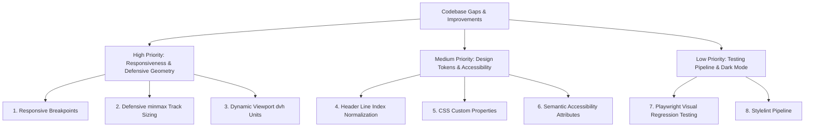

# Architectural Gaps & Prioritized Engineering Roadmap

This document enumerates the architectural gaps, missing production safeguards, and technical enhancements identified during code review, ranked in order of engineering priority with concrete remediation code.



---

## 1. Prioritized Roadmap & Remediation Matrix

| Rank | Gap Description | Current Status in Code | Architectural Risk | Remediation Solution |
| :--- | :--- | :--- | :--- | :--- |
| **1** | **Mobile Responsiveness** | Fixed 4-column layout across all viewports | Layout breaks on mobile screens (<600px); 20% sidebar is unreadable | Add `@media (max-width: 768px)` single-column linear layout |
| **2** | **Defensive Fractional Sizing** | Naked `1fr` tracks in `repeat(3, 1fr)` | Large images or unbreaking strings blowout columns | Wrap tracks in `repeat(3, minmax(0, 1fr))` |
| **3** | **Dynamic Viewport Units** | Uses `min-height: 90vh` | Mobile browser URL bar causes vertical layout shifts | Upgrade to `min-height: 90dvh` |
| **4** | **Line Index Inconsistency** | Header uses `1/5` while Footer uses `1/-1` | Adding columns breaks header spanning | Refactor header to `grid-column: 1/-1` |
| **5** | **Hardcoded Design Values** | Direct values: `red`, `20px`, `white` | Cannot support theming or central token updates | Introduce `:root` CSS custom properties |
| **6** | **Accessibility Semantics** | Placeholder text ("Small box 1") | Poor screen reader experience | Add `aria-label` and meaningful headings (`<h2>`) |
| **7** | **Visual Regression Tests** | No automated tests | Silent layout regressions during styling updates | Integrate Playwright snapshot testing |
| **8** | **SCSS Linting** | No linter configured | Inconsistent formatting or invalid properties | Integrate Stylelint with SCSS ruleset |
| **9** | **Theming & Dark Mode** | Single high-contrast red theme | Eye strain in low-light environments | Add `@media (prefers-color-scheme: dark)` |
| **10** | **Container Queries** | Child elements rely on global viewport | Cards cannot be reused in narrow widgets | Add `container-type: inline-size` |

---

## 2. Concrete Code Fix Implementations

### Fix 1 & 2: Responsive Media Query & Defensive Sizing (`style.scss`)
```scss
// Production-grade responsive refactor
body {
    display: grid;
    grid-template-columns: repeat(3, minmax(0, 1fr)) 20%;
    grid-template-rows: 1fr 2fr 4fr 1fr;
    gap: 20px;
    min-height: 90dvh;
    margin: 30px auto;

    // Mobile Breakpoint (< 768px)
    @media (max-width: 768px) {
        grid-template-columns: 1fr;
        grid-template-rows: auto;
        margin: 15px auto;

        header,
        .small-box-1,
        .small-box-2,
        .small-box-3,
        .sidebar,
        main,
        footer {
            grid-column: 1 / -1;
            grid-row: auto;
        }
    }
}
```

### Fix 4: Header Line Index Normalization
```scss
// Change style.scss Line 20
header {
    grid-column: 1 / -1; // Replaces hardcoded 1/5
}
```

### Fix 5: CSS Design Tokens Architecture
```scss
:root {
    --grid-gap: 20px;
    --grid-bg-surface: #dc2626;
    --grid-text-color: #ffffff;
    --grid-sidebar-width: 20%;
    --grid-min-height: 90dvh;
}

body {
    gap: var(--grid-gap);
    min-height: var(--grid-min-height);

    & > * {
        background-color: var(--grid-bg-surface);
        color: var(--grid-text-color);
    }
}
```
