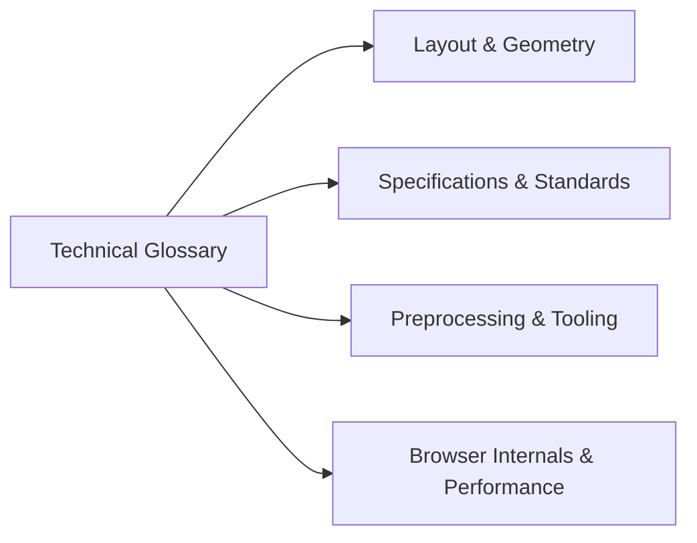

# Technical Glossary & Architectural Terminology

This glossary defines every core concept, CSS specification term, and engineering keyword utilized in the CSS Grid Showcase.

---

## 1. Layout & Geometric Terminology

- **Grid Container:** The direct parent element on which `display: grid` or `display: inline-grid` is declared, establishing a Grid Formatting Context (e.g., `document.body` in this project).
- **Grid Item:** Any direct child element of a grid container that is positioned within the grid tracks.
- **Grid Track:** The generic term for the space between two adjacent grid lines, representing either a single horizontal row or a single vertical column.
- **Grid Line:** The horizontal and vertical dividing lines that separate tracks, numbered from `1` upwards from left-to-right / top-to-bottom, and `-1` backwards from right-to-left / bottom-to-top.
- **Grid Cell:** The single intersection of one row track and one column track (the atomic unit of the grid).
- **Grid Area:** The rectangular space bounded by four grid lines, which can span one or multiple cells across rows and columns (e.g., `.sidebar` spanning 2 rows and 1 column).
- **Fractional Unit (`fr`):** A flexible CSS unit representing a fraction of the remaining free space in the grid container after fixed lengths, percentages, and gaps are subtracted.
- **Gap (Gutter):** The spacing between grid tracks declared via `gap`, `row-gap`, or `column-gap`, which is applied strictly between cells and never at container outer boundaries.
- **Explicit Grid:** The grid tracks defined explicitly in the stylesheet using `grid-template-columns` and `grid-template-rows`.
- **Implicit Grid:** Additional tracks generated automatically by the browser's auto-placement algorithm when elements are positioned outside explicit track bounds.
- **Negative Line Indexing:** The syntax where `-1` targets the trailing edge of the explicit grid, allowing full-width spanning (e.g., `grid-column: 1 / -1`).

---

## 2. Browser Engine & Rendering Terminology

- **Grid Formatting Context (GFC):** The independent layout environment created on an element when `display: grid` is applied.
- **Blink / LayoutNG:** Chromium's modern layout engine responsible for computing layout geometry, track sizing, and reflow algorithms.
- **DOM (Document Object Model):** The in-memory tree representation of the parsed HTML document.
- **CSSOM (CSS Object Model):** The in-memory tree representation of the parsed stylesheet rules and cascaded values.
- **Render Tree:** The unified tree combining visible DOM nodes and computed CSS styles used to perform layout passes.
- **Reflow (Layout):** The browser calculation that determines the exact pixel positions, widths, and heights of every element.
- **Repaint (Paint):** The process of filling in visual pixels (colors, borders, text, shadows) into display lists.
- **Compositing:** The GPU process of drawing individual rendered layers onto the physical screen buffer.
- **Critical Rendering Path (CRP):** The sequential pipeline of operations the browser executes between receiving HTML and rendering the first frame.
- **CLS (Cumulative Layout Shift):** A Core Web Vital measuring unexpected layout shifts during page lifecycle (target < 0.1).

---

## 3. Preprocessing, Tooling & Standards

- **Sass (SCSS):** Syntactically Awesome Style Sheets, a CSS preprocessor supporting nesting, variables, mixins, and modular architecture.
- **Parent Selector (`&`):** A Sass operator that references the outer enclosing selector, used here for BEM suffix concatenation (`&-1`).
- **Source Map (v3):** A standardized JSON file that maps compiled CSS declarations back to original SCSS source code lines for browser DevTools debugging.
- **Semantic HTML5:** Using markup elements according to their intended document meaning (`<header>`, `<main>`, `<footer>`) to promote accessibility and SEO.
- **BEM (Block Element Modifier):** A frontend CSS naming convention designed to ensure modularity and prevent selector specificity escalation.
- **ETag (Entity Tag):** An HTTP response header providing a content hash used for cache validation (`304 Not Modified`).
- **Anycast CDN:** A global content delivery network architecture where multiple geographically distributed edge servers share a single IP address.
