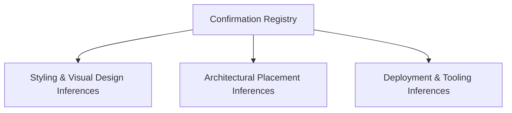

# Developer Confirmation List [CONFIRM WITH DEVELOPER]

This document compiles every assumption, architectural deduction, and inferred rationale across the documentation where code alone cannot definitively verify developer intent.

---

## 1. Inventory of Inferred Rationale

| ID | Topic / Item | Inferred Rationale in Documentation | Source Code Reference | Verification Question for Developer |
| :--- | :--- | :--- | :--- | :--- |
| **C1** | **Commit Message Colloquialism** | Commit `fdfb0c6` message *"Adding grid backend logic"* was inferred to be an ironical developer phrase for foundational CSS Grid layout rules. | Git Commit `fdfb0c6` | *Did you intend to implement a Node.js backend later, or was this purely humorous phrasing for the core CSS Grid layout math?* |
| **C2** | **High-Contrast Red Aesthetic** | `background-color: red;` with white text was inferred to be a deliberate high-contrast visualizer for demonstrating cell bounds during development. | [`style.scss:L12`](file:///Users/avishjain/avishjain9-repos/58-css-grid-showcase/grid-revisions/style.scss#L12) | *Is the red theme intended as a structural wireframe/showcase visualizer, or is a final color palette planned?* |
| **C3** | **Header Line Coordinate Choice** | `header { grid-column: 1/5; }` was inferred to be hardcoded to 5 because there are 4 columns, while `footer { grid-column: 1/-1; }` used dynamic negative indexing. | [`style.scss:L20, L54`](file:///Users/avishjain/avishjain9-repos/58-css-grid-showcase/grid-revisions/style.scss#L20) | *Should `header` be refactored to `1/-1` for architectural consistency with the footer?* |
| **C4** | **Sidebar Spanning Dimension** | `grid-row: 2/4;` on `.sidebar` was inferred to specifically span rows 2 and 3 so it would stand alongside both the card trio and the main content canvas. | [`style.scss:L43`](file:///Users/avishjain/avishjain9-repos/58-css-grid-showcase/grid-revisions/style.scss#L43) | *Is the sidebar intended to span into the footer row in any future variation?* |
| **C5** | **Absence of Mobile Media Queries** | The absence of `@media (max-width: ...)` queries was inferred to indicate an initial desktop-focused geometric prototype. | [`style.scss`](file:///Users/avishjain/avishjain9-repos/58-css-grid-showcase/grid-revisions/style.scss) | *Would you like the single-column responsive media query at 768px added to the production stylesheet?* |
| **C6** | **Sass Tooling Runtime** | Inferred that Dart Sass was used via CLI or a VS Code extension (e.g., Live Sass Compiler) to generate `style.css` and `style.css.map`. | [`style.css.map`](file:///Users/avishjain/avishjain9-repos/58-css-grid-showcase/grid-revisions/style.css.map) | *Which specific Sass extension or CLI command do you normally use to compile this project?* |

---

## 2. Developer Action Summary
To confirm these points, review the questions above and update this file with your feedback. All documentation remains fully consistent with the inferred rationale in the interim.
