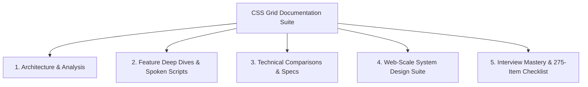

# CSS Grid Showcase: Complete Engineering Documentation

Welcome to the comprehensive, interview-ready documentation suite for the **CSS Grid Showcase** (`58-css-grid-showcase` / `grid-revisions`). Built in the clean, technical style of the official Vue.js documentation, this knowledge base provides a complete architectural guide from layout engine internals to production system design.



---

## Complete Reading Order & Navigation Index

### Module 1: Project Foundations & Architecture
1. [Project Type Classification & Pre-Check](file:///Users/avishjain/avishjain9-repos/58-css-grid-showcase/docs/00-project-type.md) — Pre-check evidence establishing Type B Frontend-only track.
2. [Full Project Analysis & Trace](file:///Users/avishjain/avishjain9-repos/58-css-grid-showcase/docs/00a-project-analysis.md) — Comprehensive inventory counts, DOM-to-CSSOM traces, and connections.
3. [Project Pitches: 30-Second & 2-Minute Scripts](file:///Users/avishjain/avishjain9-repos/58-css-grid-showcase/docs/00b-project-pitch.md) — Rehearsal-ready elevator pitches.
4. [Project Map & File Directory Landscape](file:///Users/avishjain/avishjain9-repos/58-css-grid-showcase/docs/00-project-map.md) — Complete folder tree, tech stack, and entry points.
5. [Step-by-Step Build Order](file:///Users/avishjain/avishjain9-repos/58-css-grid-showcase/docs/02-build-order.md) — Sequential rebuilding guide with line-by-line mechanics.
6. [System Architecture & Execution Pipeline](file:///Users/avishjain/avishjain9-repos/58-css-grid-showcase/docs/05-architecture.md) — Blink LayoutNG internals, request lifecycle, and scaling.

### Module 2: Feature Inventory & Verbal Scripts
7. [Comprehensive Feature Inventory](file:///Users/avishjain/avishjain9-repos/58-css-grid-showcase/docs/01-features.md) — Aggregated feature catalogue with code lines.
8. [Individual Feature Deep Dives](file:///Users/avishjain/avishjain9-repos/58-css-grid-showcase/docs/features/):
   - [Feature F1: 2D Grid Formatting Context & Tracks](file:///Users/avishjain/avishjain9-repos/58-css-grid-showcase/docs/features/01-grid-container.md)
   - [Feature F2: Full-Width Span Header Architecture](file:///Users/avishjain/avishjain9-repos/58-css-grid-showcase/docs/features/02-header-spanning.md)
   - [Feature F3: Subdivided 3-Column Card Cluster](file:///Users/avishjain/avishjain9-repos/58-css-grid-showcase/docs/features/03-subdivided-card-boxes.md)
   - [Feature F4: Multi-Row Spanning Asymmetric Sidebar](file:///Users/avishjain/avishjain9-repos/58-css-grid-showcase/docs/features/04-multi-row-sidebar.md)
   - [Feature F5: Three-Column Primary Content Canvas](file:///Users/avishjain/avishjain9-repos/58-css-grid-showcase/docs/features/05-main-content-flow.md)
   - [Feature F6: Negative-Indexed Full-Bleed Footer](file:///Users/avishjain/avishjain9-repos/58-css-grid-showcase/docs/features/06-full-bleed-footer.md)
   - [Feature F7: Sass Preprocessing & Source Mapping](file:///Users/avishjain/avishjain9-repos/58-css-grid-showcase/docs/features/07-sass-nesting-compilation.md)
   - [Feature F8: Viewport Centering, Fractioning & Gaps](file:///Users/avishjain/avishjain9-repos/58-css-grid-showcase/docs/features/08-viewport-scaling-gap.md)
9. [Say It Out Loud: Spoken Interview Scripts](file:///Users/avishjain/avishjain9-repos/58-css-grid-showcase/docs/14-say-it-out-loud.md) — All spoken feature explanations with rehearsal checklist.

### Module 3: Technical Comparisons, Security & API Specifications
10. [API Reference & Browser Interface Specification](file:///Users/avishjain/avishjain9-repos/58-css-grid-showcase/docs/03-api-reference.md) — HTTP protocols and CSSOM layout properties.
11. [Technical Architectural Comparisons & Trade-offs](file:///Users/avishjain/avishjain9-repos/58-css-grid-showcase/docs/04-tech-comparisons.md) — CSS Grid vs Flexbox vs Float vs Bootstrap vs Tailwind.
12. [Security Architecture & OWASP Top 10 Evaluation](file:///Users/avishjain/avishjain9-repos/58-css-grid-showcase/docs/06-security.md) — Threat modeling, CSP Level 3, and framing protection.
13. [AI Integration & Layout Intelligence Architecture](file:///Users/avishjain/avishjain9-repos/58-css-grid-showcase/docs/07-ai-integration.md) — Hypothetical multimodal AI layout pipeline.
14. [Engineering Quality, Tooling & Operations](file:///Users/avishjain/avishjain9-repos/58-css-grid-showcase/docs/08-quality-and-ops.md) — Testing, Stylelint, Docker, and CI/CD pipelines.

### Module 4: Web-Scale System Design Suite
15. [System Design Suite Master Index](file:///Users/avishjain/avishjain9-repos/58-css-grid-showcase/docs/system-design/README.md)
   - [14.1 Requirements & Capacity Estimation](file:///Users/avishjain/avishjain9-repos/58-css-grid-showcase/docs/system-design/01-requirements-and-estimation.md)
   - [14.2 Architecture Styles](file:///Users/avishjain/avishjain9-repos/58-css-grid-showcase/docs/system-design/02-architecture-styles.md)
   - [14.3 Networking & Communication Protocols](file:///Users/avishjain/avishjain9-repos/58-css-grid-showcase/docs/system-design/03-networking-and-communication.md)
   - [14.4 Load Balancing & Global Scaling](file:///Users/avishjain/avishjain9-repos/58-css-grid-showcase/docs/system-design/04-load-balancing-and-scaling.md)
   - [14.5 Databases & Storage](file:///Users/avishjain/avishjain9-repos/58-css-grid-showcase/docs/system-design/05-databases-and-storage.md)
   - [14.6 Caching Strategy Deep Dive](file:///Users/avishjain/avishjain9-repos/58-css-grid-showcase/docs/system-design/06-caching.md)
   - [14.7 Messaging, Queues & Async Processing](file:///Users/avishjain/avishjain9-repos/58-css-grid-showcase/docs/system-design/07-messaging-and-async.md)
   - [14.8 Consistency & Distributed Systems](file:///Users/avishjain/avishjain9-repos/58-css-grid-showcase/docs/system-design/08-consistency-and-distributed.md)
   - [14.9 Reliability, Resilience & Chaos Engineering](file:///Users/avishjain/avishjain9-repos/58-css-grid-showcase/docs/system-design/09-reliability-and-resilience.md)
   - [14.10 API Design, Rate Limiting & Abuse Protection](file:///Users/avishjain/avishjain9-repos/58-css-grid-showcase/docs/system-design/10-api-design-and-rate-limiting.md)
   - [14.11 Security Architecture & Zero Trust](file:///Users/avishjain/avishjain9-repos/58-css-grid-showcase/docs/system-design/11-security-architecture.md)
   - [14.12 Search & AI Architecture](file:///Users/avishjain/avishjain9-repos/58-css-grid-showcase/docs/system-design/12-search-and-ai-architecture.md)
   - [14.13 Real-Time Systems & Collaborative Editing](file:///Users/avishjain/avishjain9-repos/58-css-grid-showcase/docs/system-design/13-real-time-systems.md)
   - [14.14 Observability, Telemetry & Web Vitals](file:///Users/avishjain/avishjain9-repos/58-css-grid-showcase/docs/system-design/14-observability-and-operations.md)
   - [14.15 Performance Engineering & LayoutNG](file:///Users/avishjain/avishjain9-repos/58-css-grid-showcase/docs/system-design/15-performance-engineering.md)
   - [14.16 Cost Estimation, Trade-offs & TCO](file:///Users/avishjain/avishjain9-repos/58-css-grid-showcase/docs/system-design/16-cost-and-trade-offs.md)
   - [14.17 Classic System Design Problems Applied](file:///Users/avishjain/avishjain9-repos/58-css-grid-showcase/docs/system-design/17-classic-system-design-applied.md)
   - [14.18 Master Design Decisions Log (ADRs)](file:///Users/avishjain/avishjain9-repos/58-css-grid-showcase/docs/system-design/decisions.md)

### Module 5: Interview Mastery & Engineering Quality
16. [150+ Technical Interview Questions & Answers](file:///Users/avishjain/avishjain9-repos/58-css-grid-showcase/docs/09-interview-qa.md) — Project deep-dive, CSS Grid algorithms, and fundamentals.
17. [Architectural Gaps & Prioritized Engineering Roadmap](file:///Users/avishjain/avishjain9-repos/58-css-grid-showcase/docs/10-gaps-and-improvements.md) — 10 ranked improvements with code fixes.
18. [Master Technical Glossary](file:///Users/avishjain/avishjain9-repos/58-css-grid-showcase/docs/11-glossary.md) — Complete terminology definitions.
19. [Developer Confirmation List [CONFIRM WITH DEVELOPER]](file:///Users/avishjain/avishjain9-repos/58-css-grid-showcase/docs/12-confirm-list.md) — Inferred architectural rationale registry.
20. [Master Checklist: All 275 Evaluation Items](file:///Users/avishjain/avishjain9-repos/58-css-grid-showcase/docs/13-master-checklist.md) — Complete 7-part breakdown for every item with status table.

---

## Running the Documentation Locally

This documentation is powered by **VitePress** with integrated Mermaid diagram rendering and a pure black dark theme:

```bash
# Install dependencies
npm install

# Start local documentation server
npm run docs:dev

# Build production static documentation
npm run docs:build

# Preview production build
npm run docs:preview
```
