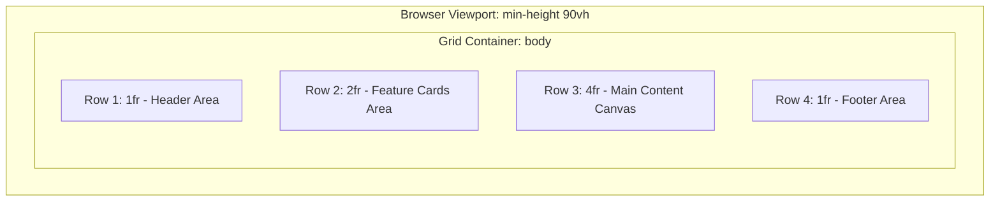

# Feature F1: Two-Dimensional Grid Formatting Context & Track Geometry

## 1. Overview & User-Facing Behavior
Feature F1 establishes the foundational two-dimensional layout matrix on the `<body>` element. It configures a 4-column by 4-row grid where the first three columns share flexible space equally via fractional units (`1fr`), while the fourth column reserves a fixed 20% width for the sidebar. Vertically, it apportions space across four distinct row tracks (`1fr 2fr 4fr 1fr`).



---

## 2. Source Code Implementation & Declarations

- **Source Files:**
  - [`grid-revisions/style.scss:L1-L8`](file:///Users/avishjain/avishjain9-repos/58-css-grid-showcase/grid-revisions/style.scss#L1-L8)
  - [`grid-revisions/style.css:L1-L8`](file:///Users/avishjain/avishjain9-repos/58-css-grid-showcase/grid-revisions/style.css#L1-L8)
  - [`grid-revisions/index.html:L12-L22`](file:///Users/avishjain/avishjain9-repos/58-css-grid-showcase/grid-revisions/index.html#L12-L22)

```scss
// style.scss Line 1-8
body {
    display: grid;
    grid-template-columns: repeat(3, 1fr) 20%;
    grid-template-rows: 1fr 2fr 4fr 1fr;
    gap: 20px;
    min-height: 90vh;
    margin: 30px auto;
}
```

---

## 3. Detailed Algorithmic Execution & Mathematical Resolution

### Column Track Sizing Formula
1. Total available width $W_{\text{container}}$ is determined by `document.body` content box.
2. Gaps deduction: $3 \times 20\text{px} = 60\text{px}$.
3. Fixed percentage column deduction: $0.20 \times W_{\text{container}}$.
4. Remaining flexible width: $W_{\text{flex}} = W_{\text{container}} - 60\text{px} - (0.20 \times W_{\text{container}})$.
5. Each fractional column width: $W_{\text{col}} = W_{\text{flex}} / 3$.

### Row Track Sizing Formula
1. Viewport constraint: `min-height: 90vh`.
2. Total vertical gap: $3 \times 20\text{px} = 60\text{px}$.
3. Flexible vertical space: $H_{\text{flex}} = \max(90\text{vh}, H_{\text{content}}) - 60\text{px}$.
4. Sum of row flex factors: $1 + 2 + 4 + 1 = 8\text{fr}$.
5. Row allocations: Row 1 = $1/8$, Row 2 = $2/8$, Row 3 = $4/8$, Row 4 = $1/8$ of $H_{\text{flex}}$.

---

## 4. Edge Cases, Performance & Security

- **Edge Cases:** If viewport width is reduced below $300\text{px}$, columns shrink proportionally. If content inside any cell exceeds its track size, the track expands beyond the fraction unless bounded by `minmax(0, 1fr)`.
- **Performance:** Native CSS Grid execution within Blink's LayoutNG engine runs in $O(N)$ where $N$ is the number of grid items (7 in this project). No JavaScript layout thrashing occurs.
- **Security:** Pure styling declarations with zero user input execution risk.

---

## 5. Say It Out Loud (Spoken Interview Script)

I built the foundational grid container right on the body tag to establish a unified two-dimensional layout for the entire page. When the browser renders the page, it reads the display grid rule and creates a four-column by four-row grid matrix. For the columns, I combined fractional units and a percentage by writing repeat three one-fr followed by twenty percent. This tells the browser to set aside twenty percent for the right-hand sidebar, subtract the twenty-pixel gaps, and divide all remaining horizontal space equally among the first three columns. For the rows, I used a one-fr, two-fr, four-fr, one-fr progression constrained by a ninety-vh minimum height, which gives the main content area twice the vertical height of the feature cards and four times the height of the header. I chose this native CSS Grid approach over Flexbox because Flexbox is strictly one-dimensional, so coordinating matching widths across separate rows would have forced me to wrap elements in artificial row containers. If this fails in a legacy browser without grid support, the elements simply fall back to normal document block flow. One limitation is that fractional units can expand unexpectedly if an image or long string overflows its cell, which I would improve in production by using minmax zero comma one-fr for defensive sizing.
