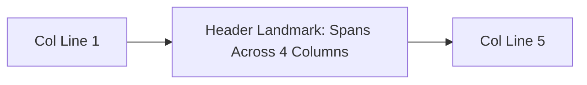
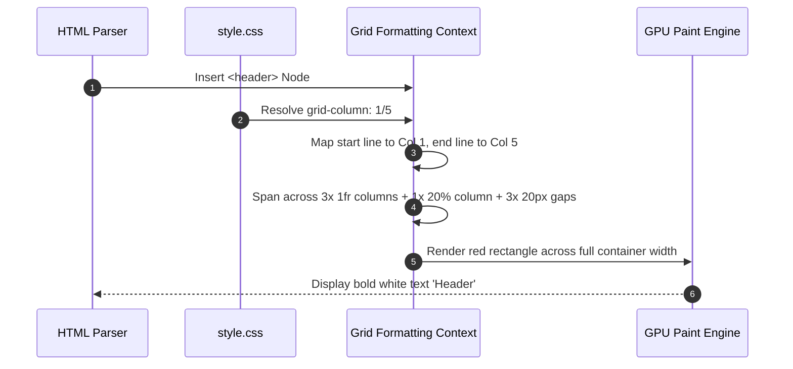

# Feature F2: Full-Width Span Header Architecture

## 1. Overview & User-Facing Behavior
Feature F2 governs the `<header>` landmark. It anchors the top of the interface, spanning completely across all four column tracks from Column Grid Line 1 to Column Grid Line 5. It renders a solid red banner displaying bold white text reading "Header".



---

## 2. Source Code Implementation & Declarations

- **Source Files:**
  - [`grid-revisions/index.html:L13`](file:///Users/avishjain/avishjain9-repos/58-css-grid-showcase/grid-revisions/index.html#L13)
  - [`grid-revisions/style.scss:L18-L21`](file:///Users/avishjain/avishjain9-repos/58-css-grid-showcase/grid-revisions/style.scss#L18-L21)
  - [`grid-revisions/style.css:L14-L16`](file:///Users/avishjain/avishjain9-repos/58-css-grid-showcase/grid-revisions/style.css#L14-L16)

```scss
// style.scss Line 18-21
header {
    grid-column: 1/5;
}
```

---

## 3. Algorithmic Execution & Line Resolution



---

## 4. Edge Cases, Performance & Security
- **Explicit vs Negative Spanning:** The rule uses explicit line numbers `1/5`. If a fifth column track were appended to `grid-template-columns`, the header would terminate before the new column. Replacing `1/5` with `1/-1` makes the spanning resilient to dynamic track additions.
- **Accessibility:** Uses native HTML5 `<header>` landmark, exposing the appropriate accessibility role to screen readers without requiring ARIA overrides.

---

## 5. Say It Out Loud (Spoken Interview Script)

I implemented the header using the semantic HTML5 header element and pinned it across the top of the layout with grid-column one slash five. When the layout engine runs, it anchors the header at column line one on the far left and stretches it continuously through line five on the far right, covering all three flexible columns and the twenty percent sidebar column. I chose explicit grid line spanning over traditional full-width block positioning or absolute positioning because it keeps the header directly inside the grid formatting context, ensuring that its height automatically informs row track calculations. If this rule were removed, the header would default to occupying only the first one-fr column cell. One limitation is that using the hardcoded line number five means that if we dynamically add a fifth column track later, the header will stop short, so in a future revision I would change this to one slash minus one to always span to the true trailing edge.
