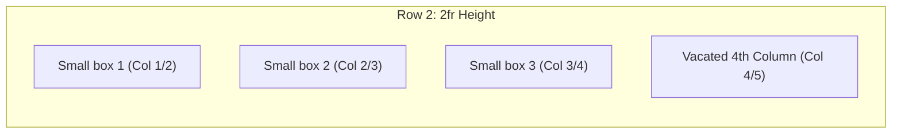

# Feature F3: Subdivided 3-Column Card Cluster

## 1. Overview & User-Facing Behavior
Feature F3 positions three distinct card containers (`Small box 1`, `Small box 2`, `Small box 3`) in a horizontal trio across Row 2. Each card is locked into an individual $1\text{fr}$ column track, leaving the fourth column ($20\%$) open for the sidebar.



---

## 2. Source Code Implementation & Declarations

- **Source Files:**
  - [`grid-revisions/index.html:L14-L16`](file:///Users/avishjain/avishjain9-repos/58-css-grid-showcase/grid-revisions/index.html#L14-L16)
  - [`grid-revisions/style.scss:L23-L39`](file:///Users/avishjain/avishjain9-repos/58-css-grid-showcase/grid-revisions/style.scss#L23-L39)
  - [`grid-revisions/style.css:L17-L25`](file:///Users/avishjain/avishjain9-repos/58-css-grid-showcase/grid-revisions/style.css#L17-L25)

```scss
// style.scss Line 23-39
.small-box {
    &-1 {
        grid-column: 1/2;
    }
    &-2 {
        grid-column: 2/3;
    }
    &-3 {
        grid-column: 3/4;
    }
}
```

---

## 3. Algorithmic Execution & Line Resolution

Each card explicitly declares its start and end column line index:
- `small-box-1`: Column line 1 to 2 (Width = $W_{\text{col}}$)
- `small-box-2`: Column line 2 to 3 (Width = $W_{\text{col}}$)
- `small-box-3`: Column line 3 to 4 (Width = $W_{\text{col}}$)

Since no `grid-row` is explicitly declared, the CSS Grid auto-placement algorithm packs them sequentially into Row 2 (the next available row after the header in Row 1).

---

## 4. Edge Cases, Performance & Security
- **BEM Selector Synthesis:** The SCSS parent selector `&` concatenates with `-1`, `-2`, `-3` to compile to `.small-box-1`, `.small-box-2`, `.small-box-3`.
- **Auto-Placement Alternative:** Because these three items appear sequentially in the DOM after the header, CSS Grid's dense auto-placement algorithm would have placed them into columns 1, 2, and 3 automatically without requiring individual line declarations. However, explicit line assignment guarantees their spatial coordinates even if DOM order is changed.

---

## 5. Say It Out Loud (Spoken Interview Script)

I created three feature cards that sit side by side in row two by using explicit column line declarations. In the HTML, they share a base class called small-box along with numeric modifier classes. In the Sass file, I nested hyphen-one, hyphen-two, and hyphen-three under small-box using the ampersand parent selector, mapping them to grid-column one slash two, two slash three, and three slash four. When the browser renders row two, it puts each card into its own flexible fractional column while leaving column four open. I used explicit line placement instead of relying solely on auto-placement so that each card remains locked to its intended grid coordinate even if the DOM ordering is altered or an editor rearranges elements. If a card's content expands vertically, the entire row track grows uniformly to maintain visual alignment across all three boxes. One limitation is that writing separate modifier classes for every single box doesn't scale if we have ten or twenty dynamic items, so in a real-world application I would leverage CSS Grid auto-flow with repeat auto-fit to dynamically handle arbitrary card collections.
