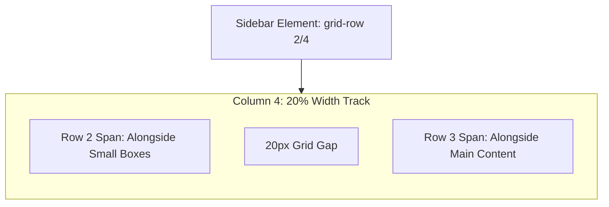
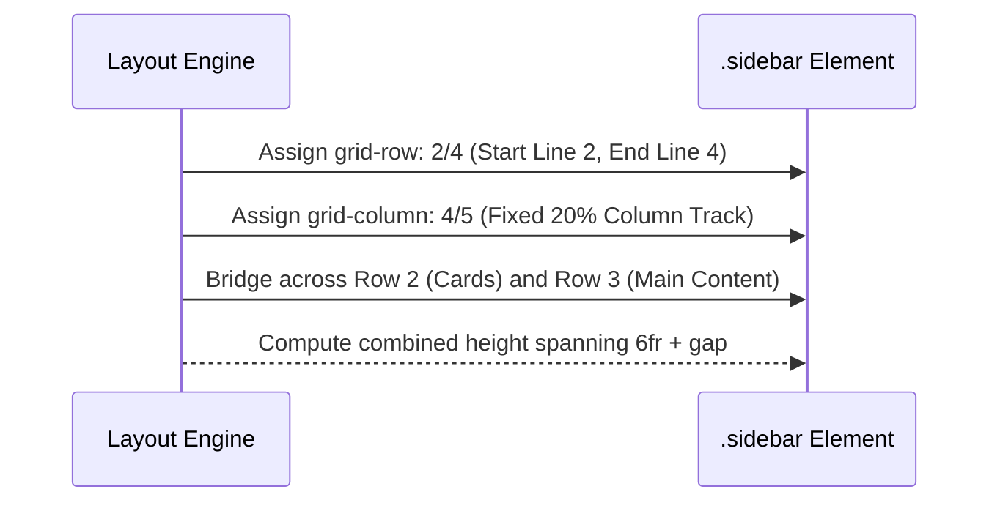

# Feature F4: Multi-Row Spanning Asymmetric Sidebar

## 1. Overview & User-Facing Behavior
Feature F4 is the defining architectural showcase of the layout: an asymmetric sidebar that spans across two distinct vertical rows (Row 2 and Row 3) while occupying the rightmost 20% column track (Column Line 4 to 5). It stands alongside the small boxes at the top and the main content area at the bottom.



---

## 2. Source Code Implementation & Declarations

- **Source Files:**
  - [`grid-revisions/index.html:L17`](file:///Users/avishjain/avishjain9-repos/58-css-grid-showcase/grid-revisions/index.html#L17)
  - [`grid-revisions/style.scss:L41-L45`](file:///Users/avishjain/avishjain9-repos/58-css-grid-showcase/grid-revisions/style.scss#L41-L45)
  - [`grid-revisions/style.css:L26-L29`](file:///Users/avishjain/avishjain9-repos/58-css-grid-showcase/grid-revisions/style.css#L26-L29)

```scss
// style.scss Line 41-45
.sidebar {
    grid-row: 2/4;
    grid-column: 4/5;
}
```

---

## 3. Algorithmic Execution & Height Spanning Formula

### Vertical Dimension Resolution
The height of the `.sidebar` element spans Row 2 ($2\text{fr}$ height), the intervening $20\text{px}$ row gap, and Row 3 ($4\text{fr}$ height):
$$H_{\text{sidebar}} = H_{\text{row2}} + H_{\text{gap}} + H_{\text{row3}}$$
Given container flex height $H_{\text{flex}}$, with $8\text{fr}$ total row tracks:
- Row 2 = $2/8 \times H_{\text{flex}} = 0.25 \times H_{\text{flex}}$
- Row 3 = $4/8 \times H_{\text{flex}} = 0.50 \times H_{\text{flex}}$
- Sidebar Total Vertical Span = $0.75 \times H_{\text{flex}} + 20\text{px}$



---

## 4. Edge Cases, Performance & Security
- **Flexbox Inability:** In a pure Flexbox model, creating this layout requires wrapping cards and main content into a left-hand flex container while placing the sidebar in a right-hand container. CSS Grid accomplishes this without any intermediate grouping elements.
- **Content Overflow:** If content inside the sidebar exceeds $H_{\text{sidebar}}$, the browser expands Rows 2 and 3 proportionally, affecting the vertical dimensions of both the small boxes and the main canvas.

---

## 5. Say It Out Loud (Spoken Interview Script)

I implemented the sidebar as a true multi-row spanning element to highlight the power of two-dimensional grid layouts. In the CSS, I gave the sidebar class two properties: grid-row two slash four and grid-column four slash five. This positions the sidebar in the fourth column—which has a dedicated twenty percent track width—and stretches it vertically from row line two down to row line four. That means the sidebar seamlessly spans across the two-fr card row, crosses the twenty-pixel row gutter, and extends all the way through the four-fr main content row. Achieving this layout in Flexbox would have forced me to corrupt the semantic HTML tree by adding an artificial outer wrapper around the cards and main content to separate them from the sidebar. With CSS Grid, every section remains a flat, direct child of the body tag, keeping the DOM lean and accessible. If the sidebar receives extra content, the browser naturally recalculates both row heights while maintaining visual harmony. One limitation is that on narrow mobile viewports, keeping the sidebar at twenty percent makes it unreadable, so for responsive devices I would write a media query that stacks it as a full-width block below the main content.
