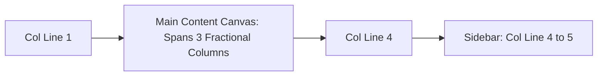
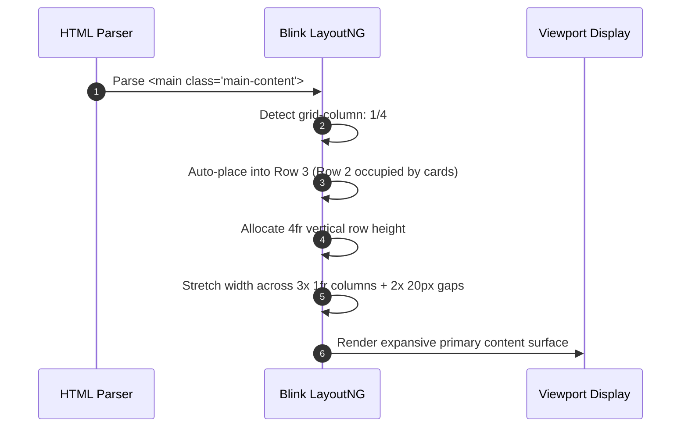

# Feature F5: Three-Column Primary Content Canvas

## 1. Overview & User-Facing Behavior
Feature F5 governs the primary content surface `<main class="main-content">`. It occupies Row 3 (the tallest row track, allocated $4\text{fr}$ vertical height) and spans horizontally across the first three fractional columns (Column Line 1 to 4), sitting immediately adjacent to the lower half of the vertical sidebar.



---

## 2. Source Code Implementation & Declarations

- **Source Files:**
  - [`grid-revisions/index.html:L18-L20`](file:///Users/avishjain/avishjain9-repos/58-css-grid-showcase/grid-revisions/index.html#L18-L20)
  - [`grid-revisions/style.scss:L47-L50`](file:///Users/avishjain/avishjain9-repos/58-css-grid-showcase/grid-revisions/style.scss#L47-L50)
  - [`grid-revisions/style.css:L30-L32`](file:///Users/avishjain/avishjain9-repos/58-css-grid-showcase/grid-revisions/style.css#L30-L32)

```scss
// style.scss Line 47-50
main {
    grid-column: 1/4;
}
```

---

## 3. Algorithmic Execution & Line Resolution



---

## 4. Edge Cases, Performance & Security
- **Semantic Landmark:** The `<main>` tag informs assistive technologies of the central document topic, fulfilling WCAG 2.1 landmark navigation criteria.
- **Auto-Placement Synchronization:** Because `.sidebar` explicitly claimed row span `2/4` and column `4/5`, column tracks 1, 2, and 3 in Row 3 remained vacant. The layout engine auto-places `<main>` into Row 3 directly across those three available tracks.

---

## 5. Say It Out Loud (Spoken Interview Script)

I structured the primary content area using the HTML5 main element and styled it to span from column line one to column line four. Because row three is defined with a four-fr height in the grid container, the main content area naturally receives the largest visual presence on the screen—twice the height of the card row and four times the height of the header or footer. It stretches across all three flexible columns while neatly stopping at line four to leave room for the sidebar. I chose this approach because the browser's layout engine automatically figures out that row three is the next available vertical slot after the cards, perfectly coordinating with the multi-row sidebar. If this rule were absent, the main element would collapse into just the first column, leaving columns two and three empty. One limitation is that a broad three-column span can cause text lines to stretch too wide for comfortable reading on high-resolution monitors, which I would address by adding a max-width constraint or introducing an internal multi-column layout.
