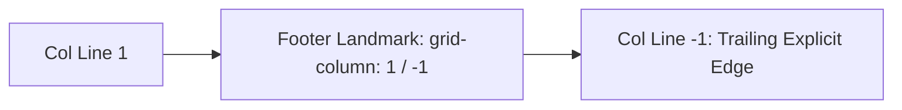
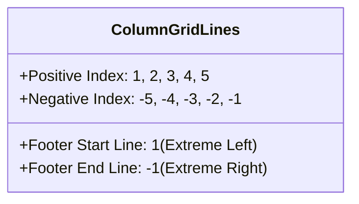

# Feature F6: Negative-Indexed Full-Bleed Footer

## 1. Overview & User-Facing Behavior
Feature F6 governs the `<footer>` element, positioning it across Row 4 at the base of the viewport. It implements negative line indexing (`grid-column: 1/-1`) to stretch from the first column line all the way to the final explicit column grid line, providing a visual baseline for the application.



---

## 2. Source Code Implementation & Declarations

- **Source Files:**
  - [`grid-revisions/index.html:L21`](file:///Users/avishjain/avishjain9-repos/58-css-grid-showcase/grid-revisions/index.html#L21)
  - [`grid-revisions/style.scss:L52-L55`](file:///Users/avishjain/avishjain9-repos/58-css-grid-showcase/grid-revisions/style.scss#L52-L55)
  - [`grid-revisions/style.css:L33-L35`](file:///Users/avishjain/avishjain9-repos/58-css-grid-showcase/grid-revisions/style.css#L33-L35)

```scss
// style.scss Line 52-55
footer {
    grid-column: 1/-1;
}
```

---

## 3. Algorithmic Execution & Negative Line Indexing

In the CSS Grid Level 1 specification, grid lines are indexed both positively from left-to-right (`1, 2, 3, 4, 5`) and negatively from right-to-left (`-1, -2, -3, -4, -5`).



By referencing `-1`, the layout engine dynamically resolves the terminal edge of the explicit grid. If an engineer later expands the grid from 4 columns to 6 or 12 columns, `1/-1` guarantees the footer continues to span the full width without stylesheet refactoring.

---

## 4. Edge Cases, Performance & Security
- **Explicit vs Implicit Grid Restriction:** In CSS Grid Level 1, negative line numbers only refer to the lines of the *explicit* grid defined by `grid-template-columns`. If auto-placed items create *implicit* tracks beyond the explicit grid, `-1` still terminates at the end of the explicit definition. Here, since all tracks are explicit, `-1` guarantees edge-to-edge coverage.

---

## 5. Say It Out Loud (Spoken Interview Script)

I implemented the footer at the bottom of the page and used negative line indexing by setting grid-column to one slash minus one. The minus-one syntax is a powerful CSS Grid feature that refers to the very last line of the explicit grid from the right, which in our four-column layout resolves to column line five. When the browser places the footer in row four, it automatically stretches it across all three fractional columns, the sidebar column, and all intermediate gaps. I intentionally used one slash minus one instead of hardcoding one slash five because it makes the layout future-proof; if we ever redesign the grid to use six or twelve columns, the footer will automatically continue spanning the entire width without touching its CSS rule. If this rule were removed, the footer would only occupy the first one-fr slot on the bottom left. One limitation with negative indices is that they only target the explicit grid and do not automatically cover implicit tracks if elements are pushed outward, which I keep in mind when designing dynamic content layouts.
