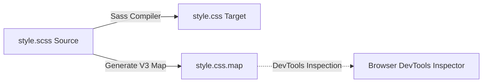

# Feature F7: Sass Preprocessing, BEM-like Nesting & Source Mapping

## 1. Overview & Developer-Facing Behavior
Feature F7 encapsulates the build-time authoring and preprocessing pipeline. Using Sass (SCSS), the developer leverages parent selector concatenation (`&`), direct descendant selectors (`&>*`), and nested modifiers to produce clean, maintainable, modular CSS accompanied by a version 3 source map for seamless browser DevTools inspection.



---

## 2. Source Code Implementation & Declarations

- **Source Files:**
  - [`grid-revisions/style.scss`](file:///Users/avishjain/avishjain9-repos/58-css-grid-showcase/grid-revisions/style.scss)
  - [`grid-revisions/style.css`](file:///Users/avishjain/avishjain9-repos/58-css-grid-showcase/grid-revisions/style.css)
  - [`grid-revisions/style.css.map`](file:///Users/avishjain/avishjain9-repos/58-css-grid-showcase/grid-revisions/style.css.map)

```scss
// style.scss Line 23-39: Parent Selector Concatenation
.small-box {
    &-1 { grid-column: 1/2; }
    &-2 { grid-column: 2/3; }
    &-3 { grid-column: 3/4; }
}
```

Compiles directly to standard CSS3:
```css
/* style.css Line 17-25 */
body .small-box-1 { grid-column: 1/2; }
body .small-box-2 { grid-column: 2/3; }
body .small-box-3 { grid-column: 3/4; }
```

---

## 3. Source Map v3 Architecture

[`grid-revisions/style.css.map`](file:///Users/avishjain/avishjain9-repos/58-css-grid-showcase/grid-revisions/style.css.map) is encoded in standard v3 JSON:
```json
{
  "version": 3,
  "sourceRoot": "",
  "sources": ["style.scss"],
  "names": [],
  "mappings": "AAAA;EAEI;EACA;...",
  "file": "style.css"
}
```
Line 37 of `style.css` contains:
```css
/*# sourceMappingURL=style.css.map */
```
This enables browser DevTools to display lines from `style.scss` rather than compiled CSS during DOM element inspection.

---

## 4. Edge Cases, Performance & Security
- **Specificity Escalation:** Because all selectors are nested inside `body { ... }` in SCSS, the compiler prepends `body` to each selector (e.g., `body header`, `body .sidebar`), elevating their CSS specificity from $(0, 0, 1)$ to $(0, 0, 2)$ or $(0, 1, 1)$. In larger codebases, over-nesting increases specificity unnecessarily; authoring with class-only selectors avoids this specificity lock.

---

## 5. Say It Out Loud (Spoken Interview Script)

I structured the stylesheet using Sass to keep the layout code organized and maintainable through nesting and parent selector references. In style.scss, I nested the entire layout under the body selector and used the ampersand parent selector to author clean BEM-style modifier classes for small-box hyphen one, two, and three without repeating the base class name. When the Sass compiler processes the file, it generates standard CSS alongside a version three source map file. The source map directive at the bottom of style.css allows browser DevTools to link any inspected element directly back to its original line in style.scss, which makes debugging instant during development. I chose Sass over plain CSS because preprocessors streamline selector authoring and prepare the codebase for design tokens like variables and mixins. If the compiler fails, the browser continues serving the existing style.css without crashing the user interface. One trade-off of wrapping everything inside the body selector in SCSS is that it increases CSS specificity for every rule, so in a larger project I would flatten the selectors to avoid specificity battles.
