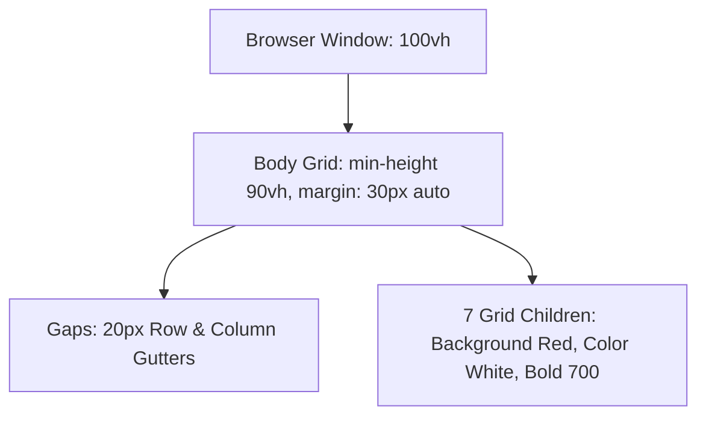

# Feature F8: Viewport Height Centering, Dynamic Track Fractioning & Gap Geometry

## 1. Overview & User-Facing Behavior
Feature F8 establishes the macroscopic viewport proportioning, spacing rhythm, and visual contrast rules. It applies `gap: 20px;`, sets a vertical container threshold of `min-height: 90vh;`, centers the grid horizontally with `margin: 30px auto;`, and applies a high-contrast red background with bold white typography across all direct children.



---

## 2. Source Code Implementation & Declarations

- **Source Files:**
  - [`grid-revisions/style.scss:L6-L16`](file:///Users/avishjain/avishjain9-repos/58-css-grid-showcase/grid-revisions/style.scss#L6-L16)
  - [`grid-revisions/style.css:L5-L13`](file:///Users/avishjain/avishjain9-repos/58-css-grid-showcase/grid-revisions/style.css#L5-L13)

```scss
// style.scss Line 6-16
gap: 20px;
min-height: 90vh;
margin: 30px auto;

&>*
{
    background-color: red;
    font-weight: 700;
    color: white;
}
```

---

## 3. Mathematical Spacing & Box Model Resolution

1. **Horizontal Centering:** `margin: 30px auto;` allocates remaining horizontal margin symmetrically:
   $$\text{Margin}_{\text{left}} = \text{Margin}_{\text{right}} = (W_{\text{viewport}} - W_{\text{container}}) / 2$$
2. **Gap Geometry:** Unlike margin-based grid layouts, the CSS Grid `gap` property applies spacing *exclusively* between tracks and never against container outer perimeters.
   $$\text{Total Column Gap Width} = (N_{\text{cols}} - 1) \times 20\text{px} = (4 - 1) \times 20\text{px} = 60\text{px}$$
   $$\text{Total Row Gap Height} = (N_{\text{rows}} - 1) \times 20\text{px} = (4 - 1) \times 20\text{px} = 60\text{px}$$
3. **Universal Styling:** `& > *` uses the direct child combinator (`>`) with the universal selector (`*`), ensuring child styling rules apply strictly to direct grid items without inadvertently polluting nested subcomponents.

---

## 4. Edge Cases, Performance & Security
- **Mobile Viewport Height (`vh`):** Mobile browser address bars dynamically collapse and expand. On mobile devices, `90vh` may trigger layout recalculations during scrolling. Modern CSS provides `90dvh` (dynamic viewport height) or `90svh` (small viewport height) to eliminate mobile jumpiness.

---

## 5. Say It Out Loud (Spoken Interview Script)

I configured the overall geometry and spacing using gap, viewport units, and universal direct child styling. On the body container, I set a gap of twenty pixels, a min-height of ninety vh, and a margin of thirty pixels auto. Using the modern gap property is a massive improvement over older CSS techniques because it places gutters purely between grid items without creating awkward outer margins that require negative margin container hacks. Setting min-height to ninety vh ensures that even with minimal placeholder text, the layout expansively fills nearly the entire screen while remaining centered by the auto margins. I then used the ampersand greater-than asterisk selector in Sass to give all direct children a solid red background with bold white text, immediately visualizing the structural boundaries of every cell. If a user resizes the browser window, the fractional row tracks dynamically recalculate against the ninety vh target in real time. One limitation is that on mobile browsers with dynamic URL bars, using standard vh units can cause slight height shifts, so in a modern update I would adopt the newer dvh dynamic viewport height unit.
