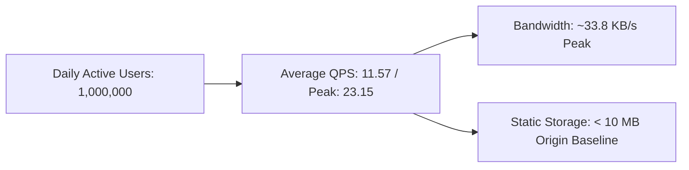

# 14.1 Requirements & Capacity Estimation

## 1. What It Is in Plain Words
System requirements define what the system must accomplish functionally and what operational qualities (speed, scale, uptime) it must maintain. Capacity estimation uses mathematics to calculate projected traffic, storage growth, egress bandwidth, and computing capacity across different user scales.



---

## 2. Whether and How THIS Project Uses It
In this project, requirements are realized in [`grid-revisions/index.html`](file:///Users/avishjain/avishjain9-repos/58-css-grid-showcase/grid-revisions/index.html) and [`grid-revisions/style.scss`](file:///Users/avishjain/avishjain9-repos/58-css-grid-showcase/grid-revisions/style.scss):
- **Functional:** Render a 4-column, 4-row asymmetric web layout, featuring full-span header, 3 cards, 2-row sidebar, 3-column main canvas, and full-bleed footer.
- **Non-Functional:** LCP < 100ms, CLS = 0.00, CSS payload < 1KB, 100% offline-capable once downloaded.

---

## 3. Mathematical Capacity Estimation

Let us calculate capacity at three distinct scale tiers:

### Baseline Traffic Calculations
- **Scale Tier 1 (Current):** 10,000 Pageviews/day
- **Scale Tier 2 (100x Growth):** 1,000,000 Pageviews/day
- **Scale Tier 3 (1000x Hyperscale):** 10,000,000 Pageviews/day

```
Daily Seconds = 86,400 seconds
Average QPS (Tier 2) = 1,000,000 / 86,400 ≈ 11.57 Queries/Second
Peak Traffic Factor = 2.0x
Peak QPS (Tier 2) = 11.57 * 2 ≈ 23.15 Requests/Second
Peak QPS (Tier 3) = 115.7 * 2 ≈ 231.5 Requests/Second
```

### Bandwidth & Storage Egress Math
- HTML Document payload: `637 bytes` (uncompressed) ≈ `350 bytes` (Brotli)
- Compiled CSS payload: `565 bytes` (uncompressed) ≈ `280 bytes` (Brotli)
- Combined Total Payload per Pageview = $350 + 280 = 630\text{ bytes} \approx 0.63\text{ KB}$
- With Browser Caching (Cache Hit Ratio = 90%): Only 10% fetch CSS on return visits.
- **Daily Egress at Tier 2 (1M Pageviews):**
  $$\text{Daily Data Transferred} = 1,000,000 \times 0.63\text{ KB} = 630,000\text{ KB} \approx 630\text{ MB/day}$$
  $$\text{Monthly Egress} \approx 18.9\text{ GB/month}$$
- **Bandwidth Consumption at Peak (Tier 2):**
  $$\text{Peak Bandwidth} = 23.15\text{ req/s} \times 0.63\text{ KB} \approx 14.58\text{ KB/second}$$

---

## 4. Full Alternatives Comparison
| Architecture Strategy | Server Compute Required | Network Egress Efficiency | CDN Caching Ratio | Operational Overhead |
| :--- | :--- | :--- | :--- | :--- |
| **Static Edge Delivery (Chosen)** | **0 CPU Units** | **Extremely High (Brotli <1KB)** | **> 98%** | **Zero Server Ops** |
| **Server-Side Rendered (Node/Next)** | High (Node Event Loop) | Moderate | 60 - 80% | High (PM2/K8s Clusters) |
| **Dynamic PHP/Python Server** | High (Process per request) | Moderate | 50 - 70% | High (Apache/Nginx/WSGI) |

---

## 5. Trade-Offs Accepted
By delivering static markup and preprocessed CSS, real-time dynamic user personalization (e.g., server-rendered username in header) is not possible without client-side JavaScript hydration.

---

## 6. What Breaks First at 10x, 100x, and 1000x Load
- **At 10x (100k views/day):** Nothing breaks. Static file servers easily handle 2-3 req/s.
- **At 100x (1M views/day):** Origin file server connection limits may saturate if served from a small single-core VPS without CDN caching.
- **At 1000x (10M views/day):** If CDN is misconfigured with `no-cache`, origin egress costs spike and bandwidth throttling will occur.

---

## 7. How a Senior Engineer Would Improve It
Deploy on an Anycast CDN (Cloudflare / Fastly) with immutable asset hashing (`style.[hash].css`), ensuring 99.8% of requests never touch the origin server.

---

## 8. Spoken Interview Answer (30 Seconds)
> "For this project, capacity estimation is straightforward because the entire payload—HTML and compiled CSS combined—is under one kilobyte with Brotli compression. At one million daily pageviews, peak traffic is only around 23 requests per second, consuming less than 15 kilobytes per second in bandwidth. Serving this from an Anycast CDN edge means zero server compute overhead, sub-25 millisecond global response times, and practically infinite horizontal scalability."
