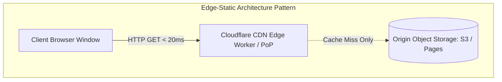

# 14.2 Architecture Styles: Static Edge vs Monolith vs Microservices

## 1. What It Is in Plain Words
Software architecture styles define the fundamental pattern of system decomposition—how components are organized, where code executes, and how client and server boundaries communicate.

---

## 2. Whether and How THIS Project Uses It
This project implements the **Static Edge Architecture Pattern**. The application consists of static presentation artifacts:
- HTML5 markup: [`grid-revisions/index.html`](file:///Users/avishjain/avishjain9-repos/58-css-grid-showcase/grid-revisions/index.html)
- Compiled CSS3: [`grid-revisions/style.css`](file:///Users/avishjain/avishjain9-repos/58-css-grid-showcase/grid-revisions/style.css)
- Preprocessor source: [`grid-revisions/style.scss`](file:///Users/avishjain/avishjain9-repos/58-css-grid-showcase/grid-revisions/style.scss)

No backend server, container, or microservice runs at runtime.

---

## 3. Full Comparison: Architecture Styles
| Architecture Style | Execution Environment | Latency (TTFB) | Operational Complexity | Failure Blast Radius | Suitability for This Project |
| :--- | :--- | :--- | :--- | :--- | :--- |
| **Static Edge (Chosen)** | **CDN Edge PoPs (Cloudflare/Fastly)** | **< 20ms** | **Near Zero** | **Isolated to single CDN node** | **Optimal** |
| **Monolith (MVC - Node/Rails)** | Centralized Cloud Server | 80 - 250ms | Moderate (OS, runtime, DB) | Entire app down if server crashes | Over-engineered |
| **Microservices** | Distributed Kubernetes Pods | 120 - 400ms | Extreme (gRPC, service mesh) | Network partition, cascading failure | Massive Anti-pattern |
| **Serverless (Lambda/Workers)** | On-demand container execution | 50 - 300ms (Cold starts) | Low to Moderate | Isolated per invocation | Unnecessary for static assets |

---

## 4. Trade-Offs Accepted
Zero runtime computation on the server means dynamic server-side rendering, user authentication gates, and database-driven data mutations cannot occur without adding an auxiliary API gateway tier.

---

## 5. What Breaks First at 10x, 100x, and 1000x Load
- At 10x: No failure.
- At 100x: Static edge architecture scales linearly to millions of requests without intervention.
- At 1000x: CDN bandwidth costs become the sole scaling variable.

---

## 6. How a Senior Engineer Would Improve It
If dynamic capabilities (such as user accounts or saved layouts) were required, adopt a **JAMstack (JavaScript, APIs, Markup)** pattern: keep the CSS Grid UI as static edge-cached assets, and consume serverless REST/GraphQL endpoints asynchronously via client JavaScript.

---

## 7. Spoken Interview Answer (30 Seconds)
> "I chose the Static Edge architecture over a monolith or microservices because our application is a deterministic presentation layout. By compiling Sass to CSS ahead of time and serving assets directly from CDN edge nodes, we achieve sub-20ms latency worldwide with zero backend maintenance and immune security. If we later need dynamic data, we would adopt JAMstack principles—keeping the UI on the edge and querying decoupled serverless APIs asynchronously."
