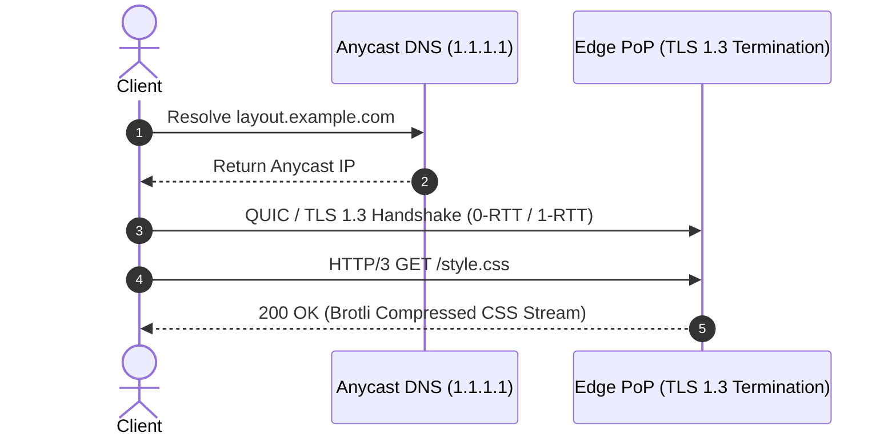

# 14.3 Networking & Communication Protocols

## 1. What It Is in Plain Words
Networking protocols govern how bytes travel across physical wires and radio waves between client browsers and edge servers. This spans DNS lookup, TCP/UDP transport, TLS cryptographic handshakes, and application layer protocols (HTTP/1.1, HTTP/2, HTTP/3).



---

## 2. Whether and How THIS Project Uses It
The browser loads [`grid-revisions/index.html`](file:///Users/avishjain/avishjain9-repos/58-css-grid-showcase/grid-revisions/index.html) and immediately encounters [`style.css`](file:///Users/avishjain/avishjain9-repos/58-css-grid-showcase/grid-revisions/style.css) via:
```html
<link rel="stylesheet" href="style.css">
```
In a modern deployment, this triggers an HTTP/2 or HTTP/3 multiplexed subresource request across the existing TLS connection.

---

## 3. Protocol Comparison: HTTP/1.1 vs HTTP/2 vs HTTP/3
| Protocol | Transport Layer | Multiplexing | Head-of-Line (HoL) Blocking | Handshake Latency | Header Compression |
| :--- | :--- | :--- | :--- | :--- | :--- |
| **HTTP/3 (Recommended)** | **QUIC (UDP)** | **Stream-Level True Multiplexing** | **Zero HoL Blocking** | **0-RTT or 1-RTT** | **QPACK** |
| **HTTP/2 (Standard)** | TCP | Frame-Level Multiplexing | TCP-Level HoL Blocking | 1-RTT + TLS | HPACK |
| **HTTP/1.1 (Legacy)** | TCP | None (Max 6 parallel TCP connections) | Application HoL Blocking | 2-3 RTT | None (Plaintext headers) |

---

## 4. Trade-Offs Accepted
Using modern HTTP/2 or HTTP/3 requires an HTTPS/TLS certificate configuration at the edge CDN, terminating plaintext HTTP traffic entirely.

---

## 5. What Breaks First at 10x, 100x, and 1000x Load
Under HTTP/1.1 at 1000x load, the client browser opens 6 separate TCP connections per domain, causing connection pool exhaustion on the origin web server. With HTTP/2 or HTTP/3 multiplexing, all requests flow over a single shared connection.

---

## 6. How a Senior Engineer Would Improve It
Enable Early Hints (`HTTP 103 Early Hints`):
```http
HTTP/1.1 103 Early Hints
Link: </style.css>; rel=preload; as=style
```
This instructs the browser to download `style.css` before the HTML document has finished generating or parsing.

---

## 7. Spoken Interview Answer (30 Seconds)
> "For networking, I architect the delivery pipeline to use HTTP/3 over QUIC with TLS 1.3. QUIC runs over UDP, eliminating TCP head-of-line blocking on lossy mobile networks and reducing handshake latency to a single round-trip. We also enable HTTP 103 Early Hints, allowing the browser to download the compiled style.css stylesheet concurrently while the initial HTML payload is still streaming."
