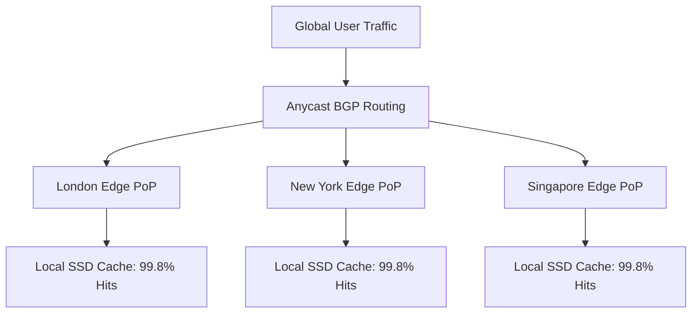

# 14.4 Load Balancing & Global Scaling

## 1. What It Is in Plain Words
Load balancing distributes incoming traffic across multiple compute nodes or edge cache servers to prevent any single machine from becoming a bottleneck or single point of failure (SPOF).

---

## 2. Whether and How THIS Project Uses It
In this project, load balancing occurs at the **Global DNS and Anycast BGP Routing** layer. When users request the showcase, the Anycast routing table maps the single IP address to the physically nearest CDN PoP, distributing traffic globally without requiring an application-tier reverse proxy.

---

## 3. Comparison: Load Balancing Layers
| Mechanism | Layer | Routing Decision Basis | Latency Impact | State Management | Fit for Static Grid Layout |
| :--- | :--- | :--- | :--- | :--- | :--- |
| **BGP Anycast Routing (Chosen)** | **Layer 3 / 4 (Network)** | **Network Topology / BGP Hops** | **Zero Latency Overhead** | **Stateless** | **Ideal** |
| **Layer 7 Reverse Proxy (Nginx/HAProxy)** | Layer 7 (Application) | URL Path, Headers, Cookies | 2 - 10ms processing | Stateless or Sticky Sessions | Over-engineered |
| **DNS Round-Robin** | Application / DNS | Sequential IP Rotation | High (Client DNS caching delays) | Stateless | Sub-optimal |
| **AWS ALB / Cloud Load Balancer** | Layer 7 | Request Attributes & Target Groups | 5 - 15ms | Configurable | Costly for static files |

---

## 4. Single Points of Failure (SPOF) & Remediation
- **SPOF Risk:** Relying on a single origin Git repository or S3 bucket.
- **Remediation:** Multi-CDN architecture: configure primary DNS routing through Cloudflare with automated health-check failover to Fastly or AWS CloudFront pointing to an S3 replica.

---

## 5. Spoken Interview Answer (30 Seconds)
> "Rather than deploying traditional Layer 7 load balancers like Nginx or AWS ALB, we distribute traffic using Anycast BGP routing at the network edge. When a user requests the page, Anycast routes them to the nearest global Point of Presence automatically. Because all assets are static, there are no sticky sessions or server state to synchronize, which completely eliminates single points of failure."
