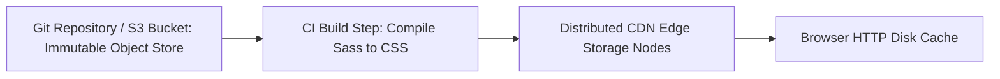

# 14.5 Databases & Storage: Static Object Storage vs Databases

## 1. What It Is in Plain Words
Data storage architectures manage persistent information across block storage, file storage, object storage, and transactional databases (SQL, NoSQL, Key-Value).

---

## 2. Whether and How THIS Project Uses It
**Status:** **No Database Used.**  
**Reason:** The CSS Grid Showcase is a static presentation layout. Layout structure is declaratively encoded in [`grid-revisions/index.html`](file:///Users/avishjain/avishjain9-repos/58-css-grid-showcase/grid-revisions/index.html) and styling rules in [`grid-revisions/style.css`](file:///Users/avishjain/avishjain9-repos/58-css-grid-showcase/grid-revisions/style.css). The storage layer is an **Immutable Object Store (S3 / Cloudflare R2 / Git filesystem)**.

---

## 3. Comprehensive Database Comparison (If Dynamic State Were Added)
If this application were expanded to allow users to create, save, and share custom CSS Grid layouts:

| Storage Engine | Paradigm | ACID Guarantees | Horizontal Scaling | Query Complexity | Fit for Saved CSS Grid Layouts |
| :--- | :--- | :--- | :--- | :--- | :--- |
| **Object Storage (S3 / R2) (Chosen)** | **Blob / Immutable File** | **Read-after-write Consistency** | **Virtually Infinite** | **Key-based retrieval** | **Ideal for static CSS/HTML** |
| **PostgreSQL** | Relational / JSONB | Full ACID | Read Replicas / Partitioning | High (Joins, Full-text) | Excellent for user accounts & layouts |
| **MongoDB** | Document NoSQL | ACID per document | Native Sharding | High (Aggregation pipelines) | Good for JSON grid AST models |
| **Redis** | In-Memory Key-Value | Configurable persistence | Redis Cluster | Low (O(1) lookups) | Ideal for session layout caching |
| **DynamoDB** | Managed NoSQL | ACID transactions | Serverless auto-partitioning | Key-value & range queries | High operational scalability |
| **SQLite** | Embedded Serverless SQL | Full ACID | Single file / Read-only replicas | High SQL queries | Great for local testing |

---

## 4. CAP Theorem & PACELC Analysis
- In terms of the CAP Theorem, static object storage backed by modern cloud providers (AWS S3) guarantees **Availability and Partition Tolerance (AP)** for global reads, maintaining strong read-after-write consistency for new asset deployments.

---

## 5. Spoken Interview Answer (30 Seconds)
> "This project uses zero database engines because layout coordinates and markup are statically defined. Instead of paying the CPU and I/O penalty of querying a relational or NoSQL database on every pageview, we store assets in an immutable object store like AWS S3 or Cloudflare R2. This delivers infinite horizontal read scaling, eliminates SQL injection vectors entirely, and keeps infrastructure costs under pennies per month."
