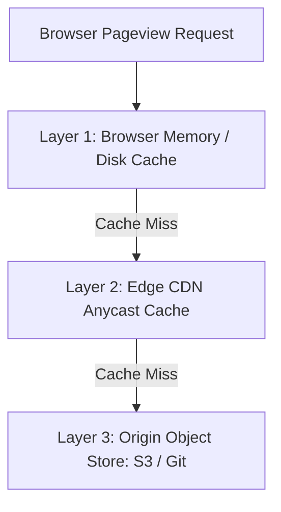

# 14.6 Caching Strategy: Browser, Edge & Invalidation

## 1. What It Is in Plain Words
Caching stores copies of frequently accessed files or computation results in high-speed memory or nearby storage layers to eliminate redundant network round-trips and computation latency.

---

## 2. Whether and How THIS Project Uses It
This project leverages a multi-layer HTTP caching architecture across client and edge:
- **Client Browser Cache:** Stores [`grid-revisions/style.css`](file:///Users/avishjain/avishjain9-repos/58-css-grid-showcase/grid-revisions/style.css) locally on disk.
- **Edge CDN Cache:** Cloudflare or Vercel edge nodes cache the compiled stylesheet and HTML document.
- **Cache-Control Directives:**
  - `style.[hash].css`: `Cache-Control: public, max-age=31536000, immutable` (Cached for 1 full year).
  - `index.html`: `Cache-Control: public, max-age=0, must-revalidate` with `ETag`.

---

## 3. Cache Eviction & Invalidation Strategies
| Invalidation Strategy | Mechanism | Pros | Cons |
| :--- | :--- | :--- | :--- |
| **Content Hashing (Chosen for CSS)** | Append SHA hash: `style.fdfb0c6.css` | 100% immune to stale cache | Requires updating HTML reference |
| **ETag / Conditional Validation** | `If-None-Match` header check | Safe for HTML entry files | Incurs 1 network RTT for 304 response |
| **Time-to-Live (TTL) Expiration** | Expire after fixed duration (e.g., 1 hour) | Simple to configure | Users see stale layout until TTL expires |
| **Purge API Invalidation** | Call CDN API to evict cached URL | Instant global wipe | CDN API rate limits & propagation delay |

---

## 4. Preventing Thundering Herd & Cache Stampedes
If a million users access the page simultaneously when the CDN cache expires:
- **Origin Shielding:** Designate a single centralized edge PoP as an origin shield. All regional edge nodes query the shield rather than overwhelming origin storage.
- **Stale-While-Revalidate:** Configure `Cache-Control: stale-while-revalidate=86400`. The CDN immediately serves stale cached CSS while asynchronously fetching the updated version in the background.

---

## 5. Spoken Interview Answer (30 Seconds)
> "Our caching strategy uses a two-tier model: immutable content hashing for stylesheets and validation caching for the HTML document. For style.css, we configure Cache-Control max-age of one year with the immutable directive, ensuring returning users load styles directly from browser memory with zero network delay. For index.html, we use ETags and stale-while-revalidate at the CDN edge to guarantee immediate visual delivery while keeping content completely fresh."
