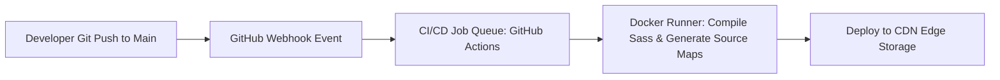

# 14.7 Messaging, Queues & Asynchronous Processing

## 1. What It Is in Plain Words
Asynchronous processing decouples time-consuming or high-volume background tasks from the immediate user request-response lifecycle using message brokers (RabbitMQ, Kafka, SQS, Redis Pub/Sub).

---

## 2. Whether and How THIS Project Uses It
**Status in Production Runtime:** **Not used.** The static web client serves pre-compiled CSS files without background message brokers or asynchronous event streams.  
**Status in Build Pipeline:** Leverages an asynchronous **CI/CD Job Queue** (GitHub Actions / GitLab CI) triggered by Git webhooks to compile Sass into CSS and upload assets to global edge buckets.

---

## 3. Comparison: Message Brokers (If Dynamic Processing Added)
If this application were expanded to support on-demand server-side image rendering of user grid layouts:

| Broker / Queue System | Architecture | Delivery Guarantee | Throughput | Use Case Fit for Layout Services |
| :--- | :--- | :--- | :--- | :--- |
| **BullMQ (Redis)** | In-Memory Task Queue | At-least-once | 10k - 50k jobs/sec | Ideal for Node.js PDF/image layout export |
| **AWS SQS** | Managed Serverless Queue | At-least-once | High / Elastic | Zero-ops cloud worker queue |
| **Apache Kafka** | Distributed Partitioned Log | At-least-once | 1M+ msgs/sec | Overkill for layout generation |
| **RabbitMQ** | AMQP Message Broker | Configurable | 20k - 100k msgs/sec | Complex routing across multi-language workers |

---

## 4. Spoken Interview Answer (30 Seconds)
> "At runtime, this project uses zero message queues because the browser evaluates layouts synchronously in the main thread. In our DevOps pipeline, however, we use an asynchronous event-driven model: whenever a commit hits main, a webhook publishes an event to our CI/CD build queue, which spins up a runner to compile SCSS, generate source maps, and deploy immutable assets to the CDN edge."
