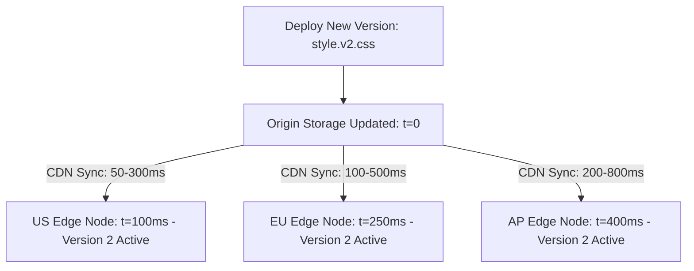

# 14.8 Consistency, Concurrency & Distributed Systems

## 1. What It Is in Plain Words
Distributed systems consistency models define how quickly and reliably updates made at one node propagate to all other nodes in the network (Strong vs Eventual consistency, Read-Your-Writes).

---

## 2. Whether and How THIS Project Uses It
In this project, distributed consistency manifests as **CDN Edge Cache Consistency**:
- **Eventual Consistency:** When a new `index.html` is published, CDN edge nodes worldwide converge on the new version within seconds (propagation delay).
- **Strong Consistency for Assets:** By utilizing unique content-hashed filenames (`style.fdfb0c6.css`), new stylesheet versions achieve immediate strong consistency upon upload, completely preventing stale asset race conditions.

---

## 3. Comparison: Distributed Consistency Models
| Consistency Model | Edge Propagation Behavior | Stale Read Risk | Implementation Mechanism |
| :--- | :--- | :--- | :--- |
| **Content-Hashed Immutable (Chosen)** | **Immediate Strong Consistency** | **Zero** | **New file path: `style.[hash].css`** |
| **Read-Your-Writes** | Intermediate | Low | Cookie-based routing to updated edge node |
| **Eventual Consistency (TTL-based)** | 5 minutes - 24 hours | High (Users see old CSS) | Relying on `max-age` expiration |
| **Linearizable / Strict Serializability** | Requires consensus (Raft/Paxos) | Zero | Unnecessary for static web assets |

---

## 4. Spoken Interview Answer (30 Seconds)
> "In a distributed CDN deployment, the classic challenge is eventual consistency—where some global edge nodes serve the new HTML while others serve the old stylesheet, causing visual corruption. We solve this using content-hashed asset fingerprinting. By embedding the commit hash directly into the CSS filename, the new stylesheet is a completely unique immutable resource, guaranteeing strong consistency and zero race conditions during deployments."
