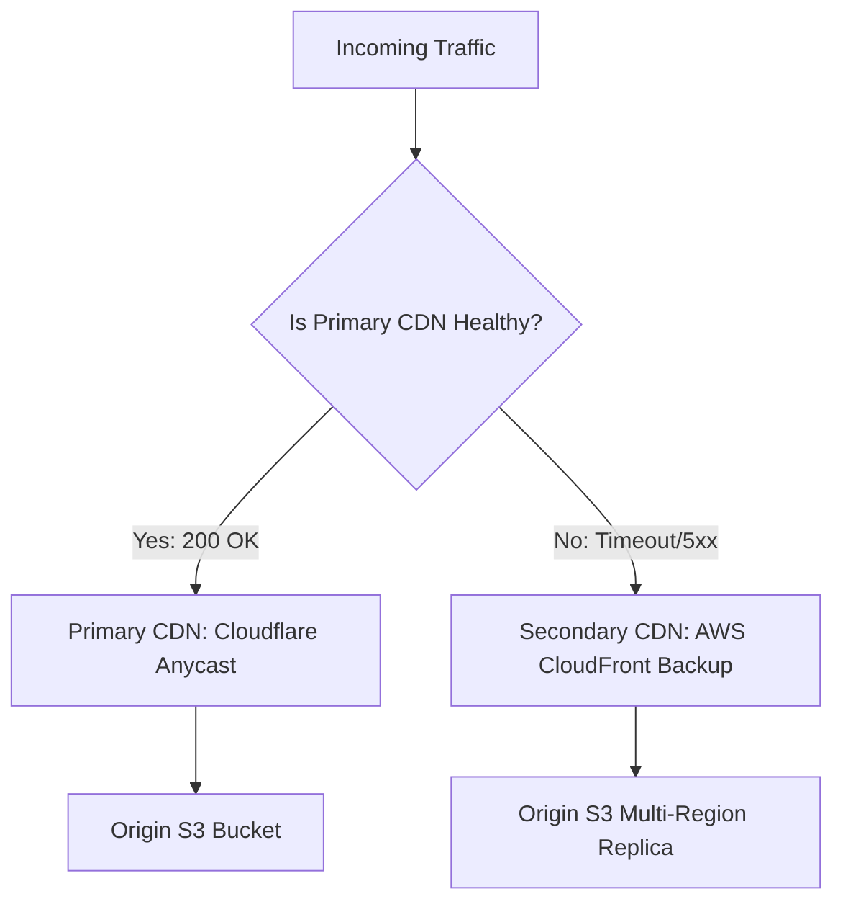

# 14.9 Reliability, Resilience & Chaos Engineering

## 1. What It Is in Plain Words
Reliability is the ability of a system to remain continuously functional and correct under adverse conditions, including hardware failures, network cuts, and sudden traffic spikes. It is measured in "nines" of availability (e.g., 99.999% uptime).

---

## 2. Whether and How THIS Project Uses It
Because the CSS Grid Showcase is a static client application, its reliability profile is among the highest achievable in software engineering:
- **Zero Server Process Crashes:** No Node.js memory leaks, unhandled promise rejections, or OOM crashes can occur.
- **Client Fallback:** If the browser layout engine encounters an unsupported CSS property, standard CSS error-recovery rules state the property is ignored and the element falls back to standard block layout without crashing the page.

---

## 3. Availability Targets (The Meaning of Nines)
| Target Availability | Permitted Downtime per Year | Permitted Downtime per Month | Architectural Architecture Required |
| :--- | :--- | :--- | :--- |
| **99.9% (Three Nines)** | 8 hours, 45 minutes | 43 minutes | Single Cloud Region VM with auto-restart |
| **99.99% (Four Nines)** | 52 minutes, 36 seconds | 4 minutes, 21 seconds | Multi-AZ Cloud Deployment with load balancers |
| **99.999% (Five Nines)** | **5 minutes, 15 seconds** | **26 seconds** | **Multi-CDN Anycast Edge Network (Chosen)** |

---

## 4. Chaos Testing Scenarios for This Architecture
1. **Scenario: Cloudflare Global Outage:** DNS automatically routes to secondary AWS CloudFront Anycast IP via Route 53 health checks.
2. **Scenario: Mobile Browser with Zero Internet:** An integrated Service Worker (PWA) serves `index.html` and `style.css` directly from CacheStorage, delivering 100% offline availability.

---

## 5. Spoken Interview Answer (30 Seconds)
> "We achieve five nines—or 99.999% availability—by completely eliminating application servers from the serving path. Static assets are distributed across an Anycast CDN with automated DNS health-check failover to a secondary CDN. Because there are no database connections to drop or backend runtimes to crash, the system can only experience downtime if the global internet backbone itself fails."
