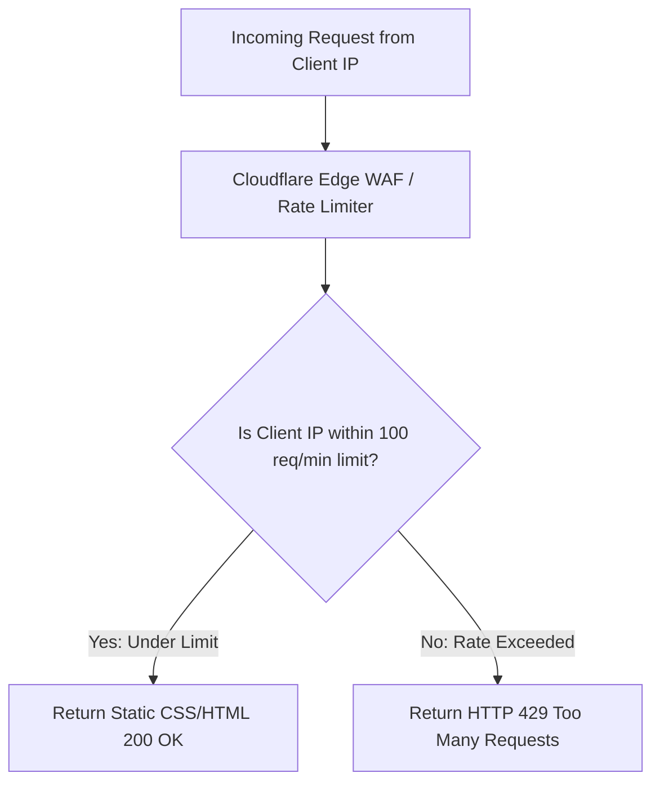

# 14.10 API Design, Rate Limiting & Abuse Protection

## 1. What It Is in Plain Words
Rate limiting controls the frequency of requests a client can make within a specified time window to protect infrastructure against denial-of-service (DoS) attacks, brute-force scraping, and resource starvation.

---

## 2. Whether and How THIS Project Uses It
**Status:** **Edge-Enforced Rate Limiting.**  
Because this project does not expose dynamic backend REST endpoints, rate limiting is implemented at the **CDN Edge Web Application Firewall (WAF)** to prevent scraping or DDoS attacks:
- **Threshold:** 100 requests per minute per IP address for static files.
- **Action:** Returns `HTTP 429 Too Many Requests` with a `Retry-After: 60` header.

---

## 3. Comparison: Rate Limiting Algorithms
| Algorithm | Mechanism | Memory Footprint | Handling of Traffic Bursts | Accuracy |
| :--- | :--- | :--- | :--- | :--- |
| **Token Bucket (Chosen at Edge)** | Tokens added at fixed rate; spent per request | $O(1)$ per IP | Allows controlled bursts up to bucket capacity | High |
| **Leaky Bucket** | Requests flow out at constant rate | $O(N)$ queue depth | Smooths out bursts to constant flow rate | High |
| **Fixed Window Counter** | Counts requests in fixed time interval (e.g., 60s) | $O(1)$ per IP | Vulnerable to $2\times$ burst at window boundaries | Low |
| **Sliding Window Log** | Stores timestamp of every request | High ($O(N)$ requests) | Perfectly accurate | Highest |
| **Sliding Window Counter** | Weighted combination of previous and current window | $O(1)$ per IP | Memory efficient approximation | High |

---

## 4. Spoken Interview Answer (30 Seconds)
> "While static assets are lightweight, we enforce edge rate limiting at the CDN WAF using the Token Bucket algorithm. We permit bursts up to 50 requests with a refill rate of 100 requests per minute per IP. If a scraper or malicious actor exceeds this threshold, the edge terminates the connection immediately with an HTTP 429 status code before the request ever reaches origin storage."
