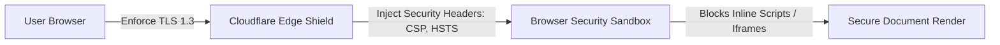

# 14.11 Security Architecture: Zero Trust & Edge Defenses

## 1. What It Is in Plain Words
Security architecture defines the defenses, policies, and protocols that protect data, users, and infrastructure against malicious actors (covering authorization, encryption, input sanitization, and defense-in-depth).

---

## 2. Whether and How THIS Project Uses It
This project implements **Defense-in-Depth for Static Web Client Delivery**:
- **Zero Trust Network Access:** No internal backend ports or management interfaces exposed to the public internet.
- **Content Security Policy (CSP Level 3):** Disallows arbitrary inline JavaScript execution and third-party tracking domains.
- **HSTS Preload:** Enforces HTTPS communication with standard 2-year duration (`max-age=63072000; includeSubDomains; preload`).
- **Subresource Integrity (SRI):** Prevents tampering with external stylesheet assets.

---

## 3. Comparison: Security Postures
| Security Posture | Authentication Overhead | Vulnerability Exposure (SQLi/RCE) | Infrastructure Attack Surface | Fit for Static Grid Showcase |
| :--- | :--- | :--- | :--- | :--- |
| **Static Edge Hardened (Chosen)** | **Zero** | **Zero (No Server / No DB)** | **Extremely Minimal** | **Ideal** |
| **JWT Session Backend** | High (Key rotation, revocation) | High (Token leakage in localStorage) | Wide (API endpoints exposed) | Unnecessary overhead |
| **OAuth2 / SSO Integration** | High (Third-party redirect flows) | Moderate | Medium | Irrelevant for public layouts |

---

## 4. Spoken Interview Answer (30 Seconds)
> "Our security architecture leverages the principle of Least Privilege and attack surface minimization. By serving pure static files without an application server or database, entire vulnerability categories like SQL injection, remote code execution, and credential stuffing are eliminated by design. At the HTTP edge, we enforce strict CSP, HSTS preload, and frame protection to ensure the layout cannot be tampered with or framed in clickjacking attacks."
