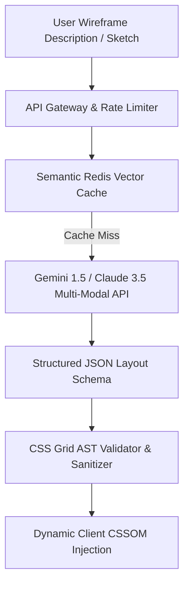

# 14.12 Search & AI Integration Architecture

## 1. What It Is in Plain Words
Search and AI architecture outlines how machine learning models, retrieval-augmented generation (RAG) pipelines, and vector databases ingest, index, and query unstructured information to generate intelligent, dynamic responses.

---

## 2. Whether and How THIS Project Uses It
**Status:** **No AI in Current Codebase.**  
The repository executes deterministic, handwritten CSS Grid rules. However, for engineering system design interviews, below is the complete blueprint for an **AI Layout Generation Pipeline**:

---

## 3. Architecture Blueprint: AI-Powered Layout Assistant
1. **Model Selection:** Use a pre-trained multi-modal vision LLM (Gemini 1.5 Flash / Claude 3.5 Sonnet) to accept both text prompts (*"Create a magazine layout with a tall sidebar and three cards"*) and hand-drawn wireframe images.
2. **Deterministic Schema Enforcement:** Set `response_mime_type: "application/json"` with JSON schema parameters defining exact `grid-template-columns`, `grid-template-rows`, `gap`, and element coordinate mappings.
3. **Semantic Caching:** Generate text embeddings of user prompts using `text-embedding-3-small` or `text-embedding-004`, querying a Redis Vector Search index to return identical cached layouts within 5ms.
4. **AST Validation:** Run generated CSS through PostCSS before browser injection to block prompt injection and invalid track syntax.

---

## 4. Spoken Interview Answer (30 Seconds)
> "While our current project implements deterministic CSS Grid rules, if we integrated AI to generate dynamic layouts, we would use a pre-trained multi-modal model like Gemini 1.5 with structured JSON schema outputs. We would place a Redis semantic cache in front to serve common layout queries instantly without API cost, and validate all generated grid coordinates through a PostCSS AST parser before injecting them into the DOM to guarantee layout safety."
