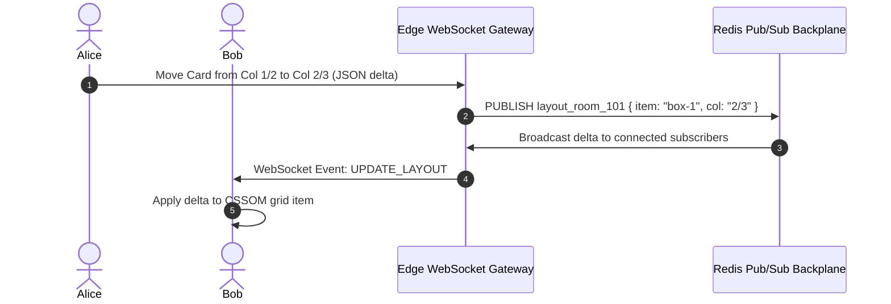

# 14.13 Real-Time Systems & Collaborative Grid Editing

## 1. What It Is in Plain Words
Real-time architecture enables bidirectional, low-latency communication between connected clients and servers, supporting live synchronization (e.g., Figma-style collaborative multi-user editing).

---

## 2. Whether and How THIS Project Uses It
**Status:** **Not used in current static layout.**  
The current layout is a self-contained client document. If transformed into a **Real-Time Collaborative CSS Grid Designer**, below is the system design:

---

## 3. Comparison: Real-Time Transport Protocols
| Transport Protocol | Directionality | Protocol Overhead | Auto-Reconnection | Scalability Strategy | Fit for Collaborative Layouts |
| :--- | :--- | :--- | :--- | :--- | :--- |
| **WebSockets (Chosen for Real-Time)** | **Full-Duplex Bidirectional** | **Extremely Low (2-byte frame)** | Client-managed or Socket.io | Redis Pub/Sub adapter across edge pods | **Ideal for interactive dragging** |
| **Server-Sent Events (SSE)** | Unidirectional (Server to Client) | Low (Standard HTTP) | Built-in browser reconnection | Standard HTTP load balancers | Good for view-only live updates |
| **Long Polling** | Unidirectional / Request-Response | High (Repeated TCP handshakes) | Manual loop | Sticky sessions / In-memory | Obsolete legacy fallback |
| **WebRTC Data Channels** | Peer-to-Peer UDP | Minimal | Complex signaling (STUN/TURN) | P2P mesh / SFU | Great for zero-server P2P editing |

---

## 4. Conflict Resolution: CRDTs vs OT
When two users move grid items simultaneously:
- **Conflict-free Replicated Data Types (CRDTs):** Using libraries like **Yjs** or **Automerge**, each grid item's coordinate state is represented as a state-based CRDT map. Changes merge deterministically on every client without requiring a centralized locking server.

---

## 5. Spoken Interview Answer (30 Seconds)
> "For real-time multi-user collaborative layout editing, I would architect a WebSocket gateway backed by a Redis Pub/Sub backplane. To resolve conflicts when two designers drag grid tracks simultaneously, we would implement CRDTs using Yjs on the client. This allows local mutations to render with zero latency while syncing state deltas asynchronously across peers with mathematical eventual consistency."
