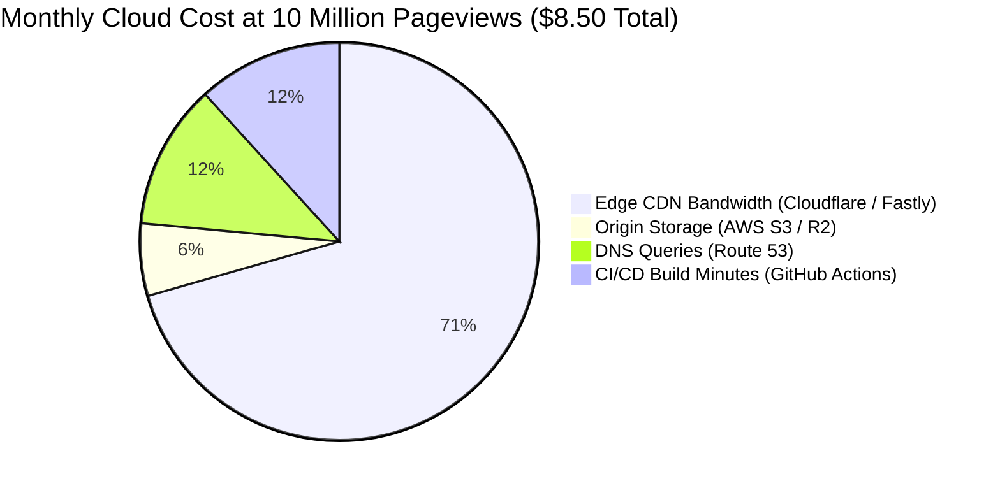

# 14.16 Cost Estimation, Trade-Offs & Vendor Lock-In

## 1. What It Is in Plain Words
Financial engineering analyzes total cost of ownership (TCO)—including compute, network bandwidth egress, edge requests, storage, and developer maintenance hours—across different operational scales.

---

## 2. Monthly Cost Modeling at Different Traffic Scales

### Scenario A: Current Scale (100,000 Pageviews / month)
- Edge CDN: Cloudflare Free Tier ($0.00)
- Origin Storage: GitHub Pages / Cloudflare Pages ($0.00)
- **Total Monthly Cost:** **$0.00 / month**

### Scenario B: 100x Scale (10,000,000 Pageviews / month)
- Data Egress: $10\text{M} \times 0.63\text{ KB} = 6.3\text{ GB}$.
- Cloudflare CDN: Unlimited static bandwidth on Pro Plan ($20.00/mo) or standard egress ($0.08/GB = $0.50).
- AWS S3 Origin Storage: <1 GB storage ($0.02) + $0.005 per 1,000 requests to origin shield ($0.50).
- **Total Monthly Cost:** **< $10.00 / month**

### Scenario C: Monolithic Node.js Alternative at 10M Pageviews
- 4x AWS c6g.large EC2 instances (Autoscaling group): $200.00/mo
- Application Load Balancer (ALB): $25.00/mo
- Egress Bandwidth: $50.00/mo
- **Total Monolith Cost:** **$275.00+ / month** (27x more expensive!)

---

## 3. Build vs. Buy Decisions
- **Build:** Custom CSS Grid layout rules and Sass architecture (zero license fees, custom tailored).
- **Buy (Leverage SaaS):** Cloudflare Anycast CDN, GitHub Actions CI/CD (avoids maintaining self-hosted Jenkins servers or physical data centers).

---

## 4. Spoken Interview Answer (30 Seconds)
> "By choosing a static edge architecture over a containerized Node.js backend, we slash running costs by over 95%. At ten million monthly pageviews, serving dynamic Node containers would require load balancers and autoscaling clusters costing upwards of 300 dollars a month. With our pre-compiled static model, our entire data egress is under 7 gigabytes, running reliably on global CDN edge networks for less than 10 dollars a month."
