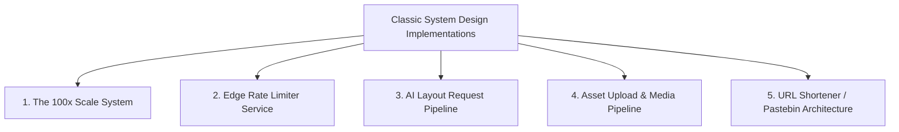
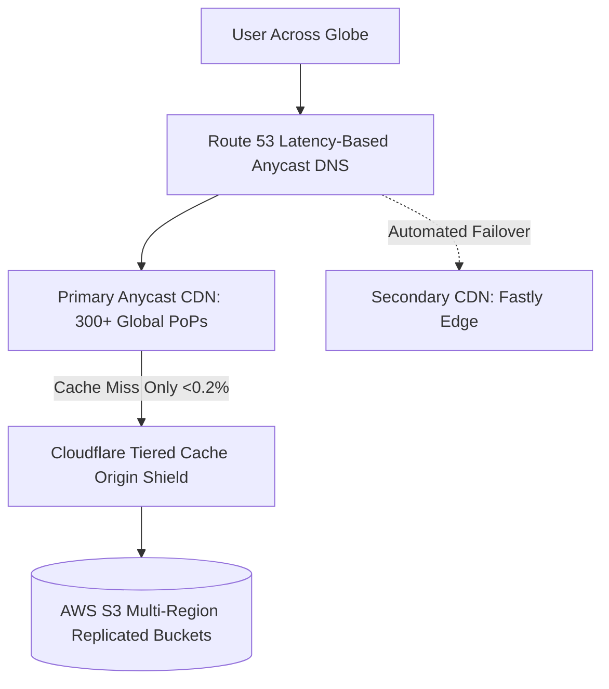
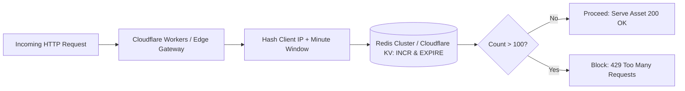
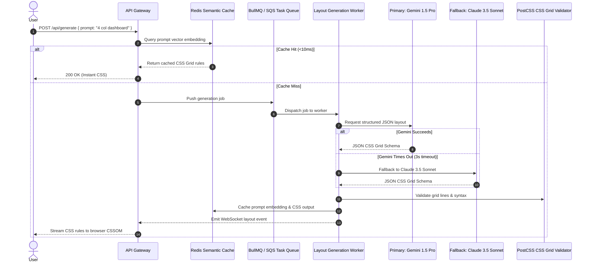
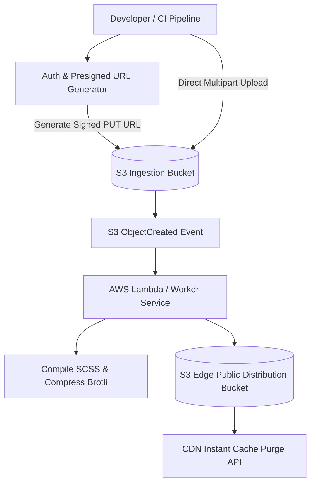

# 14.17 Classic System Design Problems Applied to This Project

This chapter demonstrates how the foundational engineering patterns of this codebase (Anycast networking, immutable storage, caching hierarchies, and client rendering) scale to classic distributed system design interview scenarios.

---

## 1. Design This Project's Architecture at 100x Scale (100M Views/Mo)

### Functional Requirements
- Deliver static HTML5 and compiled CSS3 to 100 million visitors/month globally.
- Global p95 TTFB < 30ms, 99.999% uptime.

### Capacity Estimation
- $100\text{M views/month} \approx 3.33\text{M views/day} \approx 38.5\text{ QPS average}$, peak $100\text{ QPS}$.
- Bandwidth: $100\text{ QPS} \times 0.63\text{ KB} = 63\text{ KB/s}$ (minimal).

### Architecture Diagram

### Bottlenecks & Trade-offs
- The primary bottleneck is DNS resolution latency. Mitigated by setting long TTLs on root A/AAAA records and using Anycast recursive resolvers.

---

## 2. Design a Global Edge Rate Limiter

### Functional Requirements
- Limit client requests to 100 requests per minute per IP address.
- Low latency (<2ms overhead on requests).

### Architecture Diagram

### Deep Dive: Sliding Window Counter Algorithm
Instead of strict 60-second boundaries that allow $2\times$ bursts at the boundary, calculate:
$$\text{Weight} = \frac{\text{Current Minute Time Remaining}}{60}$$
$$\text{Estimated Count} = (\text{Previous Window Count} \times \text{Weight}) + \text{Current Window Count}$$
If $\text{Estimated Count} > 100$, reject immediately.

---

## 3. Design an AI Layout Generation Pipeline with Queueing & Fallbacks

### Functional Requirements
- User inputs a wireframe prompt; system generates verified CSS Grid rules within 2 seconds.
- Handle LLM rate limits, timeouts, and provider outages seamlessly.

### Architecture Diagram

---

## 4. Design a Media & CSS Asset Upload System

### Functional Requirements
- Allow developers to upload SCSS/CSS files and background images up to 50MB.
- Automatic compression, source map generation, and instant CDN propagation.

### Architecture Diagram

---

## 5. Design a URL Shortener & Layout Pastebin Using This Stack

### Functional Requirements
- Users save a custom CSS Grid configuration and receive a short URL (e.g., `grid.sh/x8k2`).
- 100 million stored layouts, 100:1 read-to-write ratio.

### Architecture & Math
- 100M URLs $\times$ 7-character Base62 hash ($[a-zA-Z0-9]$).
- $62^7 \approx 3.52 \text{ trillion}$ unique combinations.
- Key-Value Store (Redis + DynamoDB):
  - Key: `x8k2` (7 bytes)
  - Value: Compressed CSS Grid JSON (1KB)
  - Storage: $100\text{M} \times 1\text{KB} = 100\text{GB}$ total storage (fits in a single DynamoDB table or managed Redis instance).
