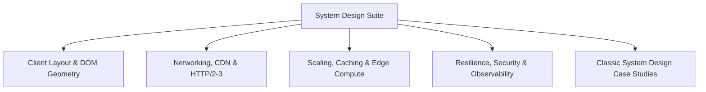

# System Design Architecture Suite: Web-Scale Blueprint

Welcome to the comprehensive System Design Architecture Suite for the CSS Grid Showcase. This collection analyzes the project from foundational client-side layout rendering to global edge delivery networks, hyperscale CDN caching, resilience, and classic distributed systems engineering.

---

## System Design Document Index

| Chapter | Topic File | Core Architecture Focus |
| :--- | :--- | :--- |
| **14.1** | [Requirements & Estimation](file:///Users/avishjain/avishjain9-repos/58-css-grid-showcase/docs/system-design/01-requirements-and-estimation.md) | Functional/non-functional specs, capacity math, bandwidth, QPS |
| **14.2** | [Architecture Styles](file:///Users/avishjain/avishjain9-repos/58-css-grid-showcase/docs/system-design/02-architecture-styles.md) | Static edge vs Monolith vs Microservices vs Serverless |
| **14.3** | [Networking & Communication](file:///Users/avishjain/avishjain9-repos/58-css-grid-showcase/docs/system-design/03-networking-and-communication.md) | DNS, Anycast CDN, TLS 1.3, HTTP/2 multiplexing, HTTP/3 QUIC |
| **14.4** | [Load Balancing & Scaling](file:///Users/avishjain/avishjain9-repos/58-css-grid-showcase/docs/system-design/04-load-balancing-and-scaling.md) | Anycast routing, L4 vs L7 load balancing, auto-scaling, SPOFs |
| **14.5** | [Databases & Storage](file:///Users/avishjain/avishjain9-repos/58-css-grid-showcase/docs/system-design/05-databases-and-storage.md) | Static asset object stores, CAP theorem, client storage |
| **14.6** | [Caching Deep Dive](file:///Users/avishjain/avishjain9-repos/58-css-grid-showcase/docs/system-design/06-caching.md) | Browser HTTP cache, CDN edge caching, stale-while-revalidate |
| **14.7** | [Messaging & Async Processing](file:///Users/avishjain/avishjain9-repos/58-css-grid-showcase/docs/system-design/07-messaging-and-async.md) | Build queues, CI/CD runners, event sourcing for style updates |
| **14.8** | [Consistency & Distributed Systems](file:///Users/avishjain/avishjain9-repos/58-css-grid-showcase/docs/system-design/08-consistency-and-distributed.md) | Edge propagation, eventual consistency, cache invalidation |
| **14.9** | [Reliability & Resilience](file:///Users/avishjain/avishjain9-repos/58-css-grid-showcase/docs/system-design/09-reliability-and-resilience.md) | 99.999% uptime, multi-region CDN failover, graceful degradation |
| **14.10** | [API Design & Rate Limiting](file:///Users/avishjain/avishjain9-repos/58-css-grid-showcase/docs/system-design/10-api-design-and-rate-limiting.md) | Edge rate limiting, token bucket algorithm, DDoS protection |
| **14.11** | [Security Architecture](file:///Users/avishjain/avishjain9-repos/58-css-grid-showcase/docs/system-design/11-security-architecture.md) | Zero Trust, CSP Level 3, HSTS preload, Subresource Integrity |
| **14.12** | [Search & AI Architecture](file:///Users/avishjain/avishjain9-repos/58-css-grid-showcase/docs/system-design/12-search-and-ai-architecture.md) | Vector embeddings for layout retrieval, LLM wireframe generator |
| **14.13** | [Real-Time Systems](file:///Users/avishjain/avishjain9-repos/58-css-grid-showcase/docs/system-design/13-real-time-systems.md) | WebSockets vs SSE for collaborative multi-user grid editing |
| **14.14** | [Observability & Operations](file:///Users/avishjain/avishjain9-repos/58-css-grid-showcase/docs/system-design/14-observability-and-operations.md) | Real User Monitoring (RUM), Web Vitals beaconing, OpenTelemetry |
| **14.15** | [Performance Engineering](file:///Users/avishjain/avishjain9-repos/58-css-grid-showcase/docs/system-design/15-performance-engineering.md) | Critical rendering path, LayoutNG optimization, sub-millisecond paint |
| **14.16** | [Cost & Trade-Offs](file:///Users/avishjain/avishjain9-repos/58-css-grid-showcase/docs/system-design/16-cost-and-trade-offs.md) | Cost estimation at 1M - 100M visits, build vs buy |
| **14.17** | [Classic System Design Applied](file:///Users/avishjain/avishjain9-repos/58-css-grid-showcase/docs/system-design/17-classic-system-design-applied.md) | Designing CDN, Layout Generator, Pastebin, and URL Shortener |
| **14.18** | [Design Decisions Log](file:///Users/avishjain/avishjain9-repos/58-css-grid-showcase/docs/system-design/decisions.md) | Master architectural decision record (ADR) table |
