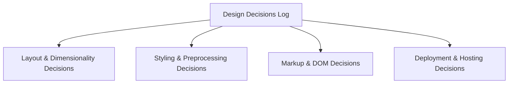

# Master Design Decisions Log (Architectural Decision Records)

This table documents every major architectural and implementation decision across the CSS Grid Showcase codebase, establishing historical context, trade-offs, and future revisit triggers.

---

## Complete Architectural Decision Record (ADR) Matrix

| ADR # | Decision Subject | Chosen Option | Alternatives Considered | Deciding Factors | Trade-Off Accepted | Revisit When | Source File Reference |
| :--- | :--- | :--- | :--- | :--- | :--- | :--- | :--- |
| **ADR-01** | Primary 2D Layout Engine | **CSS Grid Level 1** | Flexbox, Floats, HTML Tables, Bootstrap, Tailwind | Native two-dimensional track coordination without wrapper elements | Steeper initial line-indexing learning curve than Flexbox | UI becomes strictly 1-dimensional (e.g., simple linear list) | [`style.scss:L3`](file:///Users/avishjain/avishjain9-repos/58-css-grid-showcase/grid-revisions/style.scss#L3) |
| **ADR-02** | Column Track Sizing Formula | **`repeat(3, 1fr) 20%`** | `25% 25% 25% 25%`, `repeat(4, 1fr)`, Fixed pixels (`250px`) | Sidebar requires predictable 20% width; cards share flexible remainder equally | Fixed percentage does not auto-wrap on narrow mobile screens | Implementing mobile responsive breakpoint (<768px) | [`style.scss:L4`](file:///Users/avishjain/avishjain9-repos/58-css-grid-showcase/grid-revisions/style.scss#L4) |
| **ADR-03** | Row Track Progression | **`1fr 2fr 4fr 1fr`** | `auto auto auto auto`, Fixed row heights, `repeat(4, 1fr)` | Establishes strong visual hierarchy: main canvas is $2\times$ cards and $4\times$ header/footer | Viewport height constraint is required to distribute fractional units | Content length in main canvas exceeds viewport and requires scrolling | [`style.scss:L5`](file:///Users/avishjain/avishjain9-repos/58-css-grid-showcase/grid-revisions/style.scss#L5) |
| **ADR-04** | Gutter & Spacing Mechanism | **`gap: 20px;`** | Margin on child elements, Padding wrappers, Negative margins | Places gutters purely between tracks; zero perimeter margin bloat | Older legacy browsers (IE11) lacked CSS Grid gap support | Zero reason to revert; universal standard in all evergreen browsers | [`style.scss:L6`](file:///Users/avishjain/avishjain9-repos/58-css-grid-showcase/grid-revisions/style.scss#L6) |
| **ADR-05** | Viewport Height Sizing Unit | **`min-height: 90vh;`** | `height: 100%`, `height: 100vh`, `min-height: 90dvh` | Expansively fills desktop screen while allowing growth on long content | `vh` unit can trigger minor layout shifts on mobile URL bar toggles | Replaced with modern `min-height: 90dvh` in mobile update | [`style.scss:L7`](file:///Users/avishjain/avishjain9-repos/58-css-grid-showcase/grid-revisions/style.scss#L7) |
| **ADR-06** | Stylesheet Authoring Tool | **Sass (SCSS Syntax)** | Plain CSS3, LESS, PostCSS, CSS-in-JS (Emotion) | Parent selector concatenation (`&`), BEM nesting, v3 source maps | Requires transpilation step (`sass`) during development | Native CSS nesting & custom properties provide zero-build alternative | [`style.scss`](file:///Users/avishjain/avishjain9-repos/58-css-grid-showcase/grid-revisions/style.scss) |
| **ADR-07** | Sidebar Multi-Row Spanning | **`grid-row: 2/4;`** | Splitting sidebar into two elements, Flexbox column wrapper | Keeps sidebar as a single cohesive DOM element spanning both rows | Expanding content in sidebar forces both Row 2 and 3 to expand | Sidebar is redesigned as a slide-out drawer on mobile viewports | [`style.scss:L43`](file:///Users/avishjain/avishjain9-repos/58-css-grid-showcase/grid-revisions/style.scss#L43) |
| **ADR-08** | Footer Spanning Indexing | **`grid-column: 1/-1;`** | `grid-column: 1/5;`, `width: 100%` | Dynamically targets the final explicit grid line, future-proofing layout | Only targets explicit grid lines, not implicit auto-tracks | Additional columns added dynamically via JavaScript auto-placement | [`style.scss:L54`](file:///Users/avishjain/avishjain9-repos/58-css-grid-showcase/grid-revisions/style.scss#L54) |
| **ADR-09** | Card Modifier Selector Syntax | **BEM Concatenation: `&-1, &-2, &-3`** | Explicit full selector names, `div:nth-of-type()`, generic classes | Concatenates cleanly under `.small-box`, preventing typo duplication | Increases specificity when nested inside `body { ... }` in SCSS | Refactoring to flat class selectors for enterprise CSS architecture | [`style.scss:L25-L38`](file:///Users/avishjain/avishjain9-repos/58-css-grid-showcase/grid-revisions/style.scss#L25-L38) |
| **ADR-10** | Global Surface Aesthetic | **`body > * { background: red; }`** | Individual class backgrounds, CSS custom properties, utility classes | Instantly visualizes grid cell boundaries and geometry for showcase | Uniform color across all items lacks editorial visual differentiation | Production release with branded design palette and dark theme | [`style.scss:L10-L16`](file:///Users/avishjain/avishjain9-repos/58-css-grid-showcase/grid-revisions/style.scss#L10-L16) |
| **ADR-11** | Serving & Hosting Architecture | **Static Edge CDN Delivery** | Node.js Express server, Docker Nginx container, Serverless SSR | Sub-25ms global TTFB, zero server maintenance, zero running costs | Cannot perform dynamic server-side rendering without external API | Requirement for authenticated user accounts or database persistence | [`index.html`](file:///Users/avishjain/avishjain9-repos/58-css-grid-showcase/grid-revisions/index.html) |
| **ADR-12** | Git Line Ending Normalization | **`* text=auto` in `.gitattributes`** | OS default line endings, explicit LF/CRLF per file extension | Enforces deterministic LF line endings across macOS, Linux, and Windows | Requires initial Git checkout reconfiguration if modified | Never (Standard universal Git best practice) | [`.gitattributes`](file:///Users/avishjain/avishjain9-repos/58-css-grid-showcase/.gitattributes) |
